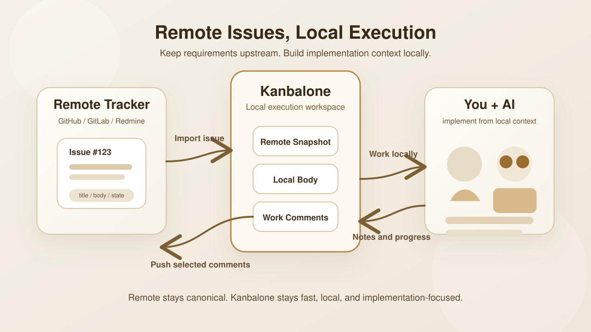
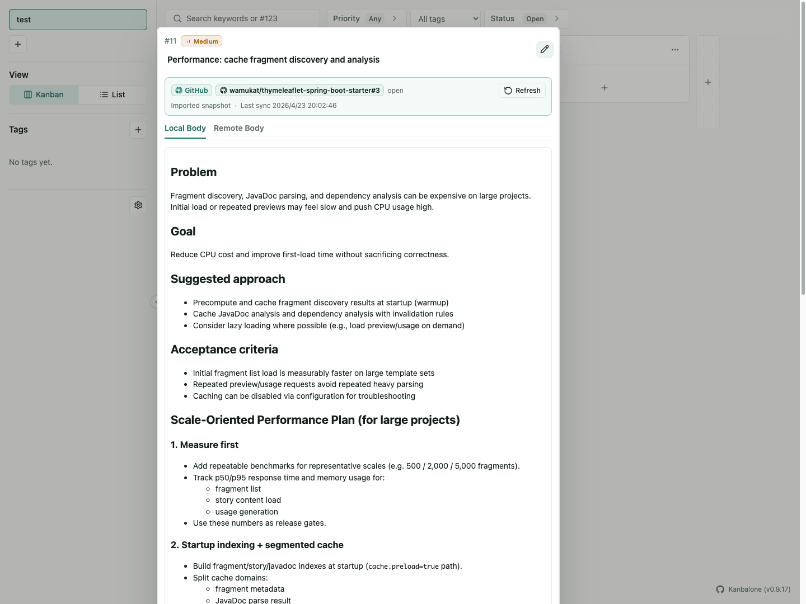
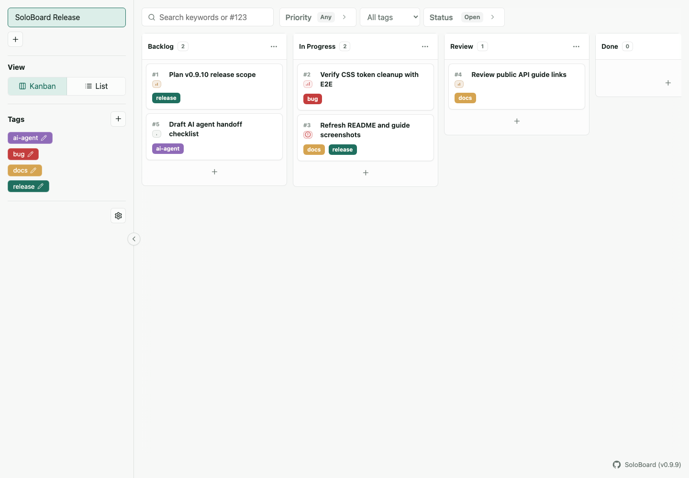
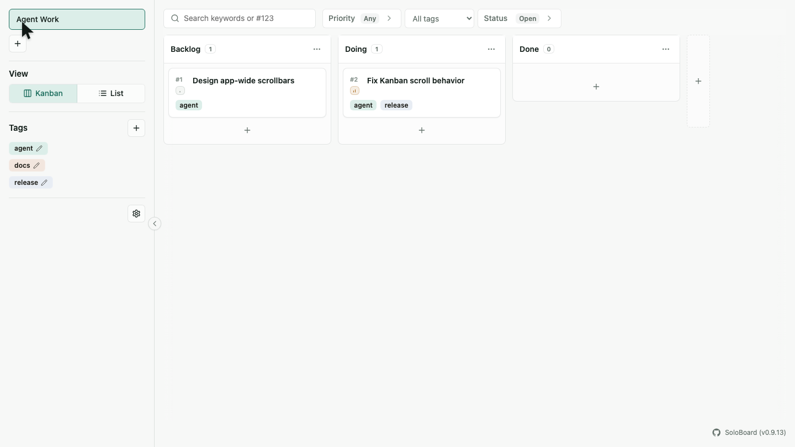

# Kanbalone

[English](README.md)

<p align="center">
  
</p>

Kanbaloneは、AIと開発する個人のためのローカル作業スペースです。

外部の依頼を手元の作業に落とし込み、調べたこと、実装方針、進捗を同じ場所に残します。人は画面から、AIはAPIから、その続きを進められます。

GitHub Issues・GitLab・Redmineの原文を参照しながら、自分の実装メモを育て、共有したいコメントだけを外へ返せます。外部Issueを使わず、自分の作業から始めることもできます。

[誰の、何を楽にするのか](docs/ja/product-positioning.md)










## Kanbaloneで楽になること

- **説明し直す負担を減らす。** 人とAIが使う作業の経緯を、同じチケットに残せます。
- **手元で自由に深める。** 共有された依頼と自分の実装メモを分け、必要な報告を選んで返せます。
- **今、見るべき仕事をつかむ。** 作業段階や目的ごとの残件を見渡し、確認した仕事を完了へ進められます。

## Groupで作業をまとめる

v0.11.0から、同じ目的のチケットをGroupにまとめられます。[ユーザーガイド](docs/ja/user-guide.md#13-グループで作業をまとめる)と[Group移行手順](docs/ja/migration-guide.md#group-migration)を参照してください。


## Quick Start

公開済み Docker Image で起動します。

```bash
docker run --rm \
  -p 3000:3000 \
  -v kanbalone-data:/app/data \
  ghcr.io/wamukat/kanbalone:v1.6.0
```

ブラウザで開きます。

```text
http://127.0.0.1:3000
```

ユーザーガイド:

```text
https://wamukat.github.io/kanbalone/
```

最新の安定版を使う場合は `ghcr.io/wamukat/kanbalone:latest` を指定してください。リリース候補を試す場合は、候補版のバージョンタグを指定します。

## Docker Compose

公開済み Image を Compose で起動します。

```bash
docker compose -f docker-compose.image.yml up
```

ホスト側のポートを変更する場合:

```bash
KANBAN_PORT=3457 docker compose -f docker-compose.image.yml up
```

アプリはSQLiteデータベースと添付画像を以下に保存します。

```text
/app/data/kanbalone.sqlite
/app/data/attachments/
```

同梱の Compose ファイルでは、永続化のために `kanbalone-data` という Docker named volume を使います。
バックアップと復元ではDBと画像をまとめて扱います。[バックアップと復元の手順](docs/ja/migration-guide.md#database-and-image-backup)を参照してください。

Windows では、Docker Desktop または Rancher Desktop with WSL2 を使い、named volume の構成を維持してください。


## Local Development

```bash
pnpm install
pnpm dev
```

デフォルト URL:

```text
http://127.0.0.1:3000
```

GitLab / Redmine 用 remote provider sandbox:

```bash
docker compose -f docker-compose.remote-providers.yml up -d
pnpm sandbox:remote-providers
```

Kanbalone は remote provider credential が 1 つ以上設定されている場合だけ、remote issue import の導線を表示します。import panel には設定済み provider だけが表示されます。

詳細は [Remote provider sandbox](docs/ja/developer/remote-provider-sandbox.md) を参照してください。

## Codex Skill

利用者向けには、APIでKanbanを操作する `kanbalone-api` スキルを配布しています。

```bash
mkdir -p "${CODEX_HOME:-$HOME/.codex}/skills"
cp -R skills/kanbalone-api "${CODEX_HOME:-$HOME/.codex}/skills/"
```

Docker image だけを使う場合は、GitHub release tag から skill を取得して Codex が動くホスト側へコピーします。

```bash
tmpdir=$(mktemp -d)
curl -L https://github.com/wamukat/kanbalone/archive/refs/tags/v1.6.0.tar.gz \
  | tar -xz -C "$tmpdir" kanbalone-1.6.0/skills/kanbalone-api
mkdir -p "${CODEX_HOME:-$HOME/.codex}/skills"
cp -R "$tmpdir"/kanbalone-1.6.0/skills/kanbalone-api "${CODEX_HOME:-$HOME/.codex}/skills/"
rm -rf "$tmpdir"
```

skill はホスト側で実行され、`http://127.0.0.1:3000` などの Kanbalone HTTP API に接続します。

## Documentation

公開ユーザーガイド:

- <https://wamukat.github.io/kanbalone/>

利用者・API クライアント向け:

- [ユーザーガイド](docs/ja/user-guide.md)
- [完了状態の移行ガイド（ユーザー・AI向け）](docs/ja/migration-guide.md)
- [データモデルと概念](docs/ja/concepts.md)
- [AI API ガイド](docs/ja/ai-api-guide.md)
- [API 例](docs/ja/api-examples.md)
- [OpenAPI](docs/openapi.yaml)

開発者・メンテナ向け:

- [開発ガイド](docs/ja/developer/development.md)
- [Remote provider sandbox](docs/ja/developer/remote-provider-sandbox.md)
- [Docker Image 配布](docs/ja/developer/docker-image-distribution.md)
- [リリース手順](docs/ja/developer/release.md)
- [パフォーマンスツール](docs/ja/developer/performance.md)
- [ダイアログボタンポリシー](docs/ja/developer/dialog-button-policy.md)
- [デザインシステム](docs/ja/developer/design-system.md)

## Tech Stack

- Node.js 26.13.1 LTS
- Fastify
- SQLite via `better-sqlite3`
- TypeScript
- Vanilla HTML/CSS/JavaScript
- Lucide-style SVG icons

## License

[MIT](LICENSE)
