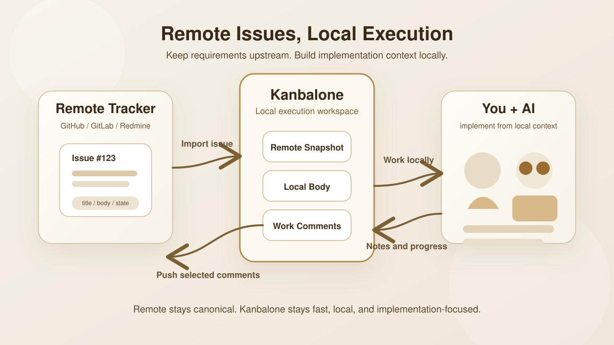
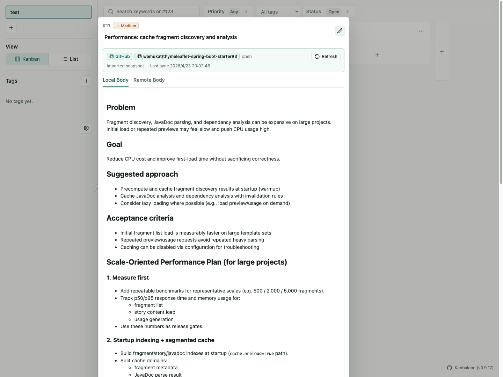
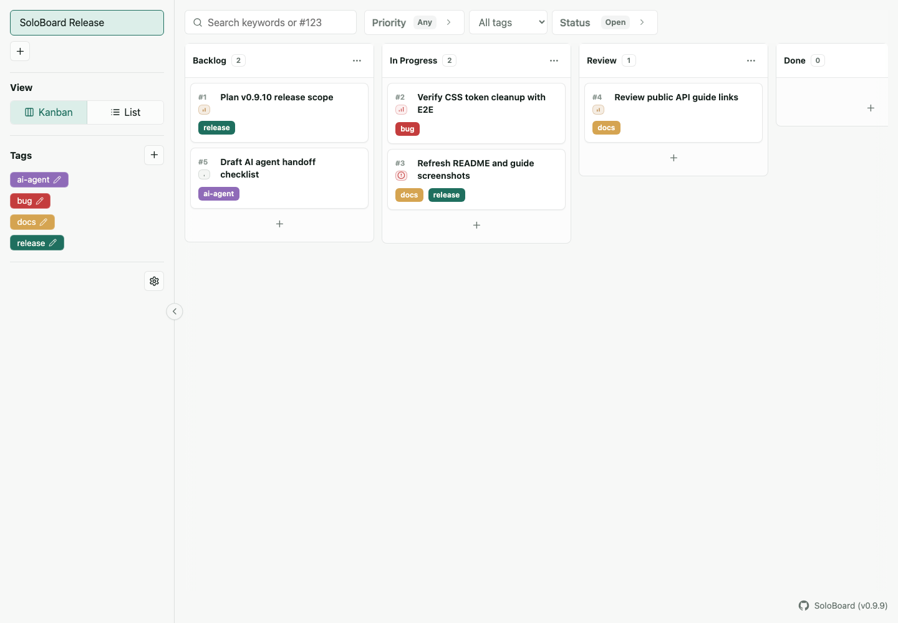
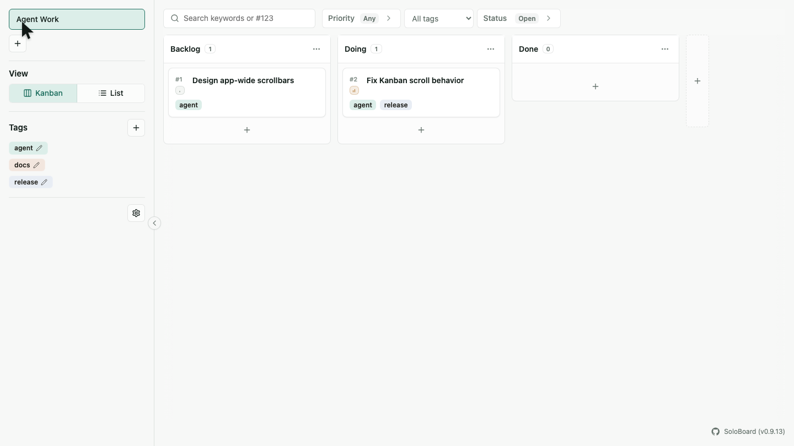

# Kanbalone

[日本語](README.ja.md)

<p align="center">
  
</p>

Kanbalone is a local workspace for individuals who develop with AI.

Turn an external request into actionable work, keeping research, implementation notes, and progress together. People use the interface; AI tools use the API to continue the same work.

Refer to the original GitHub, GitLab, or Redmine issue while developing your own implementation notes, then send back the comments you choose. You can also start with personal tasks, without an external issue.

[Who Kanbalone helps, and how](docs/en/product-positioning.md)










## What Kanbalone makes easier

- **Explain the work less often.** Keep the context people and AI need on the same ticket.
- **Develop your approach locally.** Separate the shared request from implementation notes and choose what to report back.
- **See what needs your attention.** Review stages and remaining work by purpose, then complete work you have checked.

## Organize work with Groups

Starting with v0.11.0, use Groups to organize tickets with a shared purpose. See the [user guide](docs/en/user-guide.md#13-organize-work-with-groups) and [Group migration notes](docs/en/migration-guide.md#group-migration).

## Quick Start

Run the published Docker image:

```bash
docker run --rm \
  -p 3000:3000 \
  -v kanbalone-data:/app/data \
  ghcr.io/wamukat/kanbalone:v1.6.0
```

Open:

```text
http://127.0.0.1:3000
```

User guide:

```text
https://wamukat.github.io/kanbalone/
```

Use `ghcr.io/wamukat/kanbalone:latest` for the latest stable release. To try a release candidate, specify the candidate’s version tag.

## Docker Compose

Run the published image with Compose:

```bash
docker compose -f docker-compose.image.yml up
```

Change the host port:

```bash
KANBAN_PORT=3457 docker compose -f docker-compose.image.yml up
```

The app stores its SQLite database and attached images here:

```text
/app/data/kanbalone.sqlite
/app/data/attachments/
```

The provided Compose file uses a Docker named volume, `kanbalone-data`, for persistence.
Keep the database and image files together when taking a backup or restoring data. See the [backup and restore instructions](docs/en/migration-guide.md#database-and-image-backup).

On Windows, use Docker Desktop or Rancher Desktop with WSL2 and keep the named volume setup.

Kanbalone does not include authentication. Do not expose it directly to untrusted networks.

## Local Development

```bash
pnpm install
pnpm dev
```

Default URL:

```text
http://127.0.0.1:3000
```

Remote provider sandbox for GitLab and Redmine:

```bash
docker compose -f docker-compose.remote-providers.yml up -d
pnpm sandbox:remote-providers
```

Kanbalone shows the remote issue import action only when at least one remote provider credential is configured. The import panel lists configured providers only.

See [Remote provider sandbox](docs/en/developer/remote-provider-sandbox.md).

## Codex Skill

Kanbalone distributes the `kanbalone-api` skill for API-only kanban operations:

```bash
mkdir -p "${CODEX_HOME:-$HOME/.codex}/skills"
cp -R skills/kanbalone-api "${CODEX_HOME:-$HOME/.codex}/skills/"
```

When you use only the Docker image, fetch the skill from the matching GitHub release tag to the host running Codex:

```bash
tmpdir=$(mktemp -d)
curl -L https://github.com/wamukat/kanbalone/archive/refs/tags/v1.6.0.tar.gz \
  | tar -xz -C "$tmpdir" kanbalone-1.6.0/skills/kanbalone-api
mkdir -p "${CODEX_HOME:-$HOME/.codex}/skills"
cp -R "$tmpdir"/kanbalone-1.6.0/skills/kanbalone-api "${CODEX_HOME:-$HOME/.codex}/skills/"
rm -rf "$tmpdir"
```

The skill runs from the host and talks to the Kanbalone HTTP API, for example `http://127.0.0.1:3000`.

## Documentation

Published user guide:

- <https://wamukat.github.io/kanbalone/>

For users and API clients:

- [User guide](docs/en/user-guide.md)
- [Completion-state migration guide (users and AI)](docs/en/migration-guide.md)
- [Data model and concepts](docs/en/concepts.md)
- [AI API guide](docs/en/ai-api-guide.md)
- [API examples](docs/en/api-examples.md)
- [OpenAPI](docs/openapi.yaml)

For developers and maintainers:

- [Development](docs/en/developer/development.md)
- [Remote provider sandbox](docs/en/developer/remote-provider-sandbox.md)
- [Docker image distribution](docs/en/developer/docker-image-distribution.md)
- [Release process](docs/en/developer/release.md)
- [Performance tooling](docs/en/developer/performance.md)
- [Dialog button policy](docs/en/developer/dialog-button-policy.md)
- [Design system](docs/en/developer/design-system.md)

## Tech Stack

- Node.js 26.13.1 LTS
- Fastify
- SQLite via `better-sqlite3`
- TypeScript
- Vanilla HTML/CSS/JavaScript
- Lucide-style SVG icons

## License

[MIT](LICENSE)
