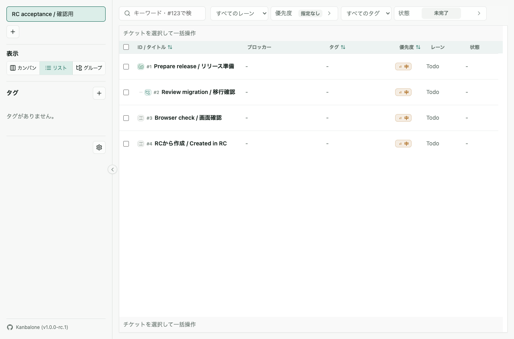
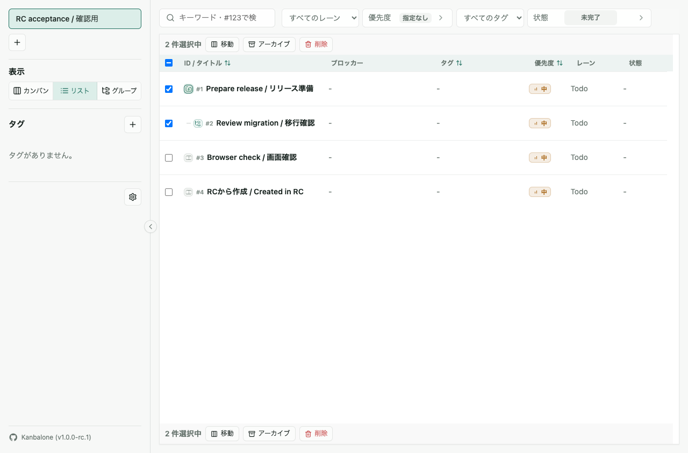
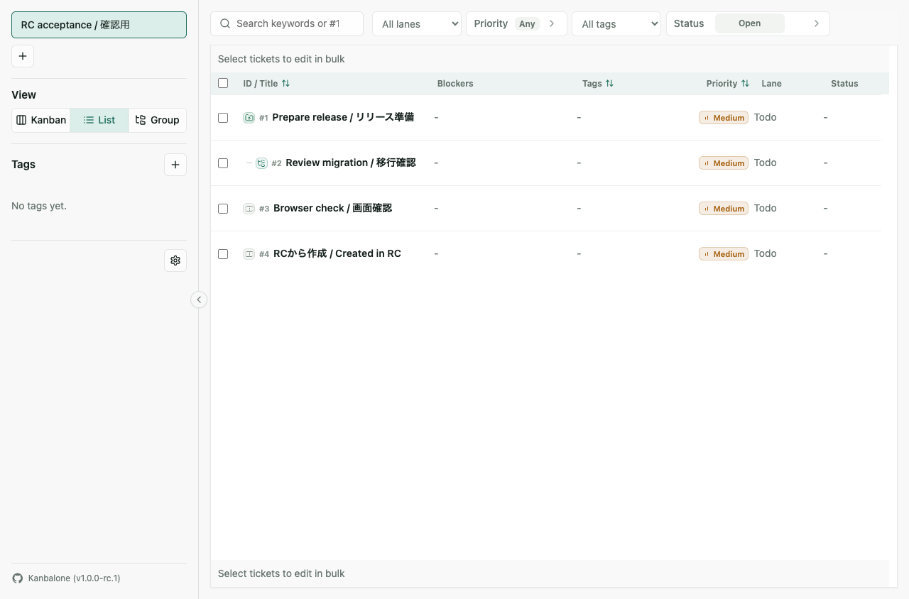
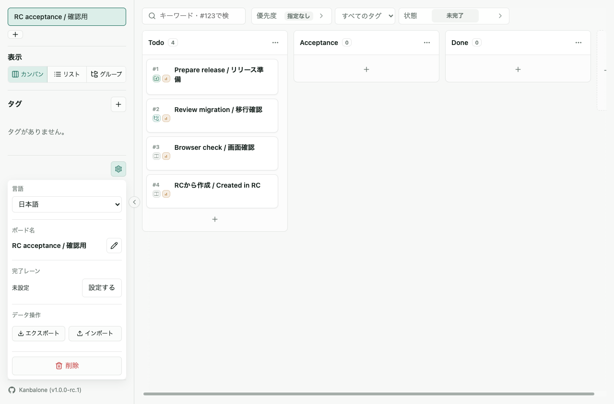

# #1487 — Translate ticket hierarchy labels

Captured 2026-11-21, Chromium via agent-browser, 1280 × 844, light theme.

## Task and versions

A Japanese-speaking user selects a parent and its child in List using the hierarchy icon. Its tooltip and accessible name should match the selected UI language; user-written ticket titles must stay unchanged.

- Before: v1.0.0-rc.1 at a050e2bb484cd35c9b41ed582308cd218a48e187, isolated Docker candidate on port 3481.
- After: working tree based on 0e6fb7b2f07e6f8fad1980606ad9fd599371c414, native Node 26.13.1 server on port 3482. Changed browser asset fingerprints are in [implementation-sha256.json](implementation-sha256.json).
- Both use the same evaluation board: parent #1, child #2, standalone #3 and #4. The after database was made using SQLite online backup of the isolated candidate. Production on port 3470 was not used for evaluation.

## Reproduction and result

1. Open board 1 in List, Japanese, settings closed, no tickets selected.
2. Inspect the parent selection icon and child/standalone icons.
   - Before: English tooltip/accessibility labels leak into Japanese.
   - After: 「親子チケットをまとめて選択」「子チケット」「単独チケット」.
3. Click the parent icon: only #1 and #2 become selected; #3 and #4 stay unselected. Click again: both are cleared.
4. Switch to English in board settings and repeat: labels remain “Select parent and child tickets”, “Child ticket”, and “Standalone ticket”; selection behavior is identical.
5. Switch back to Japanese and reopen List: Japanese preference persists.
6. Open Kanban: the non-selectable parent icon reads 「親チケット」.

API responses for all four tickets before and after selection/language changes were byte-identical. No ticket data changed. Original Japanese before/after icon bounding rectangles also match exactly. Browser reported no errors.

## Original images

Before, Japanese:

After, Japanese:

After selecting parent and child:

After, English:

After, Japanese Kanban (non-selectable parent icon):

The native title tooltips are not captured in these screenshots. Images prove the layout/context, not the translated hidden text. The accompanying *-labels.json files record actual DOM title/aria-label values, and *-snapshot.txt files record accessible button names and checkbox states. Zero-sized rectangles belong to the inactive view retained in the DOM.

## Validation and limits

- i18n catalog/editor rendering tests: 6 passed.
- Public JavaScript type check: passed.
- Extended existing Chromium List hierarchy E2E: passed; verifies both locales, title/aria-label, selection/clear, and unchanged stored parent title.
- Independent reviewer review_family_i18n inspected implementation, E2E changes, all five original images, DOM attributes, and accessibility snapshots: no actionable findings. Selection clearing and API equality are executor/E2E results, not independent reviewer interactions.
- This is a label-only change; no DOM structure, styles, selection rules, or API behavior changed.
- Native tooltip painting and spoken screen-reader output were not manually tested. Dark/narrow layouts were not re-evaluated for this attribute-only fix. These checks do not establish human usability.
