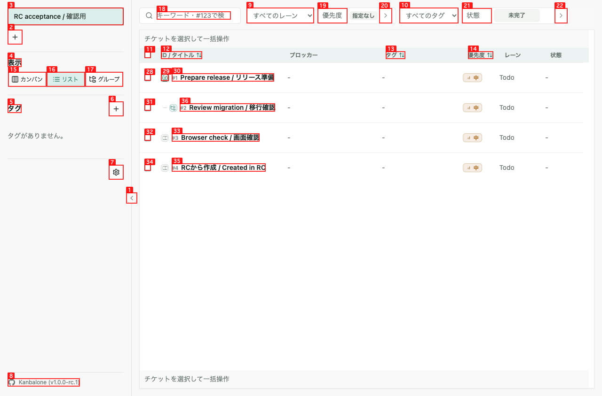

# v1.0.0-rc.1: dry-runとローカル候補版確認

## 対象と結果

- 対象アプリ: `a050e2bb484cd35c9b41ed582308cd218a48e187`、v1.0.0-rc.1。
- [Release dry-run](https://github.com/wamukat/kanbalone/actions/runs/44876216393): preflight・Unit/API/型/docs・Chromium E2E・image検証が成功。publishはskip。
- CIの旧3版×volume/bind mountの6経路で、更新・バックアップ・再起動・旧版への復元が成功。
- ローカル: 同じartifactのチェックサムと内容を照合して起動。旧データの保持、新規作成、Group所属変更、日英表示、再起動後の保持を確認。
- 検証環境: Docker/Rancher DesktopのLinux/amd64、agent-browser 0.26.0、1280×844、light。すべて合成データ。
- 検証は専用のループバックポートと隔離ボリュームで実施。
- RC公開、タグ作成、通常環境の更新は実施していない。

## 操作と保存結果

| 操作 | 確認結果 | 証跡 |
| --- | --- | --- |
| v0.11.0で親子2件＋未所属1件とGroupを作り、停止後にDB/WAL/SHMをバックアップ | バックアップ一式とSHA-256を記録 | `runtime.json`、`before-api.json` |
| dry-run artifactへ更新 | 旧3件のID・本文・レーン・親子・Groupなどを保持 | `after-upgrade-api.json` |
| 削除したAPIを呼ぶ | 完了フラグ・旧filterは400、旧2エンドポイントは404。既存チケット不変 | `api-compatibility-checks.json` |
| GroupでBrowserを検索し既存チケット#3を追加 | Group 1へ保存、表示件数2→3 | `checks-journal.jsonl`、`group-added.png` |
| 親#1の所属解除でキャンセル、その後確定 | キャンセルでは#1/#2とも保持。確定では両方解除、親子関係と別の#3所属は保持 | `parent-removal-confirmation.png`、`parent-removed.png`、API journal |
| Group内で#4を作成し本文を編集、Escape→Cancel→Save | 未保存確認で入力を保持。保存後のMarkdownチェック状態も表示 | `created-ticket-en.png`、`unsaved-confirmation-en.png`、`saved-ticket-ja.png` |
| 空のGroupを新規作成しMarkdown説明を保存 | 空でもActive一覧に表示。説明を保持 | `new-group-en.png`、`group-detail-after-restart.json` |
| 設定で日本語→英語→日本語、Kanban/List/Groupを切り替え | UIを切り替え、利用者の本文・名前は不変 | `settings-*.png`、`kanban-*.png`、`list-*.png`、`group-ja.png` |
| コンテナを再起動して再読込 | 4件とGroup一覧が再起動前後で完全一致。新Group説明と日本語選択も保持 | `before-restart-api.json`、`after-restart-api.json`、`group-detail-after-restart.json` |

`before-group.png`と`after-group-en.png`は同一データ・選択状態・viewport・themeでの更新前後比較です。それ以外は操作後の状態を表し、未操作状態との直接比較には使用しません。画像だけで永続化を判定せず、APIの再読込と再起動後の一致を確認しています。ブラウザのJavaScriptエラーは記録されていません。サーバー切替中の通信断は意図したもので、候補版起動後にログをクリアして操作確認を開始しました。

## 発見事項

| Severity | 件数 |
| --- | --- |
| Critical | 0 |
| High | 0 |
| Medium | 1 |
| Low | 1 |
| Total | 2 |

### ISSUE-001: CIとローカルでimage IDの意味が異なる（medium、手順修正）

既存手順どおり`docker load`後にartifact manifestの`imageId`を指定すると、ローカルでは`No such image`になりました。archiveのチェックサムは一致しています。

- CI image ID: `sha256:aa0a658ea665da21ebbe096bff93c2b23dda9b7c888249ba7c4ccfb61cd02397`（archive内のOCI manifest digest）。
- ローカル image ID: `sha256:1e0533ce332ea2d70658b2552e086a038e1b0f560f77a3f82a86933292a30ecd`（同manifestが参照するconfig digest）。
- archive内のblobハッシュ、manifest→configの参照、レイヤー配列、読み込み後のRootFS・版・SHAを照合して同一性を確認。別ビルドへの置き換えはしていません。
- 再利用できる`scripts/load-release-image.mjs`と日英手順を追加。同じ実artifactでロード成功。破損や無関係なイメージを許容する変更ではありません。
- 元のartifact manifestは変更せず、`loaded-image.json`に両方のIDを保存します。[Dockerの保存方式](https://docs.docker.com/engine/storage/containerd/)と[containerdのmanifest/config構造](https://containerd.io/docs/main/content-flow/)も参照。

この問題はCLI手順の問題で、ブラウザ動画ではなく`artifact-manifest.json`、`image-identity.json`、`loaded-image.json`で記録しています。候補アプリのSHAは変更していません。

### ISSUE-002: 日本語Listの親子まとめ選択ボタンに英語が残る（low、未対応）

1. 設定で日本語を選択する。
2. 親子チケットがあるボードのListを開く。
3. 親行のまとめ選択ボタンを確認する。

期待: title／aria-labelも日本語。実際: 両方とも`Select parent and child tickets`。再読込後も再現しました。機能障害・データ損失は確認していません。階層ラベルは別途修正しました。 [階層ラベルの修正 PR](https://github.com/wamukat/kanbalone/pull/23)

アクセシビリティツリー: `list-ja-accessibility.txt`。静的ラベルの問題なので動画は対象外です。この時点では修正しておらず、修正後の画像はありません。

## 制約と残作業

この確認は候補版の主要経路です。全UI操作、dark/narrow表示、長時間・競合操作、実プロバイダー認証の網羅確認や、個別のUI・多言語対応・API変更の受入確認とは別です。今回のローカル操作ではバックアップへの実復元は行わず、復元は同じSHAのCI検証で確認しています。

当時の残作業は公開承認後のRC公開と、タグ、ノート、匿名pull、latest、公開後の起動の確認でした。公開に使うSHAを変更する場合はdry-runを再実行してください。

元の`image.tar`と停止後バックアップはローカルの`coverage/release-acceptance/1.0.0-rc.1/`に保持しています。ここにはバイナリarchiveやDBを含めず、照合用JSONと合成データの画像を保存しています。CI artifactの保存期間は30日です。
