# Index child candidate relationships

[Implementation PR](https://github.com/wamukat/kanbalone/pull/41)

## Scope

This work followed the Group row icon change. [PR #40](https://github.com/wamukat/kanbalone/pull/40) (`80d7410cd24091ca0c8f8abc9f94403a89840f96`). Child candidate construction previously scanned all candidate tickets for every eligible root ticket to decide whether it already has children. Build a parent-ID Set once per candidate calculation from the same complete candidate collection. Keep existing self/parent/selected-child rules, archived membership, matching and priority-descending/ID-ascending order.

This adds no retained cache, API, pagination, storage or UI contract. No migration required. It does not remove the full candidate fetch, selected-ID array lookups, rendering costs for broad matches or other large-board costs.

## Performance method

Node 26.13.1, local isolated SQLite, Playwright Chromium; English/light 1440×1000. Baseline source is read from Git `80d7410`; candidate source is the working tree. The same JS module URL is intercepted in both phases. Each phase uses a fresh browser context (routing disables browser HTTP cache). Open the existing ticket editor, focus Child search, wait for initial network idle, then measure:

1. First query `999`: includes complete candidate API collection and candidate processing.
2. Repeated query `998`: reuses the complete candidates.
3. No-match query `not-a-real-candidate`: reuses the complete candidates.

Set the input value and dispatch a bubbling `input` event. `syncMs` measures the synchronous dispatch/handler. `ms` ends after the options MutationObserver detects a non-busy result and two requestAnimationFrame callbacks. This is a synthetic event-to-two-frames measurement, not INP, native typing or human task time. The initial synchronous handler returns while the API is still loading; do not interpret first-search syncMs as total processing time.

One excluded warmup and five retained alternating phase pairs at 1,005 and 10,005 board tickets. No parallel tests during measurement. API logs and full ordered candidate IDs are retained. Synthetic fixture is deliberately mostly standalone tickets to exercise the expensive negative parent lookup; it is not a representative distribution study. Fixture was derived from the existing synthetic Group benchmark by clearing most parent links in an isolated copy. Regular port3470/user data is separate.

## Visual and persistence method

Same nine-ticket fixture with identical IDs per phase: edited parent with selected child; parent with only archived child; standalone candidates with priority ties and one archived candidate; another parent's child. English/Japanese, 1440×1000 light and 390×1000 dark.

Search `Candidate` and verify [high archived, equal priority, low] ordering. Search for the archived-only parent's title and verify it is excluded. Search `#ID`, select by Enter, cancel/discard and verify no persisted parent. Re-edit, select again, save, verify child/parent GET relationships and reload summaries. Capture search/exclusion/selection/saved states. This verifies cancellation and persistence; screenshots alone do not establish either.

## Reproduction

From repository root, Node26 and installed dependencies. Use a disposable output directory and port3640:

```sh
mkdir -p coverage/relation-next
gzip -dc docs/development/evidence/2026-11-22-child-candidate-index/fixture.sqlite.gz > coverage/relation-next/benchmark.sqlite
node --import tsx docs/development/evidence/2026-11-22-child-candidate-index/server.mjs
# Another shell, no simultaneous tests:
node docs/development/evidence/2026-11-22-child-candidate-index/benchmark.mjs
node --import tsx docs/development/evidence/2026-11-22-child-candidate-index/visual.mjs
pnpm check
pnpm exec playwright test test/e2e/editor-candidates.spec.ts test/e2e/ticket-editor-relations.spec.ts --workers=2
```

Do not overwrite an existing evaluation database. The archived SQLite is a consistent synthetic backup. Scripts write disposable results to `coverage/relation-next`.

## Results

Chromium 159.0.8154.6. Median milliseconds, five retained samples per variant/size:

| Tickets | Query | Before event→2rAF | After event→2rAF | Before synchronous | After synchronous |
| --- | --- | ---: | ---: | ---: | ---: |
| 1,005 | First | 95.3 | 95.5 | 1.6 | 1.6 |
| 1,005 | Repeat | 28.2 | 27.5 | 15.2 | 1.4 |
| 1,005 | No match | 51.4 | 44.4 | 14.8 | 1.1 |
| 10,005 | First | 2203.0 | 799.4 | 1.6 | 1.7 |
| 10,005 | Repeat | 1472.6 | 36.0 | 1445.5 | 6.1 |
| 10,005 | No match | 1067.8 | 37.1 | 1044.0 | 6.5 |

No first-search improvement at 1,005 tickets. At 10,005 tickets, removal of repeated full scans substantially improves initial and ready-candidate searches. Both phases fetch the same complete candidate data: 6 requests / 548,058 encoded body bytes at 1,005 and 51 / 5,527,445 bytes at 10,005. Repeat/no-match issue zero candidate requests. Every retained phase/run has the same ordered option IDs, focus remains on Child search, and no page errors occur. Broad-query large DOM and full collection transfer remain unoptimized.

The final scale screenshots at both sizes are byte-identical. Raw results contain warmups (excluded from medians), response timings, bytes, IDs and errors. Five trials in this local fixture are evidence for this targeted case, not a general latency guarantee.

## Verification

`pnpm check` passes (200 tests, OpenAPI lint, build, public typecheck, docs build). Related E2E: 11 pass, including the new hierarchy/ordering/archived-only-child/save/reload regression and existing loading/error/retry/stale-response/re-edit cases. All eight visual phase/language/viewport runs pass; `interaction-results.json` contains their persisted results. Actual candidate UI was also inspected with agent-browser at port3640; query998 returned the expected #998 option.

36 original screenshots form 18 pairs (16 small-fixture pairs plus two scale pairs). Seventeen pairs are byte-identical. Japanese/light excluded-state differs in only six pixels on the existing selected-child chip's right rounded edge (x601–602,y574–590; maximum channel delta21). Visible text, result and layout match on inspection; the precise rasterization cause was not established. No image pixels were modified. See `image-comparison.json`.

## Images

### before-10005

Before:

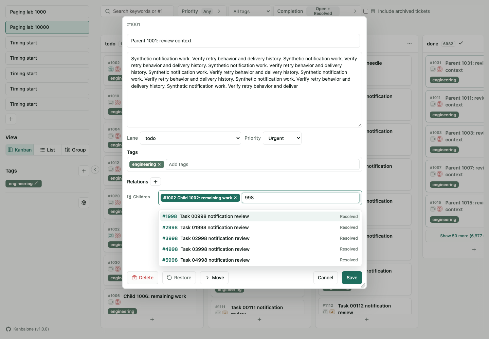

After:


### before-1005

Before:

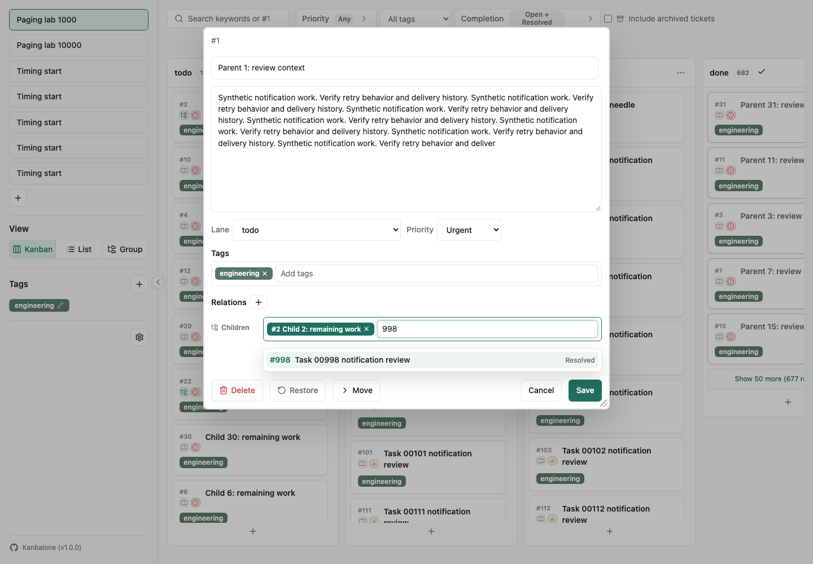

After:


### en-dark-390-excluded

Before:


After:

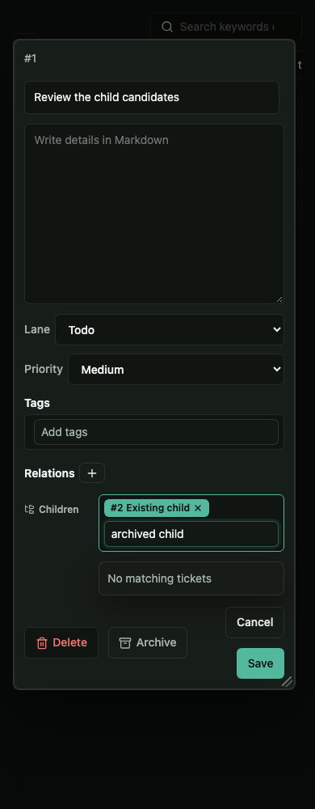

### en-dark-390-saved

Before:


After:

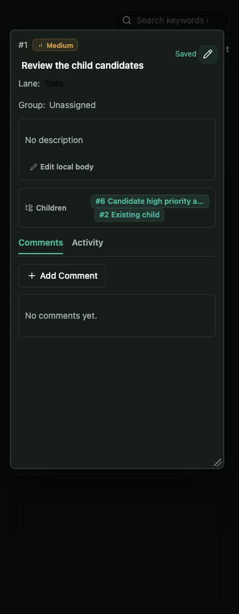

### en-dark-390-search

Before:


After:


### en-dark-390-selected

Before:

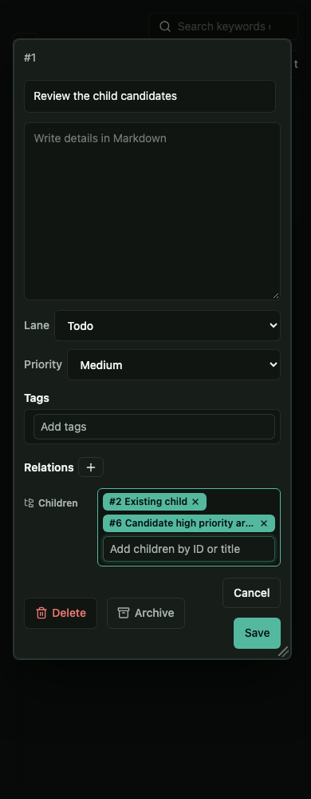

After:


### en-light-1440-excluded

Before:


After:


### en-light-1440-saved

Before:


After:

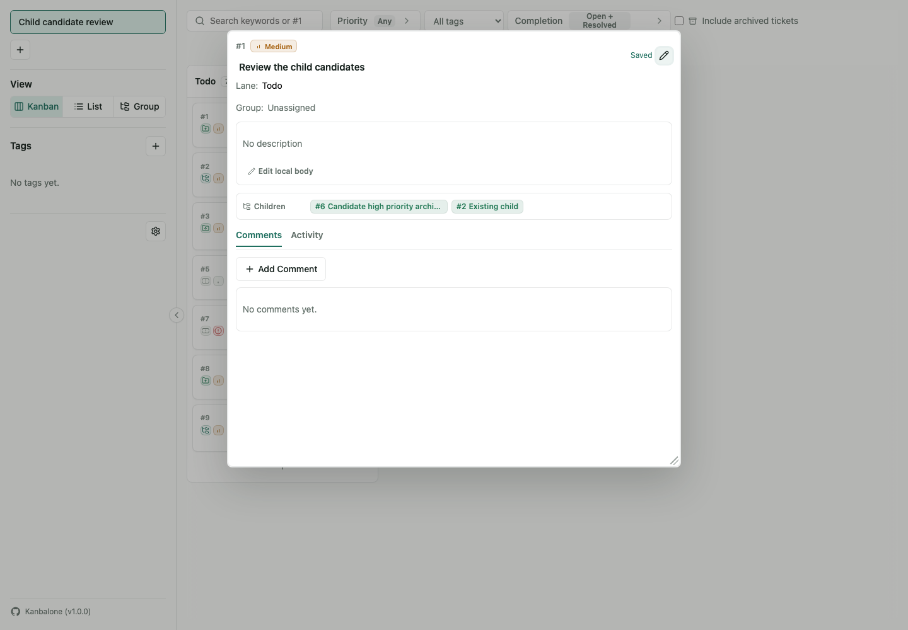

### en-light-1440-search

Before:


After:

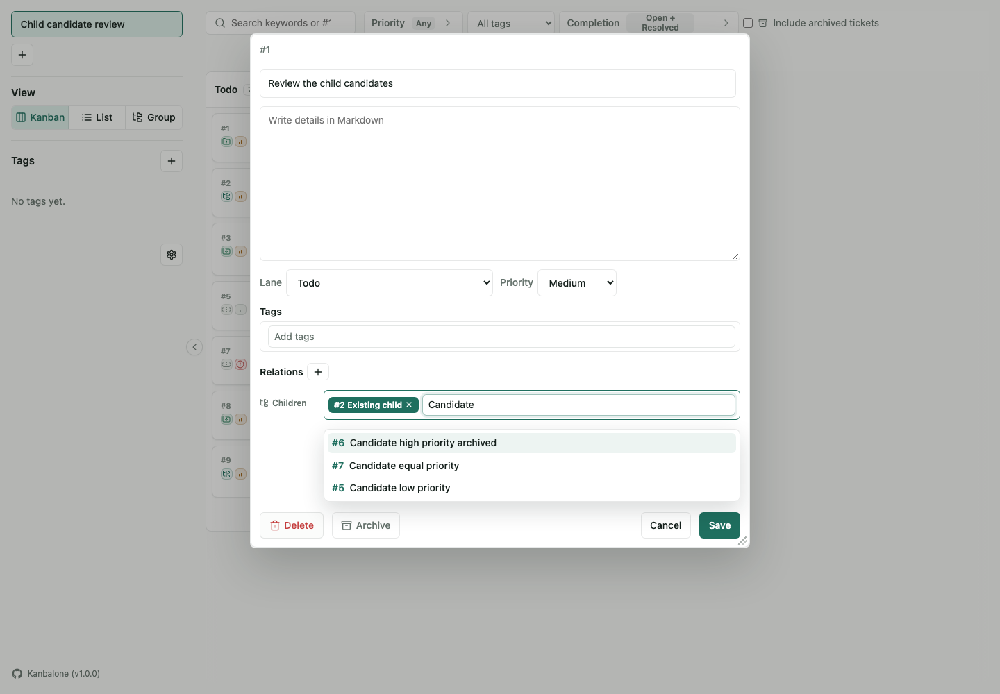

### en-light-1440-selected

Before:


After:

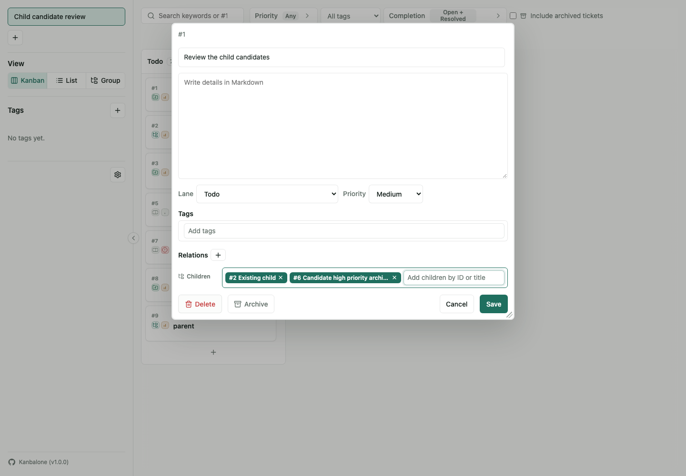

### ja-dark-390-excluded

Before:

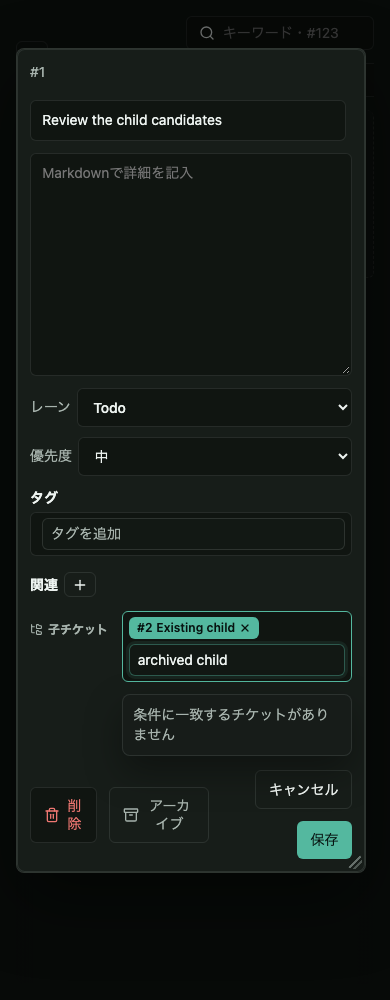

After:


### ja-dark-390-saved

Before:

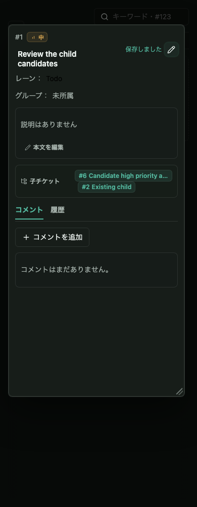

After:


### ja-dark-390-search

Before:

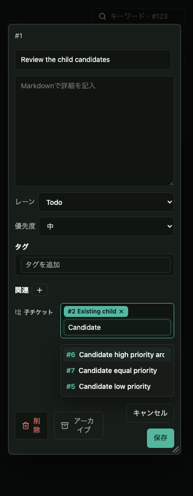

After:


### ja-dark-390-selected

Before:


After:

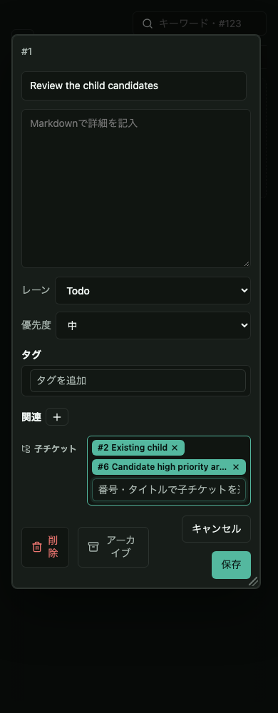

### ja-light-1440-excluded

Before:


After:

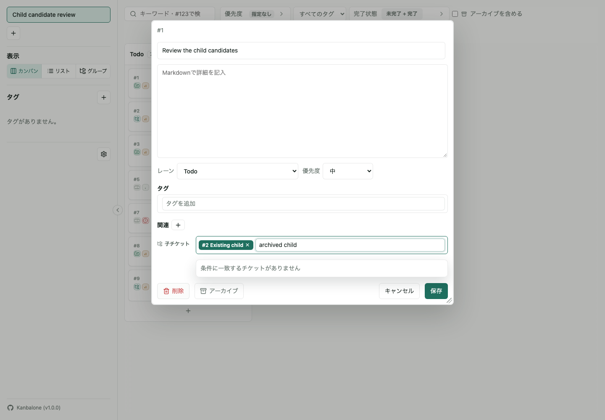

### ja-light-1440-saved

Before:

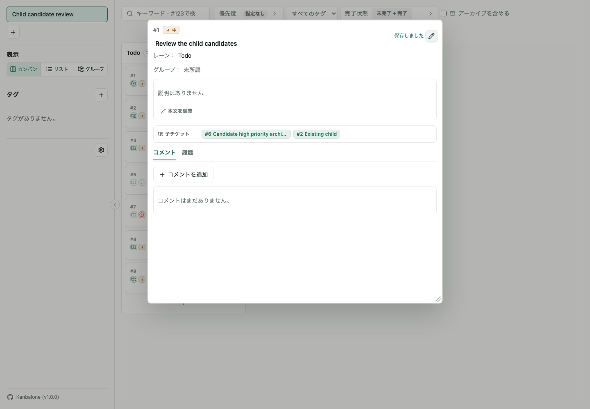

After:


### ja-light-1440-search

Before:

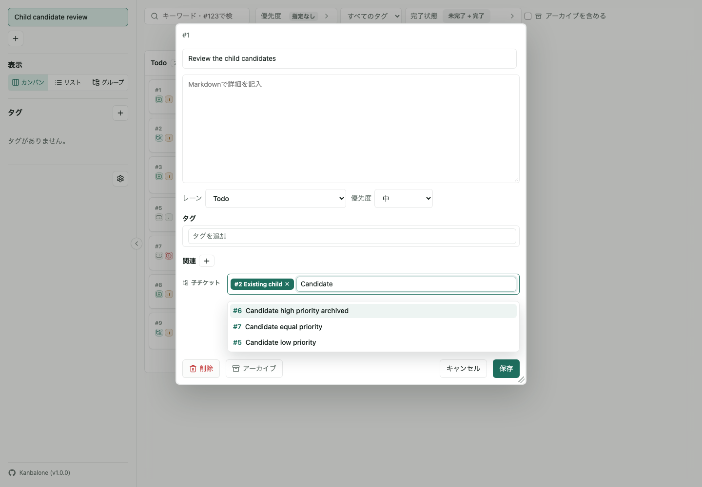

After:


### ja-light-1440-selected

Before:

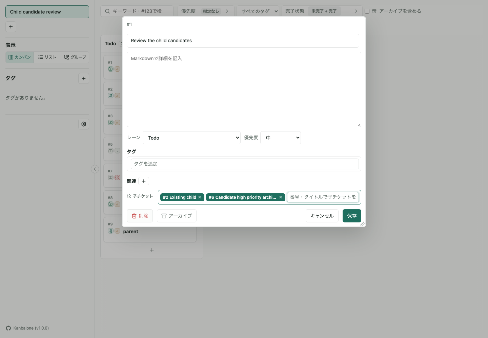

After:


