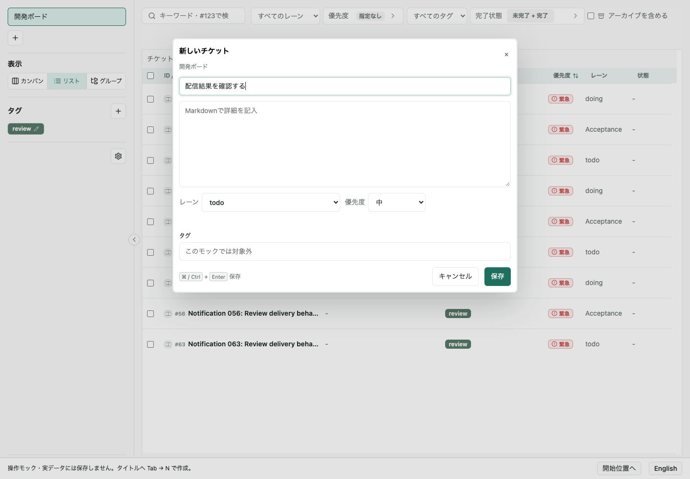
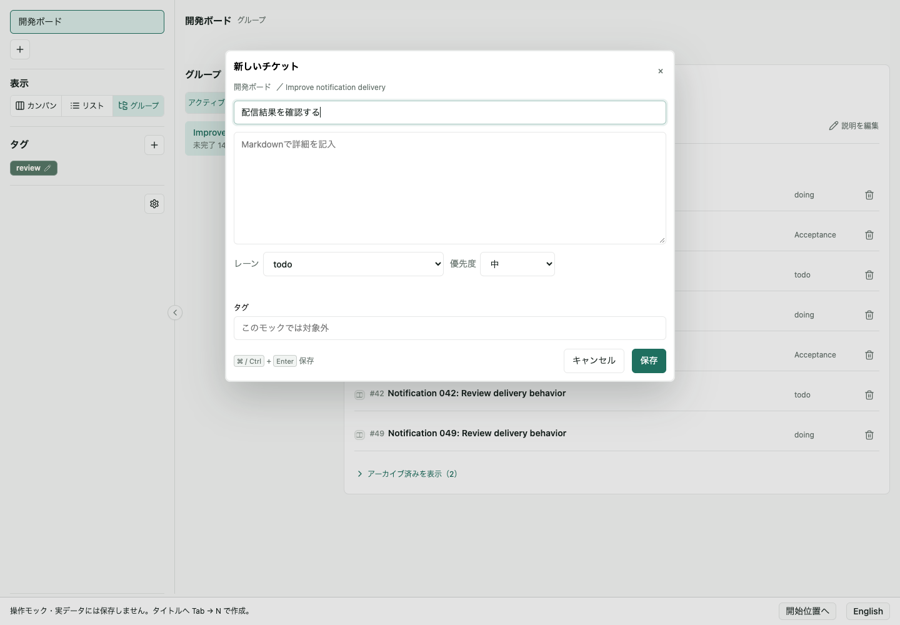
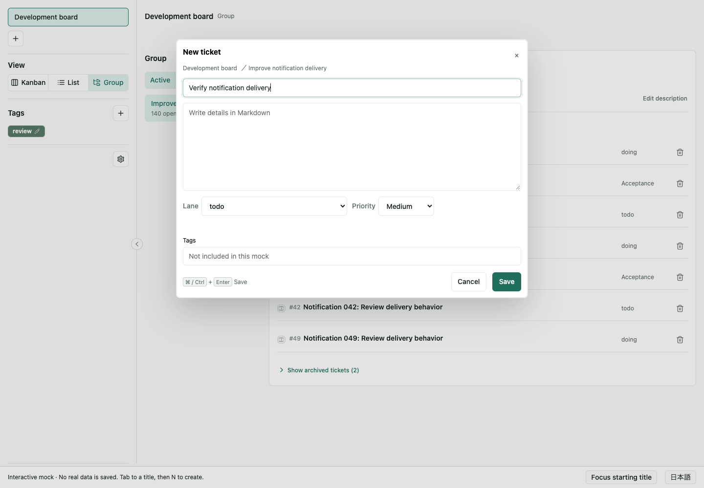

# #1511 新規作成のキーボード操作モック

状態: **仕様確認用モック。本製品には未実装。Acceptance の前後エビデンスではない。**

[操作モック](../../mockups/create-keyboard.html)は単体 HTML。API 接続・実データ更新・永続保存を行わない。ローカルで開くか、本ディレクトリのリポジトリで `python3 -m http.server 3598 --bind 127.0.0.1 --directory docs/development/mockups` を実行し、`http://127.0.0.1:3598/create-keyboard.html` を開く。

## 提案する操作

1. List / Kanban / Group のチケットタイトルにフォーカスして **N**。既存の＋／作成ボタンもそのまま使える。Group は選択中 Group ボタンからも N。
2. 既存エディターの形で開き、タイトルにフォーカスする。ボード、Group（所属ありの場合）、レーンを確認して入力する。
3. **⌘ / Ctrl + Enter** で保存。タイトルで Enter だけでは保存しない。IME 変換中・キー長押しは新規作成／保存を起動しない。
4. 保存／キャンセル後は、開始したタイトル／ボタンとスクロール位置へ戻る。未保存の入力があれば破棄を確認する。

| 表示 | 初期レーン | Group |
| --- | --- | --- |
| List | ボードの先頭レーン。選択中チケットのレーンを継承しない | 未所属 |
| Kanban | フォーカス中チケット／＋のレーン | 未所属 |
| Group | ボードの先頭レーン | 表示中 Group |

本モックの先頭レーンは `todo`。初期レーンは既存＋／エディターの既定値に合わせる提案であり、完了レーンを自動除外しない。Kanban の done から N を押すと完了チケットとして作成する旨をエディターに表示する。List の検索条件やフォーカス中チケットから Group を暗黙に継承しない。

N が働くのは上記の操作対象にフォーカスがあるときだけ。検索・本文・タイトル・画面背景では働かない。空の一覧は既存の作成ボタンへ Tab → Enter を使う。本モックは空一覧を再現していない。

## 変えないもの／このモックで確認するもの

- 変えない: サイドバー、表示切替、上部フィルター、既存＋の位置、Group の一覧と内容の分割、既存エディターのレーン選択。
- 確認する: 対象にフォーカス中の N、タイトルへの初期フォーカス、保存ショートカット、同じ対象への復帰、作成先の予測可能性。
- 新しい常設作成ボタンやグローバル検索ダイアログは追加しない。
- 下端の操作モック案内・言語切替・開始位置ボタンは評価用であり、製品へ追加する案ではない。

## 画面と検証

2026-11-22、Chromium / agent-browser、1440×1000、ライトテーマ。追加で 1280×720 のエディター表示も確認し、保存ボタンとキー案内が見えることを確認した。日英×3ビューでタイトルから N →入力→Ctrl+Enter→開始した要素への復帰を実際に操作。`verification.json` にフォーカステキスト、スクロール、モック内作成結果を記録した。各 `*-start.png` / `*-create.png` / `*-returned.png` はこの**同一モックの操作前・入力・復帰**であり、製品の修正前後比較ではない。

UI は b7dc02e と同じ PR #31 のページング版（bae2485）の評価用 260 件ボードの DOM と、b7dc02e の既存 CSS を再利用。表示件数をモック用に減らしたため、件数表示はキャプチャ元の値のまま。ヘッダー・ボタン・余白・白いパネルは既存画面のスタイルを保っている。

## 制限と実装時の必須確認

- 保存はメモリー内の配列と表示行への追加のみ。再読込で消え、表示切替後の追加行の維持は未対応。API の保存結果、再読込、競合、障害時の保証を示す証拠ではない。
- 比較用ボードの件数、フィルター、タグ、ソート、優先度の結果反映などは操作対象外。実装の代替ではない。
- レーン表示の変更、Group の引き継ぎ、タイトルと本文の値を使う。既存タグや親子編集はこのモックでは扱わない。
- 実際の OS IME、スクリーンリーダー、暗色・モバイル幅・200% 拡大の評価は未実施。IME のコード上のガードと合成イベント検証は実機 IME 評価の代わりにならない。
- 本実装時には空ボード／空一覧、先頭レーンが完了レーン、フィルターで作成したチケットが見えない場合、SSE 更新・保存失敗、元の対象の削除や表示切替、連打を確認する。日英の実画面前後画像をチケットに添付し、別レビュアーが確認するまで Acceptance に移さない。

ユーザー判断待ち: **N の対象限定、レーン／Group の初期値、保存後に新規行ではなく開始位置へ戻る方針**。実装着手はこのモックの確認後。

独立レビューでは、List の検索中の N を横取りしないこと、合成 compositionstart 中の Ctrl+Enter を抑止すること、compositionend 後の保存と同じタイトルへの復帰を確認。Kanban doing 起点の作成先と未保存確認からの入力継続も確認した。実機 IME の検証ではない。
