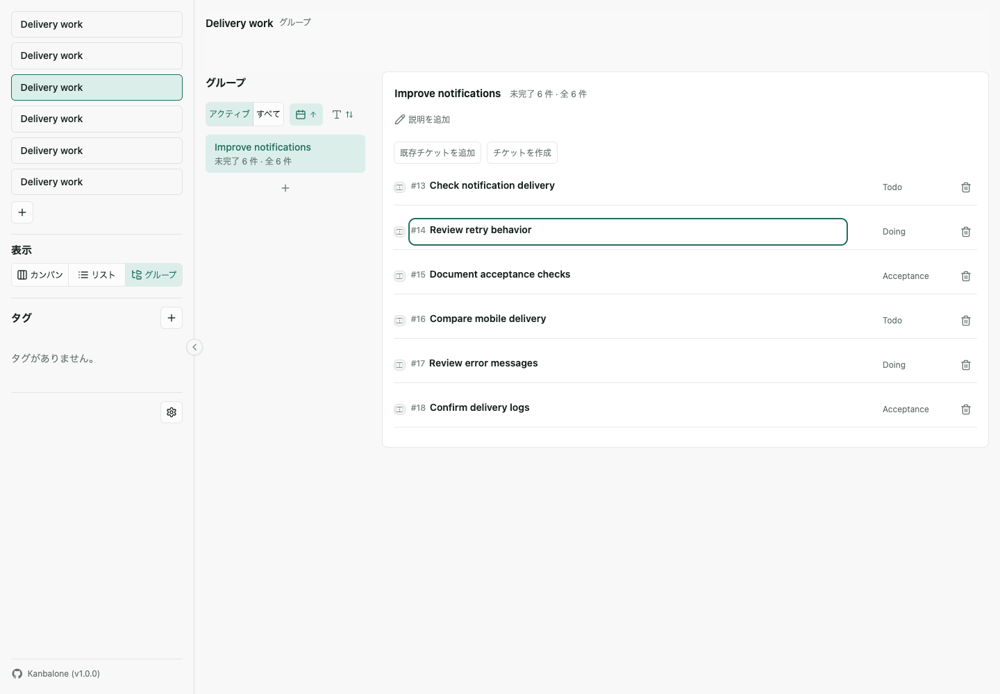
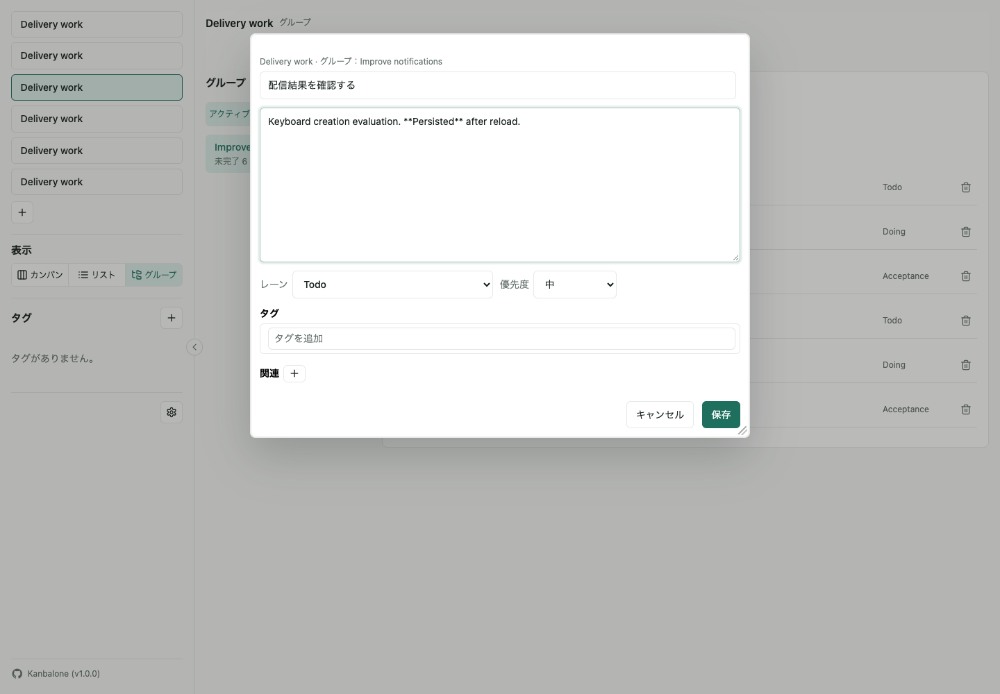
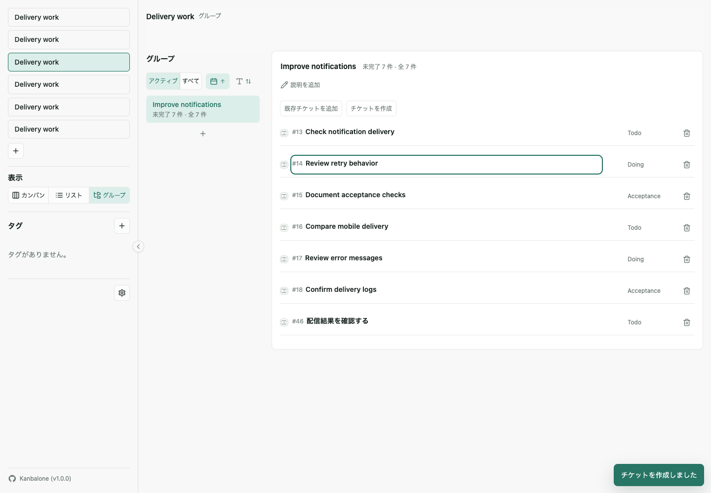
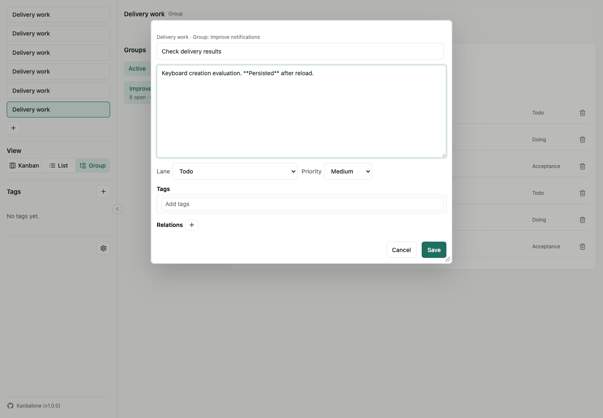

# #1511: keyboard ticket creation

This directory contains **actual application captures**, separate from the earlier [interaction mock](../2026-11-22-create-keyboard-mock/README.md). All boards and writes below are disposable evaluation fixtures. Production data was not used.

## Task and expected behavior

From a focused ticket title, press **N**, type a title/body, save with **Ctrl/Cmd+Enter**, and continue from the same original title and scroll position. Creation must use the same destination as existing creation controls: List uses the first board lane, Kanban uses the focused ticket's lane, and Group uses the first lane plus the selected Group. A focused, selected Group choice and existing creation buttons also support N. An unselected Group choice must not create into a different selected Group.

Do not intercept normal typing, composition, modifiers or held keys. Keep unsaved-change confirmation and failed-save drafts. If a pending operation's board/view/Group changes, do not open the stale destination. If the original ticket leaves the filter, fall back to the existing search input.

## Baseline and candidate

- Baseline: `b7dc02e8885f740afd9a47f12fab4c9079346041`, static files extracted using `git show` into `coverage/create-keyboard/public-before`.
- Candidate: working-tree source hashes and served-file verification are in `revision.json`.
- Both use the same unchanged backend and separate SQLite databases, served on loopback ports 3601/3602. `serve.mjs` reproduces this layout; run under Node 26 with `--import tsx` from repository root.
- `seed.py` creates six boards for Japanese/English × List/Kanban/Group. Each starts with the same six ticket titles, three lanes, priorities and Group membership. IDs are aligned across the two databases; timestamps differ because fixtures are seeded sequentially. `fixtures.json` records the inputs.
- Chromium through agent-browser, 1440×1000, light theme. Original images are unaltered. `capture.py before` and `capture.py after` drive the actual UI and record results. Repeated candidate capture runs remove only generated evaluation tickets before replaying the same tasks.

## Image sequence and stored results

For each language/view pair:

1. `before-*-*-n.png`: focus the origin title and press N. The baseline stays on the board, does not open an editor and does not create a ticket. This is the actual unsupported baseline behavior, not a reconstructed editor image.
2. `after-*-*-create.png`: repeat N from the same origin. The existing editor opens with title focus; title/body are entered. Board/Group context and the initial lane are visible.
3. `after-*-*-returned.png`: save with Ctrl+Enter. The editor closes and focus returns to the original title. A new ticket is present in its intended destination.

`before-verification.json` records the unchanged counts and closed editor. `after-verification.json` records origin/return focus and scroll, selected lane and context, the stored ticket fetched through the API, and successful rendering of the new ticket after a browser reload. Each case creates exactly one independent ticket, with the expected lane, Group (or no Group), null parent, and full Markdown body. Screenshots alone do not establish persistence or timing; the API/reload checks supply that evidence.

## Regression checks and findings

`test/e2e/create-keyboard.spec.ts` covers six Japanese/English context flows, both Ctrl+Enter and Meta+Enter, search typing, modifiers, synthetic composition, held keys, plain Enter in the title, cancelled discard, an injected HTTP 503 save failure and retry, completion-lane creation, selected/unselected Group choices, filtered List scroll restoration, an origin leaving the filter during SSE refresh, a delayed Group creation followed by selection of another Group, and existing creation-button focus.

Testing found a real focus race after saving: the generic post-save focus fallback could run before the editor-close refresh completed, especially before Kanban's asynchronous card batch. The implementation now gives the pending origin restoration precedence. The corrected Kanban and delayed-Group cases passed three repeated runs each. Group selection also retains its focused selector across its render.

Final `pnpm check` passed: 192 unit/API tests, OpenAPI lint, backend/public type checks and documentation build (`check.txt`). The final 44-test E2E run passed, covering the new creation tests plus existing keyboard navigation, Group behavior/visuals/focus, ticket CRUD, unsaved edits and in-flight saves (`e2e.txt`). The two corrected race cases also passed three repeated runs each (`race-repeat.txt`). Independent review is recorded in `review.md`.

Supplemental actual Group creation captures at 1280×720, in light and emulated OS dark mode, show that the title receives focus and the Save button stays inside the viewport (bottom 616.8px). These are after-only layout checks, not additional before/after claims. Existing dark-mode label contrast is outside this change and has not been certified by this evaluation.

## Limits

- Composition events are synthetic browser events, not an OS-level Japanese IME acceptance test. Real IME, real screen reader and real participant usability evaluation remain unverified.
- Synthetic 503 and delayed requests validate local recovery paths; they are not evidence of a specific external service's behavior.
- No API contract or database format changed. No production migration or runtime update was performed.
- Images must be embedded in the Kanbalone ticket and their published URLs verified before moving this ticket to Acceptance. Local files alone do not meet that gate.

## Full CI assertion alignment and ticket evidence

The first full PR #33 CI run passed 156/158 E2E tests. Two legacy action-recovery assertions expected search focus after saving from a lane + button; the approved behavior now returns to that initiating button. The test-only update checks the exact Source/Todo + button and retains editing, moving and persistence assertions. The affected action-recovery and new-creation suite then passed all 17 tests (`ci-alignment.txt`). Runtime hashes and captured images are unchanged. Full GitHub checks are rerun on the updated commit.

The author embedded all 18 primary images in Kanbalone #1511 from immutable commit `af6d96b9c2a4b1eb3007487f19be434c79742b24` and verified them in its actual ticket screen: all loaded at 1440×1000. The pre-existing dark label issue was reproduced on baseline and candidate, with both comparison images attached to separate ticket #1513.
