# #1518 — Open tickets without collecting every relation candidate

The baseline is merged main `ac23f0f12b9efb7da330b9b4142c87642ba9441c`, also installed in the ordinary local runtime before this investigation. The candidate opens a new editor immediately and loads an existing ticket's own detail, activity and events without waiting for the complete board collection. The first nonempty relation search still loads **all** candidate pages, including archived tickets, once for that editor session.

This moves work away from ordinary opening; it does **not** make the first relation search cheaper or prove that the previously unreproduced 859 ms initial request was fixed. Existing candidate matching and priority/ID ordering are retained. The separate [performance report](performance.md) measures opening and first search independently.

## Scope and safeguards

- Current relation chips come from the ticket detail, even before candidates are fetched. Removing a relation or saving an unrelated change retains the other stored relationships.
- Candidate data belongs to the editor and never replaces the board's partially loaded tickets.
- Loading, error and retry appear in the existing picker. Late responses cannot replace a newly opened editor's state; saving, re-editing or closing invalidates the candidate collection.
- Loading completion preserves text, query, selection and focus. Normal creation does not wait for a pending candidate search.
- The reverse dependency row (`Blocks`) now uses the detail response, which orders by priority descending / ID ascending. The old full-board scan used board position. This small visible order change is explicit in the supplemental comparison below.

## Actual before / after screens

All data is synthetic, in separate SQLite files and servers on ports 3624 (baseline) and 3625 (candidate). Normal port 3470 and existing user data are not used or changed. Desktop pairs are 1440×1000, light theme, identical task content and states. The fixture has existing child, blocker, archived related ticket, reverse dependency and archived candidate. Japanese and English screenshots were taken through agent-browser, unaltered.

| Task / state | Before | After |
| --- | --- | --- |
| 日本語: 新規作成 | 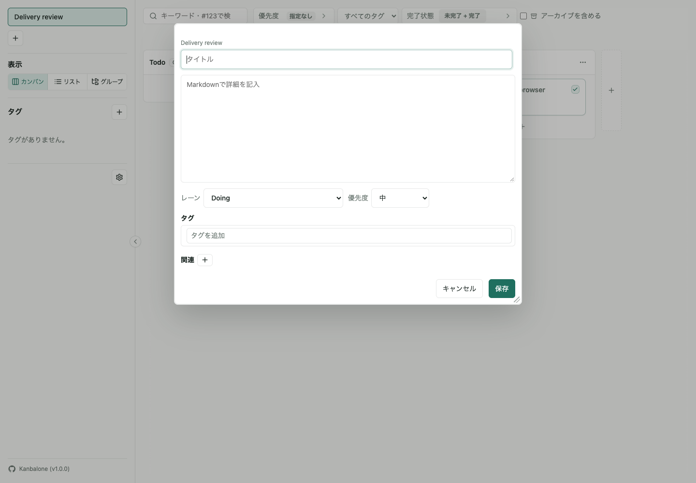 |  |
| 日本語: 詳細と関係 | 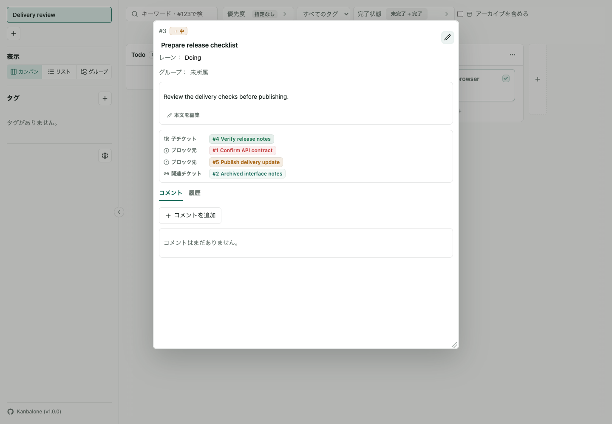 |  |
| 日本語: 編集済みの関係 | 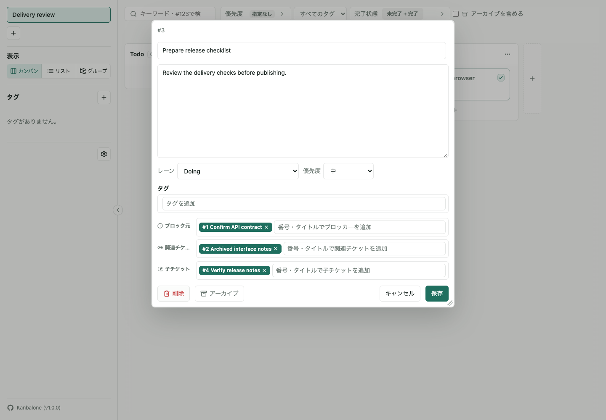 |  |
| 日本語: 候補検索 |  |  |
| 日本語: 親を持つチケット |  | 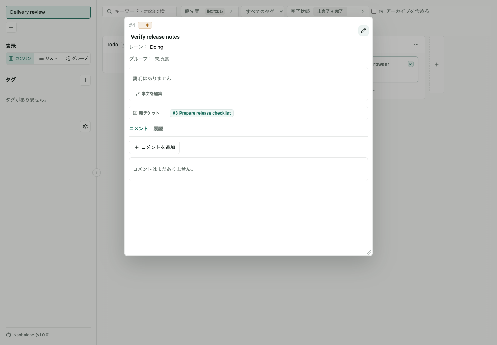 |
| English: new |  |  |
| English: detail / relations | 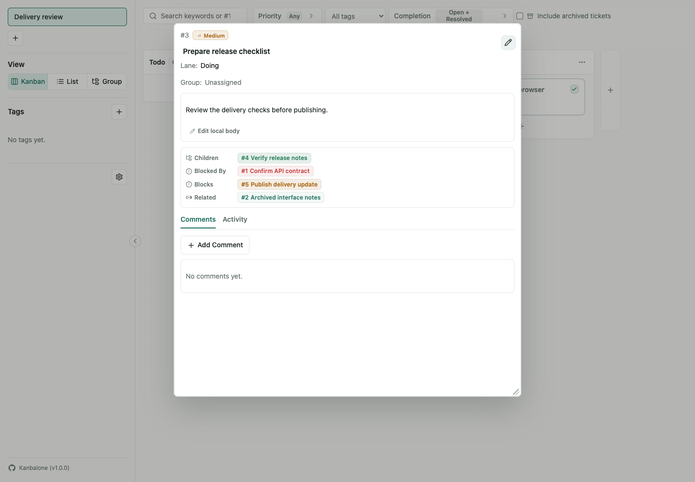 |  |
| English: selected relations | 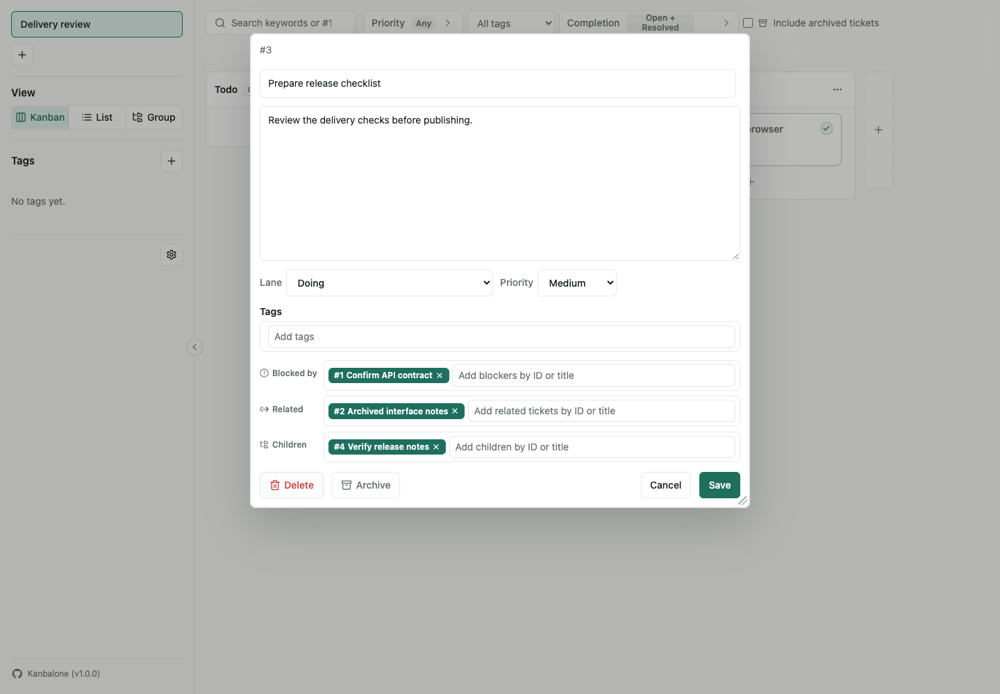 |  |
| English: candidate search |  | 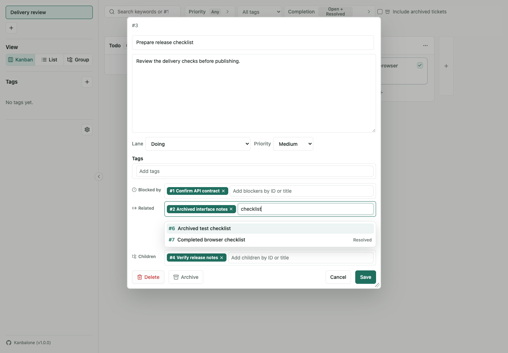 |
| English: child detail | 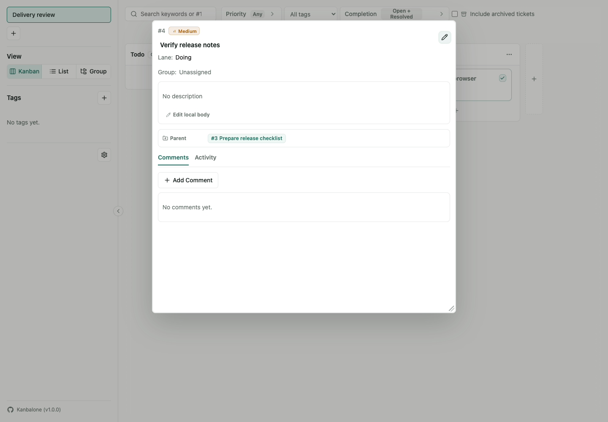 |  |

These images demonstrate final appearance and relationship visibility, not timing. [Before interaction assertions](before-capture.json) / [after interaction assertions](after-capture.json) record archived and reverse dependencies, query and search focus.

### Loading, failure and retry

A browser-only fetch adapter holds the first candidate response, then returns an explicitly injected 503. No production error or network latency is fabricated. The retry uses the real isolated server. The existing title and query are retained throughout. [Recorded measurements](loading-verification.json) compare title, search field, whole relation control, adjacent child row and Save button rectangles. Loading and error are identical; actual candidate results retain the existing variable list-height behavior.

| Language | Loading | Injected error | Retry success |
| --- | --- | --- | --- |
| 日本語 | 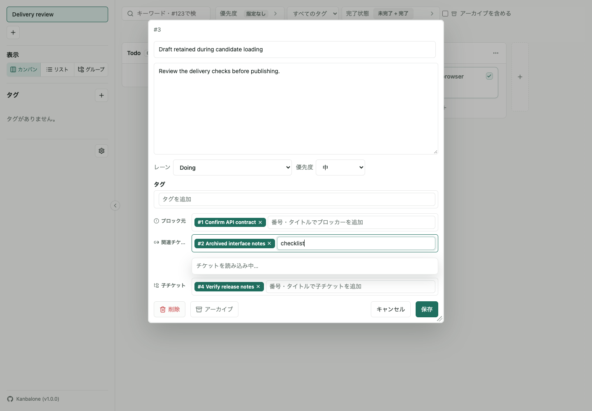 |  | 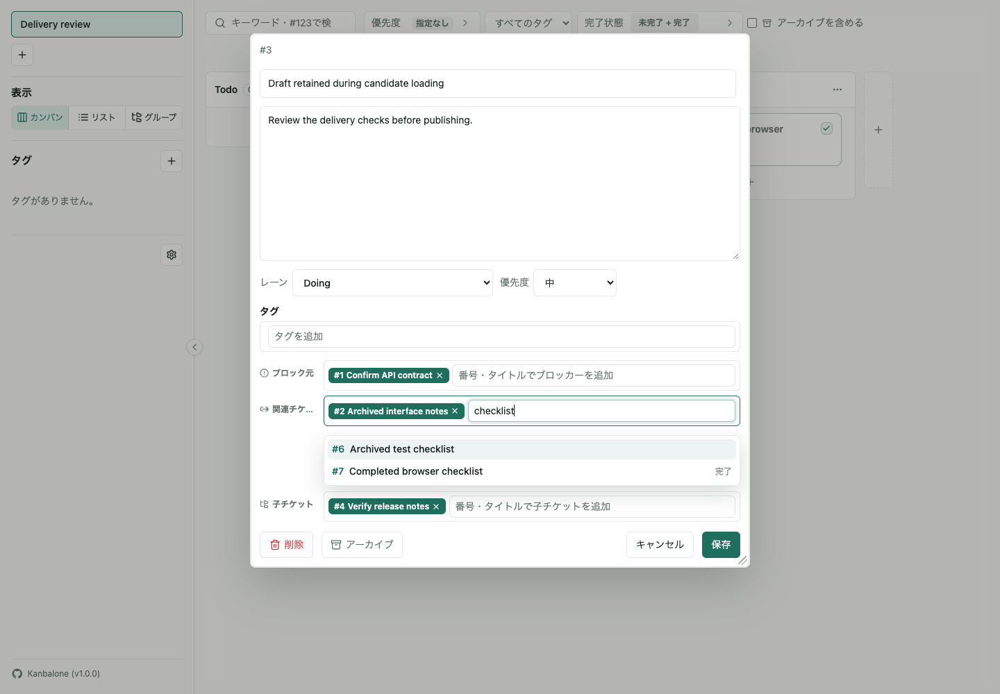 |
| English | 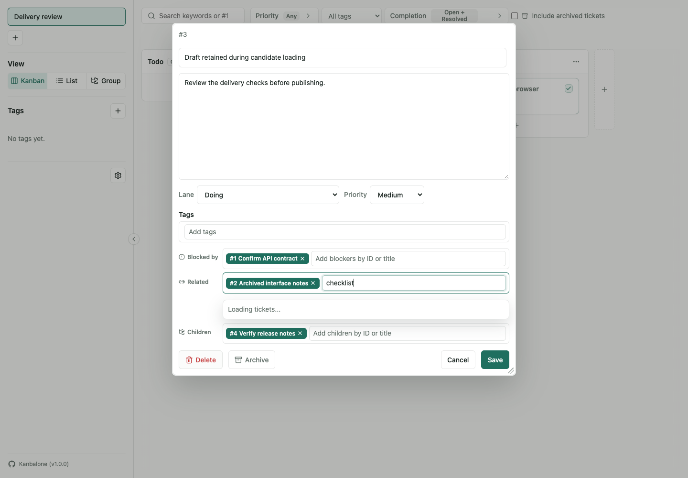 | 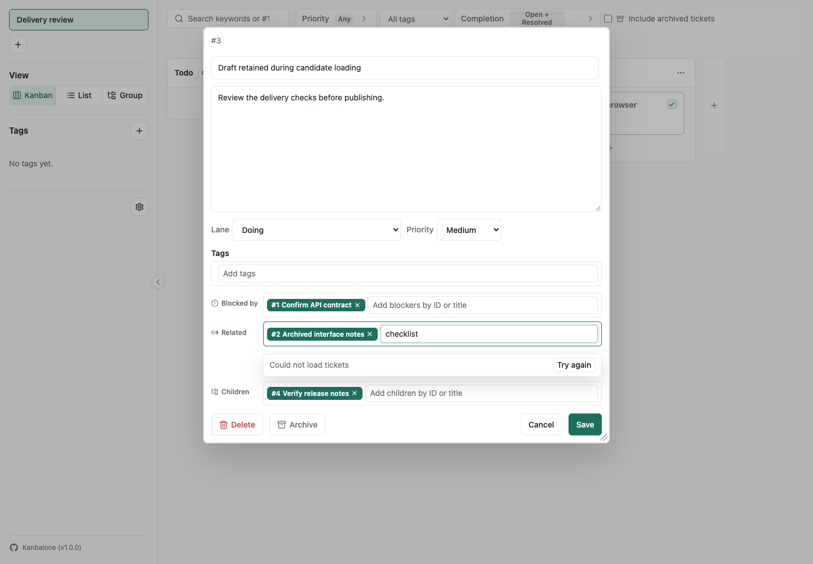 |  |

An initial implementation placed error text and Retry on two rows, shifting the lower controls by 32 px. Visual review caught this and the final implementation uses a fixed-height single status row. Narrow review then caught the Retry action overflowing the picker; allowing the grid item to shrink fixed this. Only the final status captures are retained here.

### Narrow / dark and reverse-dependency order

Narrow comparisons set the viewport to 390×844 **before** navigating and opening the dialog; [rectangle records](narrow-verification.json) show x=16 and width=350 for both versions. The form is taller than this viewport and remains scrollable, as before. Resizing an already-positioned desktop dialog gave an invalid offscreen capture during harness development; those captures were replaced, not treated as a passing result.

| State | Before | After |
| --- | --- | --- |
| 日本語: narrow / dark search |  | 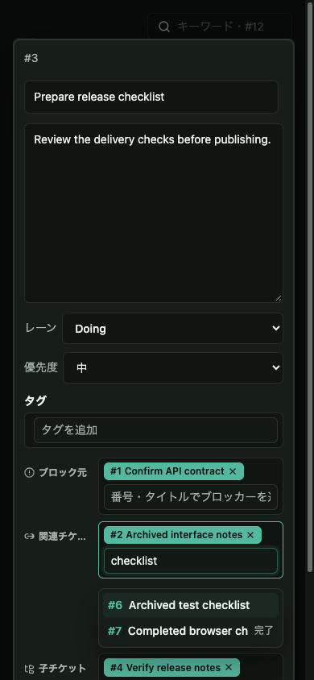 |
| English: narrow / dark search | 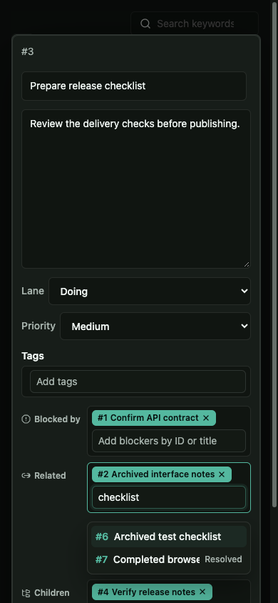 |  |
| Blocks with differing priorities |  | 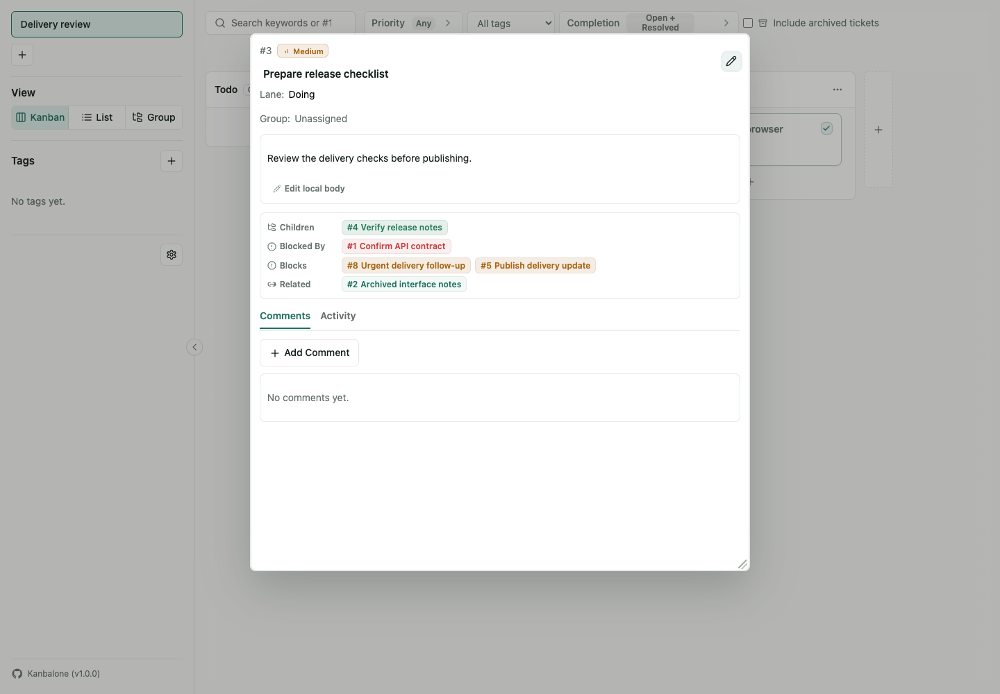 |

For the Blocks comparison only, the same additional urgent blocked ticket was created on both isolated fixtures after the main paired captures. [Order record](blocks-order.json) shows both tickets remain present; the urgent one moves first in the candidate. Desktop dark and narrow loading/error supplementary images are also retained in this directory.

## Regression and stored-state verification

`test/e2e/editor-candidates.spec.ts` adds nine checks: no initial collection, complete multi-page archived candidates, ordinary save during a pending search, input/focus preservation, failure/retry, stale response after close/reopen, removal before collection, invalidation after save/re-edit and narrow Retry geometry. API GETs verify the actual saved relations and unchanged child/blocker sets.

The related suite also exercises JA/EN keyboard creation in Kanban/List/Group, keyboard opening/return, existing parent/blocker/child editing, CRUD, board moves and unsaved edits. The old Group-opening test assumed a mandatory initial full-board request; it was updated to hold an actual relation search, then close/switch Group and check that a late response does not restore the old context.

An exploratory test attempted to assert that a failed relation-link navigation retains the old editor. Relation links perform a full page navigation; that assertion was invalid and removed. The defensive in-place opening failure handling was reviewed in source but is not claimed as browser-covered by that discarded test.

[Full check](check.txt): 198 tests passed, plus lint, TypeScript/public-JavaScript checking, build and documentation build. [Related browser regressions](e2e.txt): **35 passed (3.2m)**, including the original eight new candidate tests. [Narrow Retry regression](narrow-e2e.txt): **1 passed (7.9s)** after the final CSS correction. Total: 36 browser cases across these two runs. [Independent review](review.md) is separate from user acceptance.

## Reproduction and limits

Use Node 26.13.1 and the repository's locked dependencies. Extract `git archive ac23f0f src public` into `coverage/editor-candidates/baseline`. Start `server.mjs before`, run `seed.py` once, then start `server.mjs after`. Run `capture.py before`, `capture.py after`, `capture-loading.py`, `capture-narrow.py`, and finally `capture-order.py` (the latter adds one fixture ticket). Use fresh SQLite files when repeating the entire sequence.

Screenshots do not establish persistence, race safety, universal speed, or human usability. Tests and recorded API responses support the specific interactions; a human acceptance review remains required. Performance results use isolated synthetic data and do not estimate latency for every machine or network.

## CI follow-up

The first full CI browser run passed178/180 and exposed two test synchronization errors. [Re-edit request counting](ci-reedit.md) and [Group keyboard readiness](ci-group.md) describe the trace evidence and test-only corrections. Each corrected scenario passed10 targeted repetitions. Production files, UI images and performance measurements are unchanged. The full CI suite is rerun on the updated PR head.
