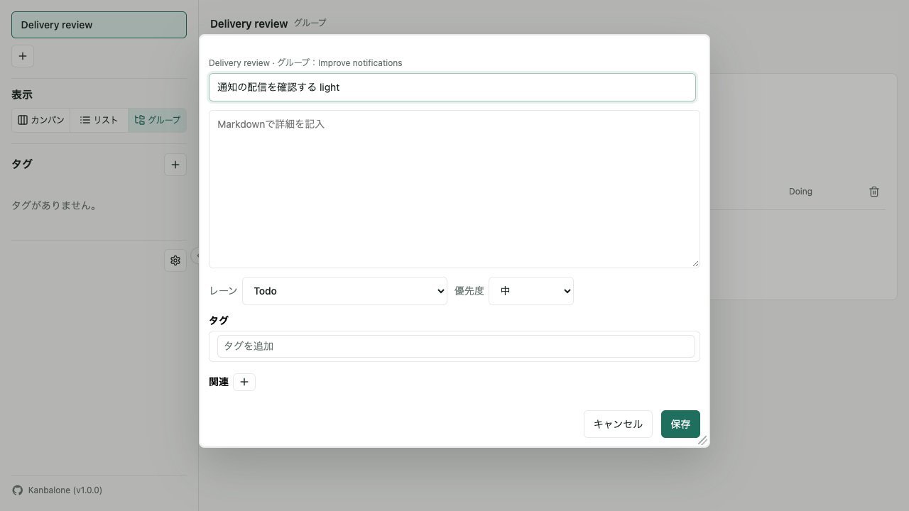
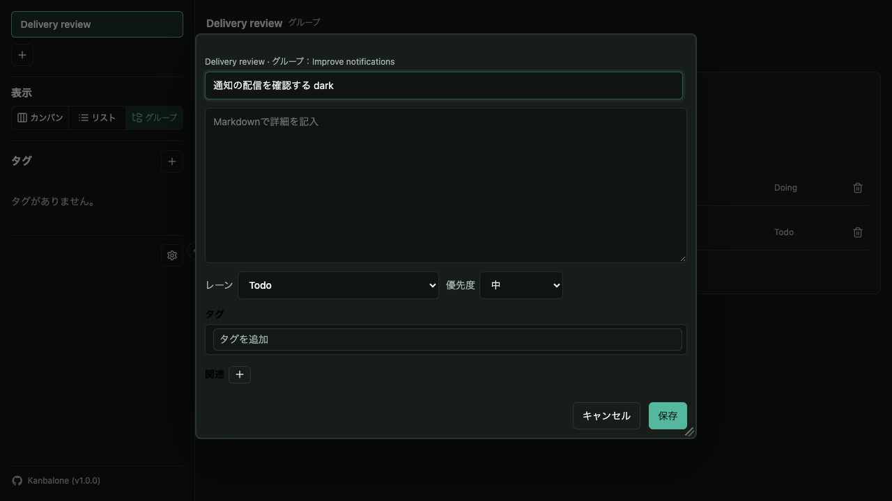
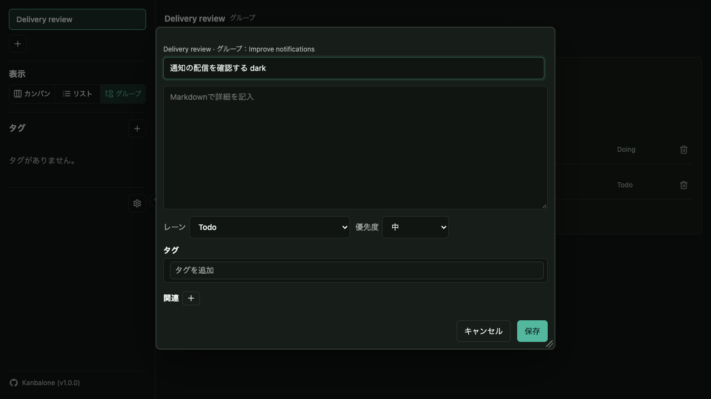
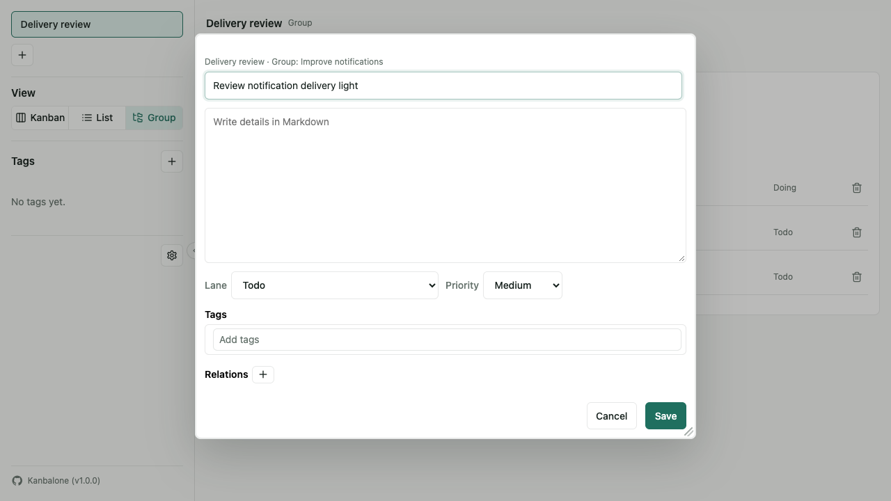
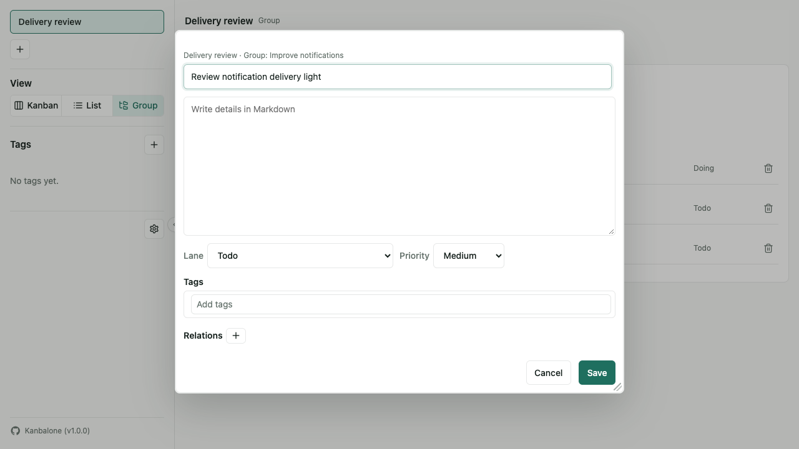
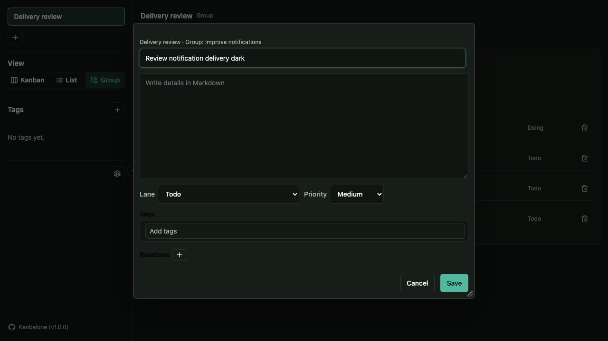
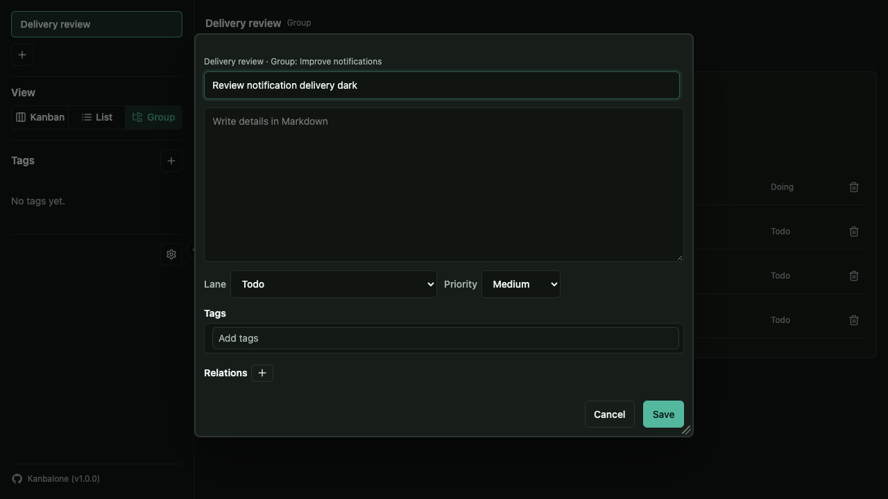

# #1513 — Editor heading contrast

The Tags and Relations headings inherited the browser's black dialog text, making them difficult to read in dark mode. The shared `.editor-field-label` now uses the existing `--text-strong` token. No layout, JavaScript, API, or storage behavior changes.

## Comparable actual screens

Captured with agent-browser in the running application, at 1280 × 720. Each pair uses the same language, explicit light/dark preference, fixture contents, focused title input, and new-ticket dialog opened from Group. Baseline: `09ad816c1fb51c3a0af143ee0cee477e2964eee9`; candidate: that revision plus the single CSS declaration. [revision.json](revision.json) includes runtime and served CSS hashes.

| Language / theme | Before | After |
| --- | --- | --- |
| 日本語 / light |  |  |
| 日本語 / dark |  |  |
| English / light |  |  |
| English / dark |  |  |

## Observed results

- Dark headings: `#000000` → `#eef4f1`, on `#171d19`; measured contrast **1.226:1 → 15.369:1**.
- Light headings: `#000000` → the standard `#15201c`, on white; **21:1 → 16.730:1**.
- Both heading rectangles and the Save button rectangle are identical before/after in all four pairs. [comparison.json](comparison.json) records computed-style contrast and geometry comparisons.
- All eight actual browser sequences passed: focus an existing Group ticket → **N** → title receives focus → type title → **Ctrl+Enter** → return focus to the original ticket → GET saved ticket → reload and find the new ticket. Group and Todo lane assignments are persisted correctly. Raw GET results and observations: [before](before-verification.json), [after](after-verification.json).
- Existing Japanese and English Group keyboard-creation E2E cases: **2 passed**. [Log](e2e.txt).

## Reproduction

Use Node 26.13.1 and the repository dependencies. From the repository root, create `coverage/editor-heading-contrast/before`, then extract `git archive 09ad816 public` into it. Start `node --import tsx docs/development/evidence/2026-11-22-editor-heading-contrast/serve.mjs before` on port 3610. Run `seed.py` once; it seeds an isolated board and uses SQLite backup to create the candidate database. Start the same server script with `after` on port 3611. Run `python3 docs/development/evidence/2026-11-22-editor-heading-contrast/capture.py before`, then `after`. Use clean fixture databases for a rerun. Never point these scripts at user data.

The two databases start with identical data. Each capture subsequently creates four equivalent tickets; timestamps and edit tokens differ between the two independent runs. [fixture.json](fixture.json) records the original seed.

## Scope and limitations

This checks two visible heading colors, not whole-product accessibility. Screenshots establish appearance; persisted API results and reload checks establish saved state. This CSS-only change does not require new implementation-mirroring tests. The shared label class also appears in remote-import forms, which receive the same standard foreground token; those forms were not separately exercised. No claims about OS-specific IME behavior or all viewport sizes are made.

Independent review: [review.md](review.md). Ticket attachment and Acceptance are handled separately after review.
