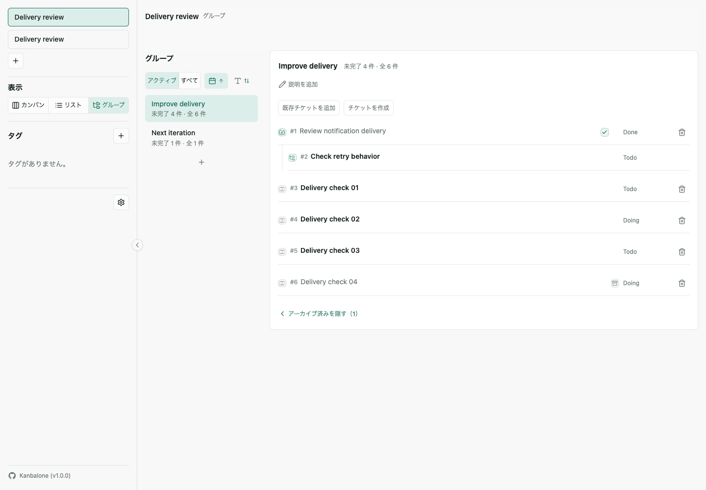
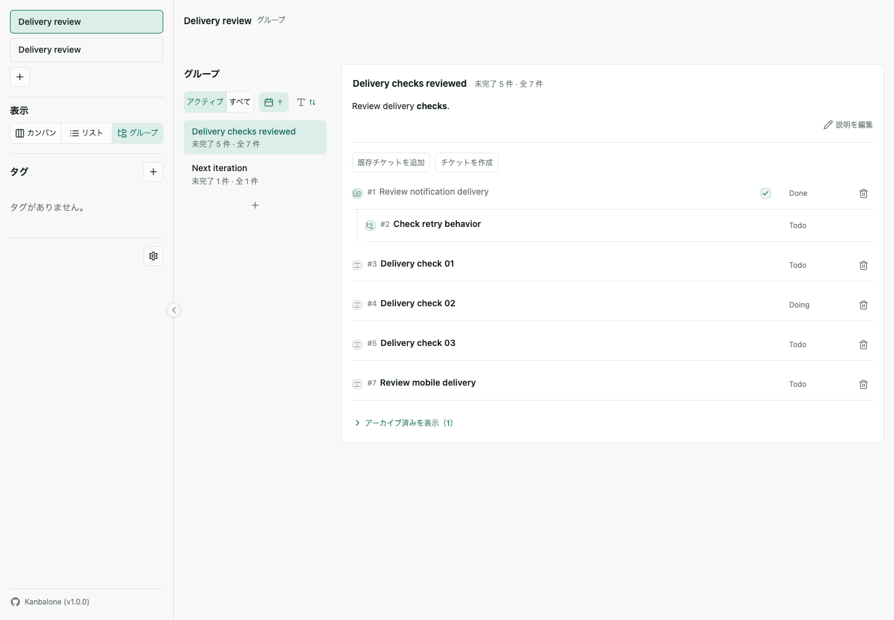
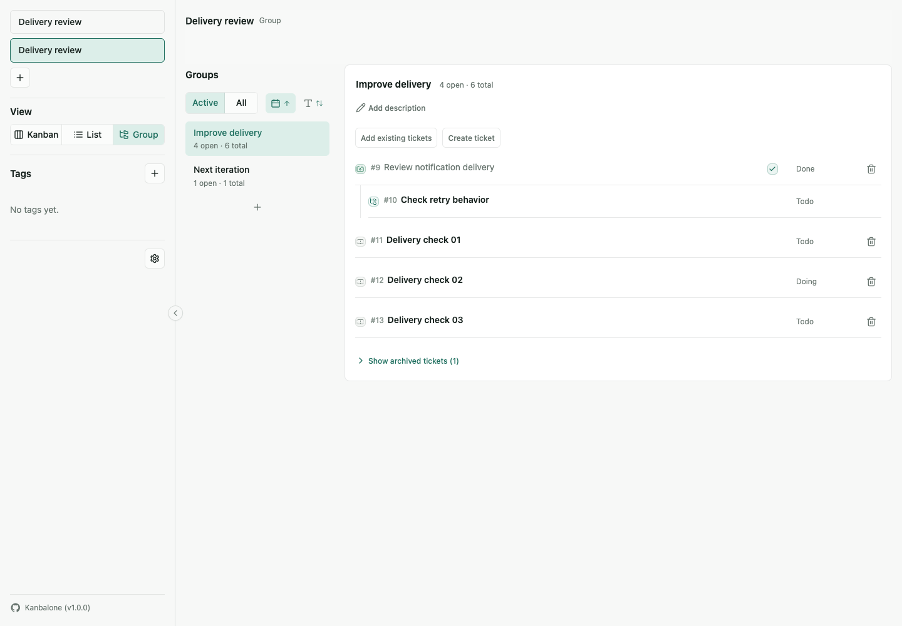
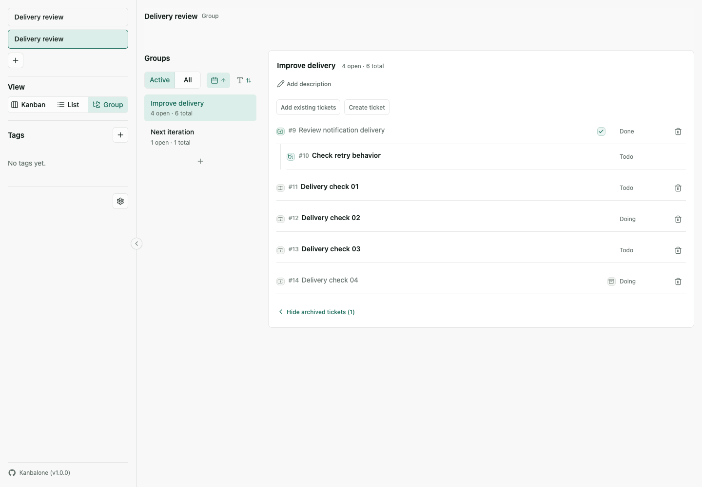
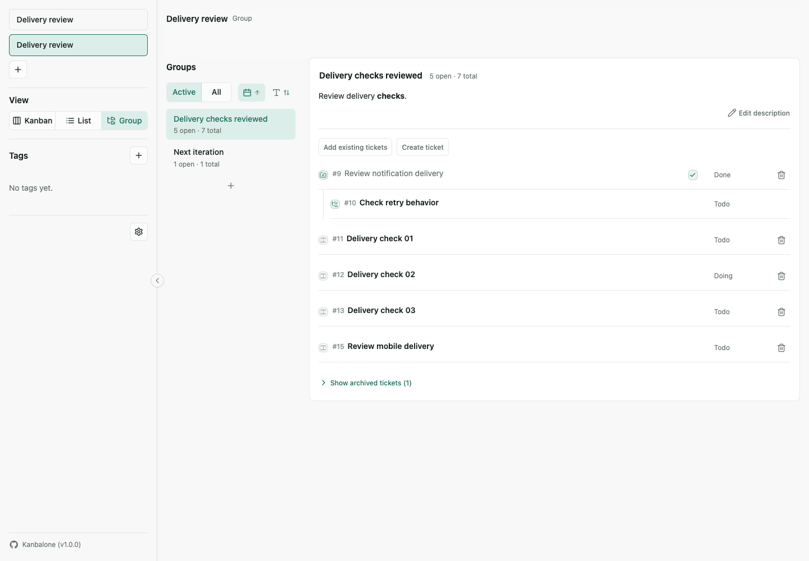

# #1515 — Group initial retrieval

Group now collects its members with the existing `id_asc` cursor order, then applies its established visible priority/parent order. The backend reuses Group metadata only within one summary mapping call. Public default ordering, page size, response fields and the displayed member set remain unchanged.

## Results

[Performance report](performance.md): at 10,000 members, median initial-display observation **3,955.5 → 3,456.0 ms**, and member collection **1,000.1 → 529.0 ms**. At 1,000 members, collection improves but overall initial display is effectively unchanged. The approximately 2.56-second post-response rendering cost at 10k remains; this change does not resolve it. Measurements were isolated from heavy test runs. See raw samples, conditions and limitations in the report.

[Full check](check.txt) passed: 198 tests plus lint, build, public-JavaScript type checking and documentation build. Relevant browser regressions: **50 passed (3.8m)**, one worker; [e2e.txt](e2e.txt). Existing cases cover pagination boundaries, hierarchy, ordering, membership, live refresh, draft/focus recovery and keyboard creation/navigation. New regression tests check request-local Group metadata freshness and identical hierarchy rendering across API orders.

## Actual UI before/after

Small fixtures use the same copied database, 1440×1000 viewport, light theme, language and interaction sequence. Baseline is `09ad816c1fb51c3a0af143ee0cee477e2964eee9`, including its full backend and static source. Candidate is that baseline plus the two runtime changes. [revision.json](revision.json) records exact source hashes. These captures are separate from the large timing fixtures and never modify user data.

| State | Before | After |
| --- | --- | --- |
| 日本語: completed parent, open child |  |  |
| 日本語: archived member shown |  |  |
| 日本語: saved description, added member, renamed Group |  |  |
| English: completed parent, open child |  |  |
| English: archived member shown |  |  |
| English: saved description, added member, renamed Group |  |  |

Four additional actual large-fixture Japanese/English screenshots are linked in the [performance report](performance.md). Screenshots establish appearance, not elapsed time or persistence. [Image parity](image-parity.json) compares the original small-fixture pixels without image editing: all six pairs are pixel-identical. [Interaction comparison](interaction-comparison.json) also confirms matching initial/archive ID order.

## Interaction and persistence evidence

Each of the four before/after × Japanese/English sequences:

1. Open Group with a completed parent and an unfinished child; verify five visible IDs in expected order.
2. Show archived members; verify six IDs, capture, then hide archived again.
3. Edit Markdown description, preview and save; verify stored description by GET.
4. Search an unassigned ticket, select and add it; verify persisted Group ID and reload visibility.
5. Rename Group through API, observe live UI refresh, and fetch fresh ticket summaries; verify every summary has the new Group name.
6. Remove the added ticket through the visible remove button and confirmation; verify null Group ID by GET and absence after reload.
7. Verify original ticket title, lane, parent, completion, archive, priority and membership fields are unchanged.

All four sequences passed. Existing ticket DOM nodes also remain unchanged during description/candidate controls before membership changes. Raw API records and assertions: [before](before-verification.json), [after](after-verification.json). Group rename uses an API write to exercise live invalidation; description and membership changes use actual UI controls.

## Reproduce small-fixture checks

From the repository root with Node 26.13.1 and dependencies installed:

1. Create `coverage/group-initial-load/before`; extract `git archive 09ad816 src public` there.
2. Start `node --import tsx docs/development/evidence/2026-11-22-group-initial-load/interaction-server.mjs before` (3612).
3. Run `python3 docs/development/evidence/2026-11-22-group-initial-load/interaction-seed.py` once. It creates two isolated boards and copies the database using SQLite backup.
4. Start the server script with `after` (3613).
5. Run `interaction-capture.py before`, then `interaction-capture.py after` with Python. Run `image-parity.py` to compare screenshots. Use fresh fixture databases when repeating.

The original database copies are identical. Subsequent independently saved description/membership operations have different timestamps, revisions and edit tokens. Match task content and displayed state, not raw post-write database bytes.

## Limitations and review

These are synthetic local datasets and Chromium observations, not a guarantee for all hardware or user workflows. This ticket changes retrieval, not layout, and retains complete member collection; incremental rendering remains a separate decision. Historical diagnostic probes were not shipped and are clearly separated in the performance report.

Independent review: [review.md](review.md). User acceptance and required CI remain separate merge gates.
