# Group row inline SVG — 2026-11-22 JST

## Change and decision

The Group icon change preserves all Group rows, ordering, variable-height titles and operations while reducing repeated external SVG `<use>` layout work. [PR #40](https://github.com/wamukat/kanbalone/pull/40) Only Group row hierarchy/status/remove icons use six generated inline shapes from `public/icons.svg`. Shared renderers default to their existing external SVG behavior elsewhere. No API, database, pagination, membership or display-limit change; no migration required.

Baseline: `aebd2687631ff831c89b67607893f74ab023e532`. Candidate files are identified in `source-sha256.json` and the containing commit. Synthetic SQLite data only; regular port 3470 and user data were not modified by the evaluation. Node 26.13.1, Playwright Chromium 159.0.8154.6, macOS, local server 3632. Both phases intercept identical module URLs; baseline modules are read from the baseline Git commit, candidate modules from the working tree. All other source and backend are identical.

## Performance

Each size: one excluded warmup pair plus five retained pairs, alternating phase order, fresh browser contexts, 1440×1000, English/light. Routing disables browser HTTP cache in both phases. Server/JIT warmup is not a browser-cache warmup. No concurrent test runs during measurements. `benchmark.json` contains all samples.

Median milliseconds:

| Rows | Measurement | Before | After |
| --- | --- | ---: | ---: |
| 1,000 | navigation → row-count/first-ID match + 2 rAF | 560.5 | 512.7 |
| 1,000 | final ticket responseEnd → same endpoint | 306.8 | 201.1 |
| 1,000 | CDP cumulative LayoutDuration | 154.7 | 98.3 |
| 1,000 | CDP cumulative RecalcStyleDuration | 161.6 | 64.2 |
| 10,000 | navigation → row-count/first-ID match + 2 rAF | 3542.7 | 2497.5 |
| 10,000 | final ticket responseEnd → same endpoint | 2635.8 | 1709.2 |
| 10,000 | CDP cumulative LayoutDuration | 1172.4 | 662.7 |
| 10,000 | CDP cumulative RecalcStyleDuration | 1335.8 | 404.5 |

10k navigation endpoint improved about 30% in this isolated experiment. This endpoint is **not paint completion, interaction-ready time, INP or a human task time**. The post-response interval includes JSON parsing, JS, DOM, style and layout, not pure rendering. CDP durations are cumulative over navigation. Cold contexts only; warm navigation and other browser engines remain unmeasured. API collection cost and large DOM remain.

For every pair, all row IDs/order and each row's x/y/width/height hashes match; scroll heights remain 64,000 / 640,000px; API page counts remain 5 / 50. No page errors. All row `<use>` elements are removed in candidate, while non-row icons retain `<use>`. Scale screenshots are byte-identical before/after at both sizes. Screenshots are taken after fonts and external SVG resource completion, separately from the measured endpoint.

## Visual and interaction verification

`visual.mjs` recreates the same isolated seven-ticket fixture (same IDs) per phase: parent with two children including a completed child, a long wrapping title, archived parent context with active/archived children, and a completed standalone ticket. Languages en/ja; 1440×1000 light and 390×1000 dark.

Sequence in both phases:

1. Open Group; six visible rows. Capture initial, compare all row rectangles.
2. Show archived; seven rows. Capture archived and scrolled bottom, showing all six icon types.
3. Hide archived. Focus child and press Enter, open detail, Escape, verify focus returns.
4. Focus family remove and press Enter. Capture confirmation. Cancel; focus returns, API child membership preserved.
5. Press Enter again, confirm removal; capture removed state. GET parent and child membership is null, child parent link remains unchanged.
6. Reload; three remaining visible rows, removed family remains absent.

All eight language/theme/phase runs passed. `interaction-results.json` records geometry and saved results. Compare geometry's first four fields; the textContent field contains SVG formatting whitespace that changes with inline shapes, while visible labels are unchanged. All row rectangles match.

40 small-fixture images form 20 before/after pairs. Fourteen pairs are byte-identical. Six narrow dark initial/archive/bottom pairs differ only in 15 pixels at the unchanged sidebar toggle border (x16–18, y43–70), maximum channel delta 2; Group content pixels match. See `image-comparison.json`. No pixels were edited. These tiny differences are outside the changed row rendering; their rasterization cause was not established.

`pnpm check`: 200 tests pass, OpenAPI lint/build/public typecheck/docs build pass. Group E2E: 21 pass (groups, groups-visual, group-partial-render, group-membership-focus). Existing failures, cancellation, keyboard Tab navigation, narrow layouts, live updates and focus behavior covered by those tests. Additional actual UI inspection via agent-browser confirmed 1,000 rows, 2,672 row SVGs and zero row `<use>` nodes. No real-person usability study or browser-find keyboard sequence was performed.

## Reproduction

Use a checkout of the commit containing this change, with Node 26 and installed dependencies. Run the commands from its repository root:

```sh
node scripts/generate-group-icons.mjs --check
mkdir -p coverage/group-next
gzip -dc docs/development/evidence/2026-11-22-group-inline-icons/fixture.sqlite.gz > coverage/group-next/benchmark.sqlite
node --import tsx docs/development/evidence/2026-11-22-group-inline-icons/server.mjs
# In another shell; run measurements without parallel tests:
node docs/development/evidence/2026-11-22-group-inline-icons/benchmark.mjs
node --import tsx docs/development/evidence/2026-11-22-group-inline-icons/visual.mjs
pnpm check
pnpm exec playwright test test/e2e/groups.spec.ts test/e2e/groups-visual.spec.ts test/e2e/group-membership-focus.spec.ts test/e2e/group-partial-render.spec.ts --workers=2
```

Use a disposable checkout/output directory. Do not overwrite a running evaluation database. Benchmark script output is `coverage/group-next/product`; visual output is `coverage/group-next/visual`. The SQLite archive is a consistent backup of synthetic evaluation data, not user data.

## Image pairs

### en-dark-390-archived

Before:


After:


### en-dark-390-bottom

Before:


After:


### en-dark-390-confirm

Before:

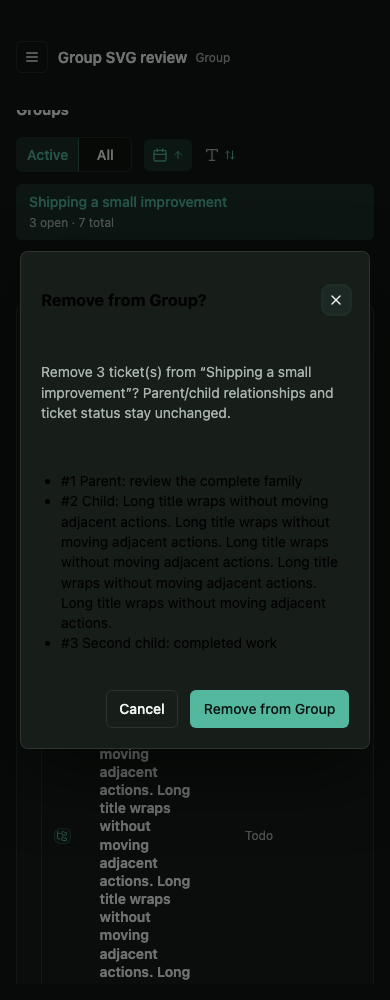

After:


### en-dark-390-initial

Before:


After:

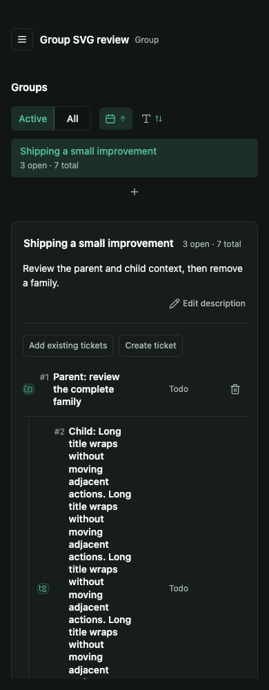

### en-dark-390-removed

Before:

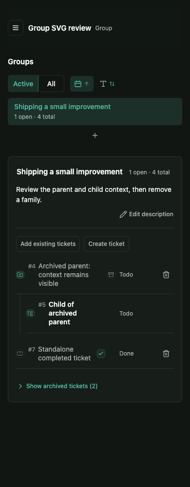

After:


### en-light-1440-archived

Before:


After:


### en-light-1440-bottom

Before:

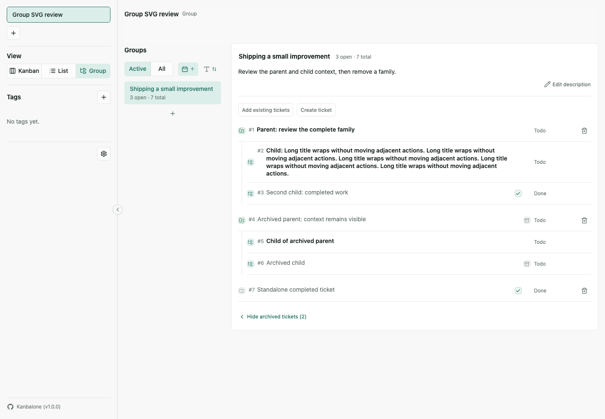

After:


### en-light-1440-confirm

Before:

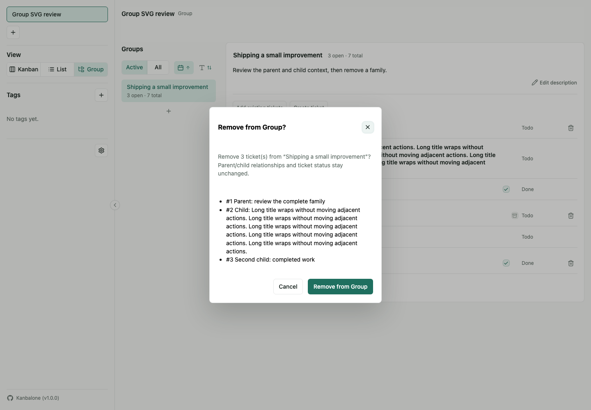

After:


### en-light-1440-initial

Before:


After:

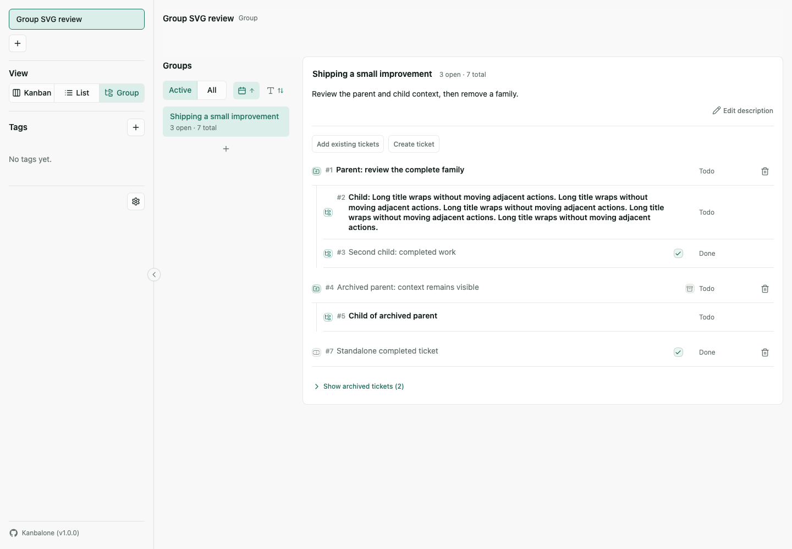

### en-light-1440-removed

Before:


After:

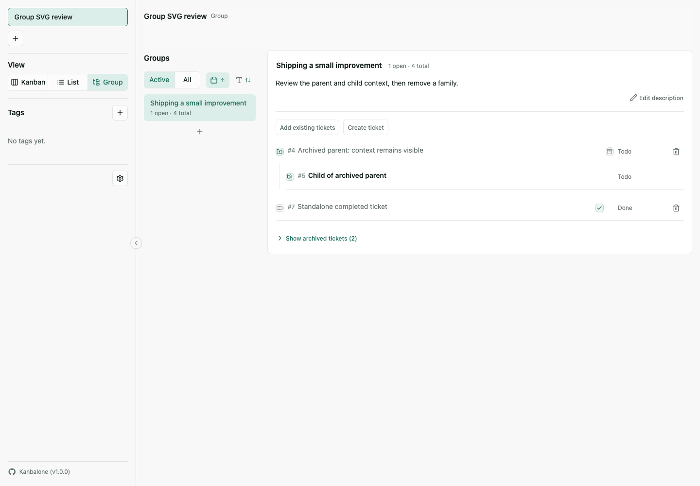

### ja-dark-390-archived

Before:


After:


### ja-dark-390-bottom

Before:


After:

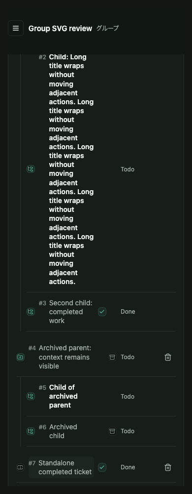

### ja-dark-390-confirm

Before:


After:

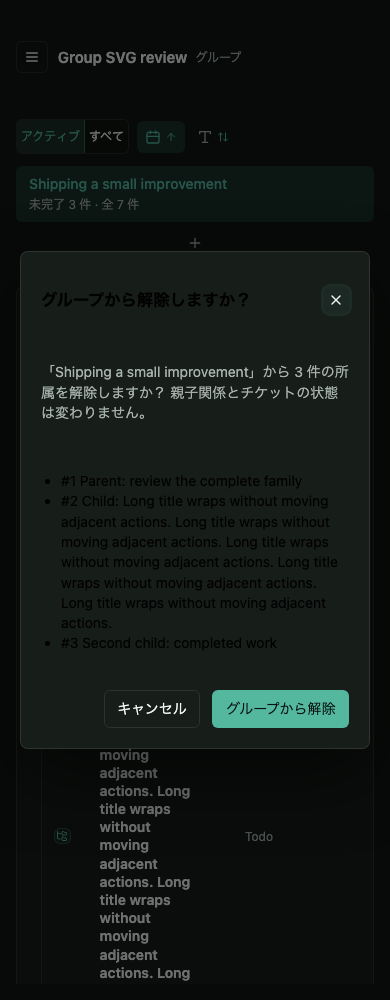

### ja-dark-390-initial

Before:

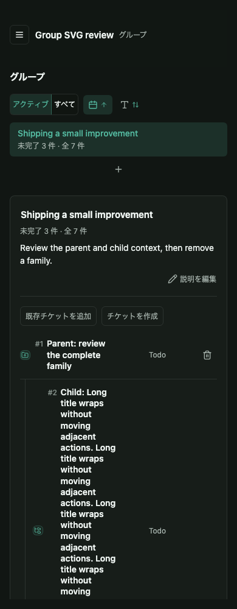

After:


### ja-dark-390-removed

Before:

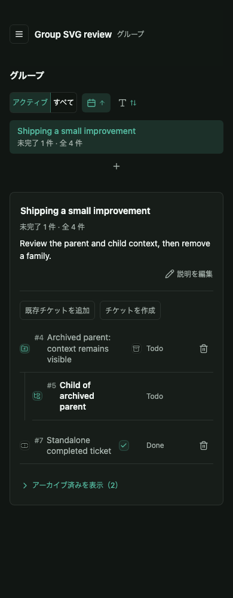

After:


### ja-light-1440-archived

Before:

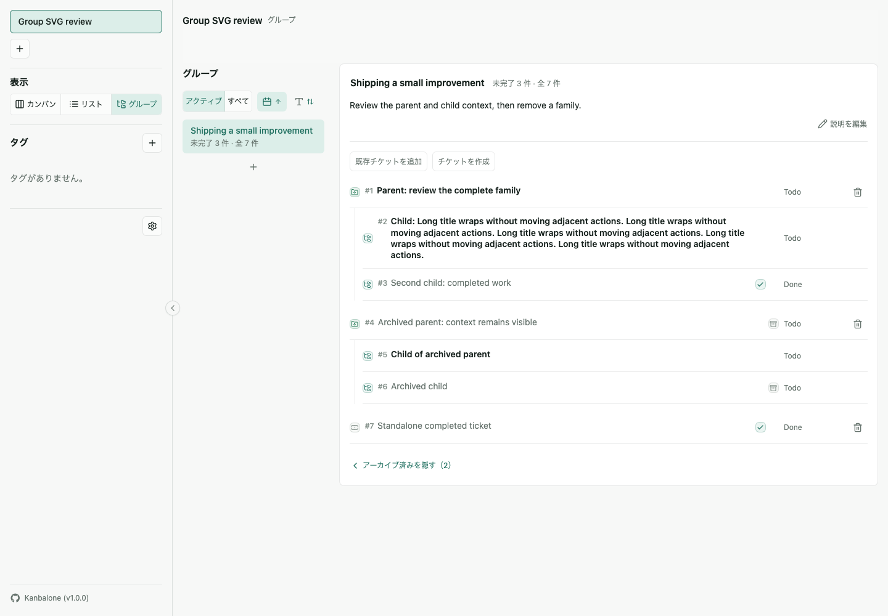

After:


### ja-light-1440-bottom

Before:


After:


### ja-light-1440-confirm

Before:


After:

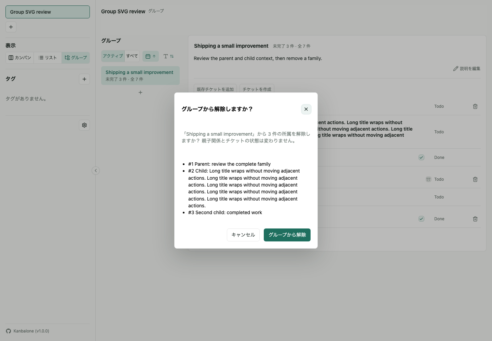

### ja-light-1440-initial

Before:

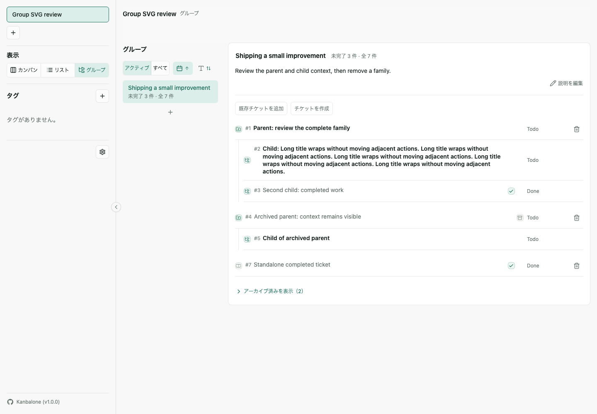

After:


### ja-light-1440-removed

Before:

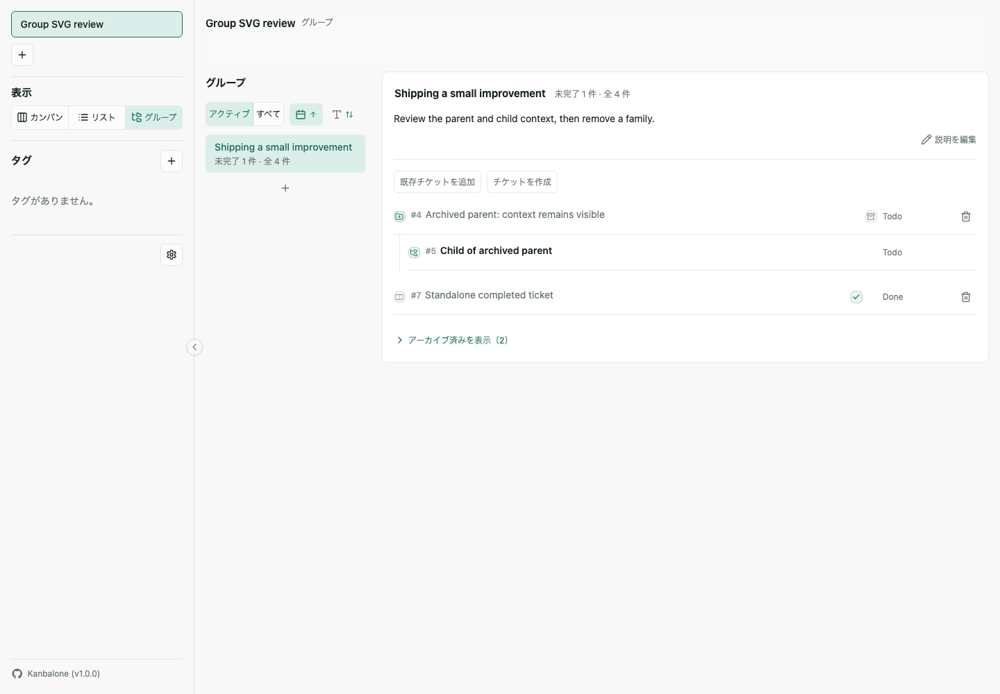

After:


### 1000 rows

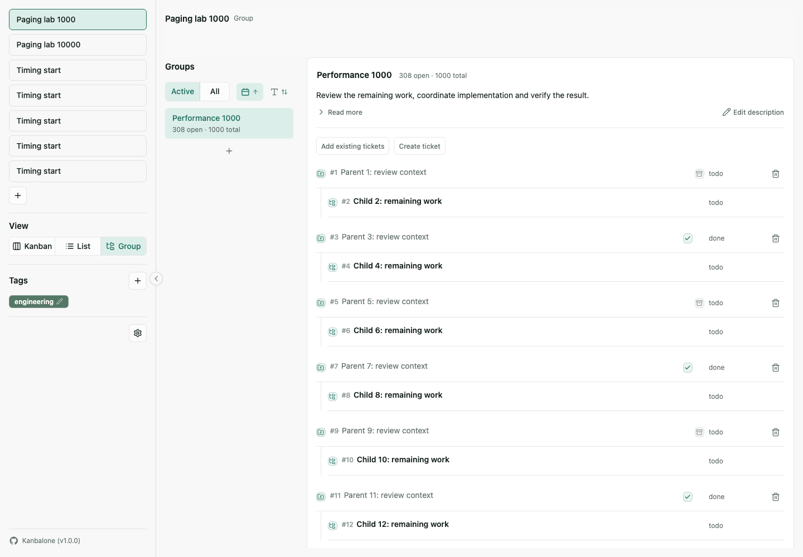


### 10000 rows


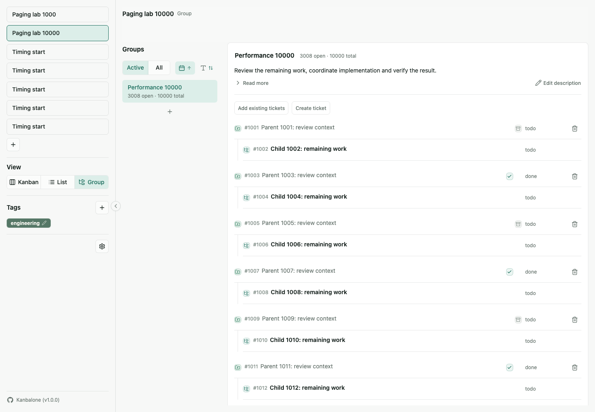

