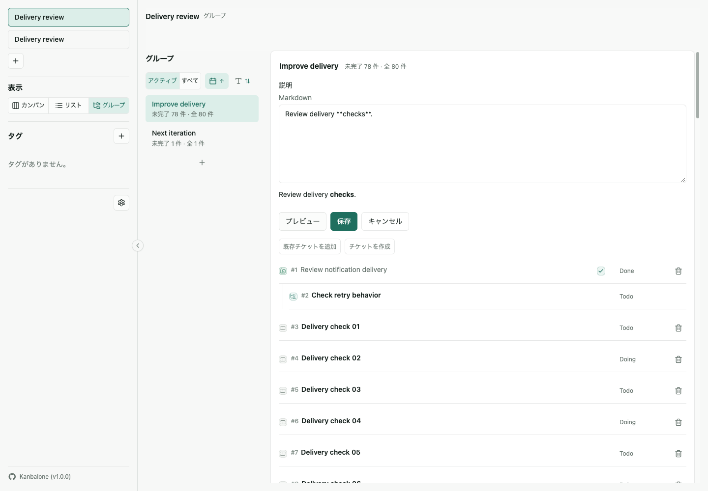
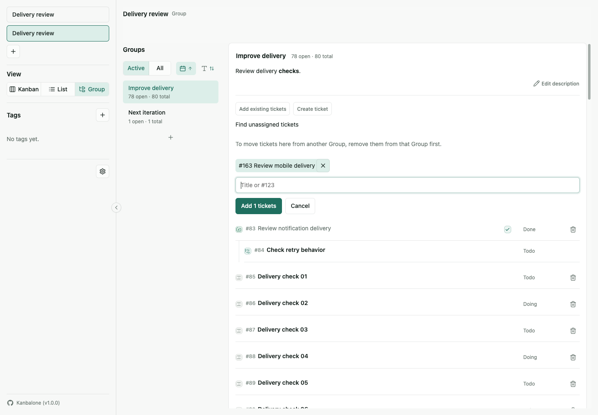

# #1514: retain unchanged Group tickets while operating controls

Group description, search and selection controls previously rebuilt the entire ticket area. This change updates the Group list, controls, tickets and footer independently. Unchanged ticket rows remain in the document; changed titles, hierarchy, status, ordering, lane names, membership, archive visibility and locale still refresh the relevant rows. No visible row limit or new user operation is introduced.

## Actual before/after evidence

- Baseline: `2c44327c1b05753b165181ee663af9fb5253e40f`, integrating the reviewed hierarchy-index and creation-keyboard changes. Baseline static files were extracted before implementation into `coverage/group-partial-render/before/public`.
- Reproduce from published `main` commit `1f63826ad713de97870bb91d914d249ada8508ac`: its complete Git tree exactly equals the capture baseline (`9fd16bba08c98cb5e82d80b788fdc08f551cdc7f`). The local integration commit is retained as capture provenance, not required for public reproduction.
- Candidate source/served-asset hashes: `revision.json`.
- Native Node 26.13.1, Chromium via agent-browser; 1440×1000, light theme, Japanese and English. The additional pairs cover 1440×1000 dark mode and 390×844 light mode.
- Ports 3603/3604, isolated SQLite fixtures only. `seed.py` creates two language fixtures with 80 Group tickets, including a completed parent/open child and an archived ticket, plus an unassigned candidate and another Group. SQLite's backup API copies the baseline database before any scenario writes, so both sides start from the same data. Subsequent save timestamps can differ.
- `serve.mjs`, `seed.py` and `capture.py` reproduce the scenarios. Run from repository root with the baseline public tree prepared; the server uses Node `--import tsx`. Existing production data is never used or changed.

For each language, the unaltered image pairs show the same initial Group, description preview, candidate search and selected candidate. The scripts then save the description, add the existing candidate and reload. Supplementary dark/mobile pairs show the final saved state, with the same ticket and Group contents on both sides.

`before-verification.json` and `after-verification.json` record browser node identity and stored results. On the baseline, all five control steps replace the original row nodes. On the candidate, all five retain them in both languages: description edit, preview, save, candidate search and pick. Each sequence separately verifies the saved Markdown description and the candidate's Group membership through the API and after browser reload. Existing tickets' titles, lanes, hierarchy, status, priority and membership remain unchanged. Screenshots demonstrate layout; node references establish retention, and API/reload checks establish persistence.

## Regression coverage

`test/e2e/group-partial-render.spec.ts` exercises:

- Row retention through description editing/preview/save, Group sorting, candidate search/pick/unpick/cancel, plus live Group rename with retained draft caret.
- Invalidation for title, priority order, completion/lane, lane rename, new children, parent changes, archive state and membership removal; parent-only action counts remain correct.
- Busy-state updates on retained removal buttons during a delayed save, followed by re-enabling the controls.
- Synthetic HTTP 503 failures in description and Group creation forms, retaining drafts and re-enabling Save/Create for successful retry.
- Scrolled ticket focus through an unrelated update, correct Group switching, and the existing N → creation → Escape → original ticket flow.

Review found a recovery bug in the first draft: cached section HTML did not reflect the directly disabled submit button, so a failed save could leave the retry button disabled. The form section is now invalidated when the submit button is disabled. Regression cases cover both header and Group-list forms.

`pnpm check` passed 196 unit/API tests, OpenAPI lint, backend/public type checks and documentation generation (`check.txt`). The final affected E2E suite passed all 49 tests in 2.7 minutes (`e2e.txt`), including the five new cases and existing Group, keyboard, creation, editor, draft and in-flight-save coverage. Independent review is in `review.md`.

## Performance and scope

The separate [1,000/10,000-ticket benchmark](performance.md) records actual control interaction measurements and their limits. Its larger fixtures are distinct from the 80-ticket screenshot fixtures. This patch improves repeated control operations; it does not eliminate initial loading, full API collection or large ticket DOM creation.

A previous [CSS-only experiment](../2026-11-22-group-render-prototype/README.md) was rejected because it changed scroll geometry. That experiment used an earlier baseline and is rationale for the choice of approach, not this change's before/after evidence or performance gain.

The screenshots are original browser captures. `image-parity.py` compares decoded pixels without altering the images. Images and source hashes are listed in `SHA256SUMS`. Before moving the ticket to Acceptance, embed the published before/after images in Kanbalone and verify that they load. Real user usability, OS IME and assistive-technology evaluation are not established by these browser checks. No API contract, storage format, migration or production runtime change is included.

The ten image pairs have the same dimensions. Four pairs are pixel-identical (both initial views, dark mode and mobile); the remaining six differ by 1–21 pixels in the controls/search-caret area, outside the ticket rows. See `image-parity.json` for exact counts and bounds. These images support unchanged layout; they do not by themselves establish rendering speed.
