# #1506 / #1507 — 検索結果のキーボード選択

2026-11-22（Asia/Tokyo）。List #1506、Kanban #1507。ユーザー承認済みモックを実装し、人の受入待ち。

## 環境と再現

- Before: v1.0.0 / `0bf19d1b21536457e503068c7b6d2340e93b30e3`、localhost:3580。
- After: `codex/keyboard-ticket-navigation` 未コミット変更、localhost:3581。対象ファイルのSHA256は `revision.json`。検索失敗通知・非同期終了の競合修正後に通常操作を再撮影。
- Node 26.13.1、Chromium / agent-browser。日英とも1440×1000、ライト。追加の狭幅ダークは980×850、日本語。
- 専用SQLiteとボード `Keyboard navigation QA`。既存ユーザーデータは複製も変更もせず、`seed.py`で両環境に同一の30チケットを作成。Acceptanceには検索語に一致しない2件、doneには8件（初期表示5件）。
- 再現: 空の専用DBでサーバーを3580/3581に起動し、`python3 seed.py http://localhost:3580 http://localhost:3581`。`python3 capture.py before` / `after`で実画面を撮影。既存DBへseedを再実行しない。

## 操作と結果

検索欄に `Notification` を入力して、結果が表示されてから以下を実行。入力中は検索欄にフォーカスを維持する。

| チケット | 操作 | Before | After |
| --- | --- | --- | --- |
| #1506 List | ↓×18 → Enter → Esc | ↓で行を選択できず、Enterでも詳細は開かない | #18の詳細を開き、検索語・フォーカス・縦位置380pxを保持して同じ行へ復帰 |
| #1507 Kanban | ↓×8 → →×2 → Enter → Esc | カード選択やレーン間移動ができず、詳細は開かない | todo→doing→空のAcceptanceを飛ばしてdoneへ。#26を開閉し、同じカードと横位置124pxへ復帰 |

BeforeのEscは検索欄に対するブラウザ標準操作で、検索文字を消す。Beforeの`*-detail.png`は「Enterを押しても開かなかった状態」であり、詳細画面の画像ではない。

`before-trace.json` / `after-trace.json`には操作列、実DOMのフォーカス、検索語、全スクロール要素、詳細のopen状態を記録。Afterの4ケースすべてで選択時と復帰時の値が完全一致し、`*-selected.png`と`*-return.png`もバイト単位で一致した。APIのチケット取得結果は各環境で操作前後に不変（`dataUnchanged: true`）。`*-tickets.json`は撮影後の全チケット。スクリーンショット単体を状態保持の証明とはしていない。

検索は既存のフィルタを利用し、新しい検索ダイアログは追加しない。フォーカスは既存のタイトルボタンへ置き、一括選択チェックボックスとは区別。完了レーンの追加表示は明示操作のみ。関係チケットを詳細内で開いても、一覧に戻る位置は元のチケット。元が表示されなくなった場合は検索欄へ戻る。

## 画像

### #1506 List

| | 修正前：↓操作後 | 修正後：選択 | 修正後：詳細 | 修正後：復帰 |
| --- | --- | --- | --- | --- |
| 日本語 | 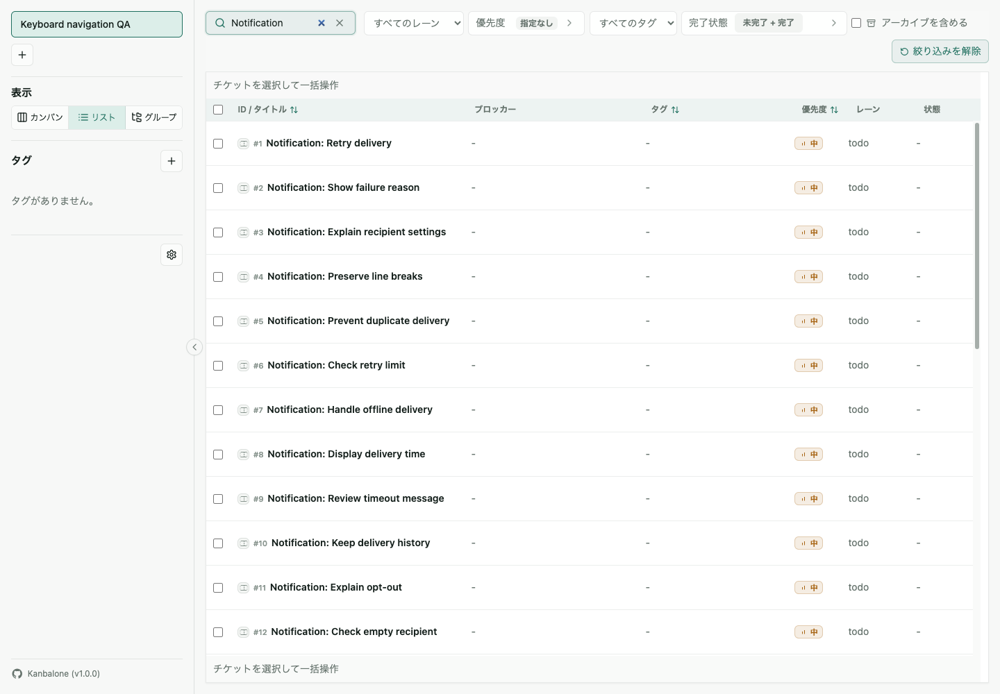 | 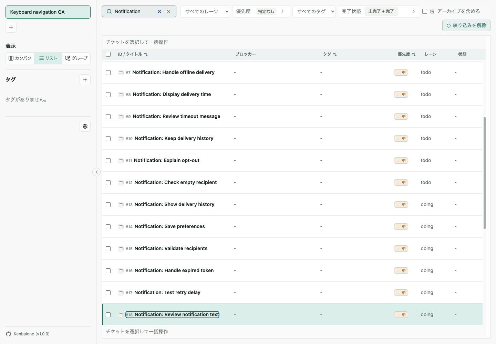 | 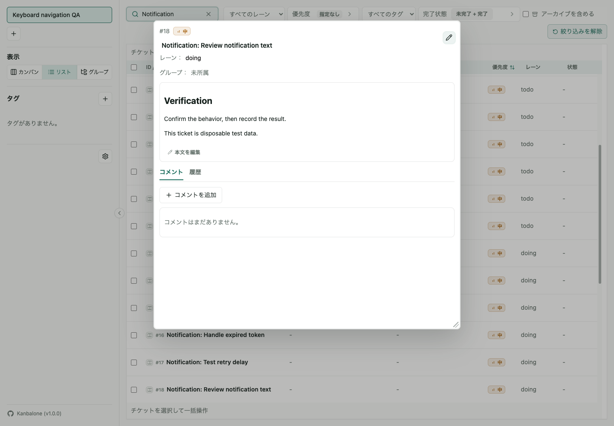 |  |
| English | 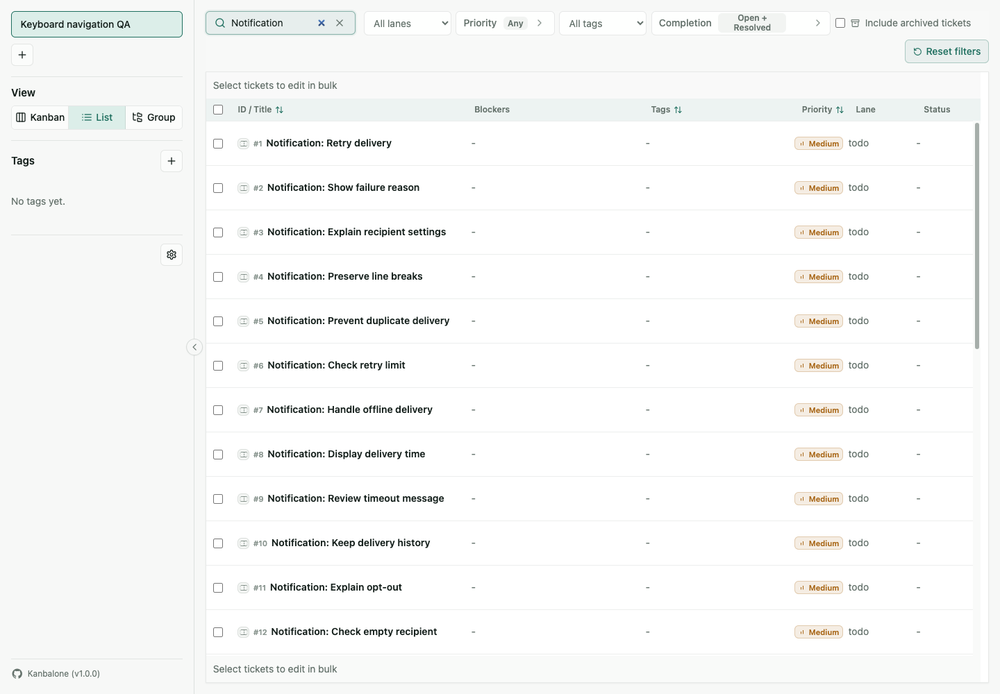 |  | 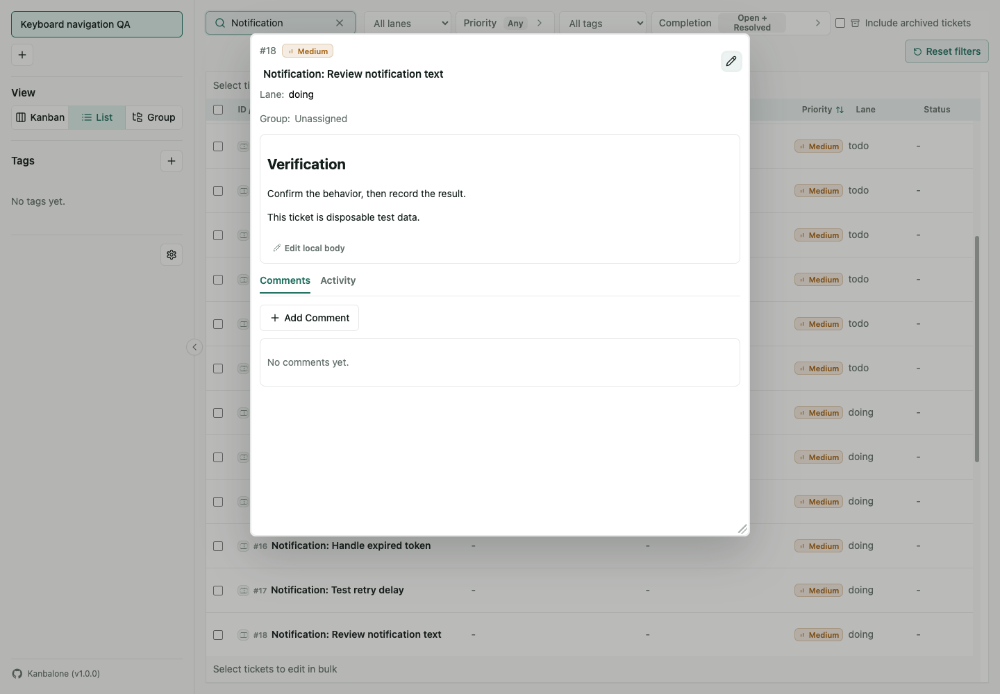 | 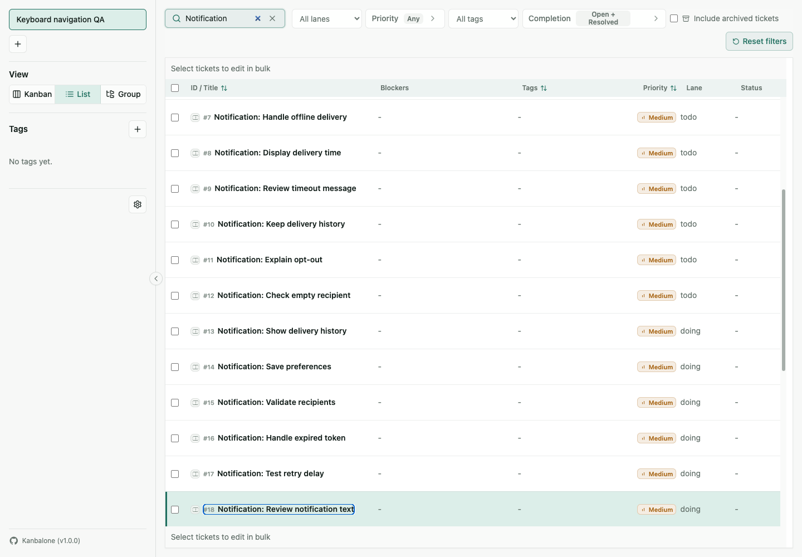 |

### #1507 Kanban

| | 修正前：矢印操作後 | 修正後：選択 | 修正後：詳細 | 修正後：復帰 |
| --- | --- | --- | --- | --- |
| 日本語 | 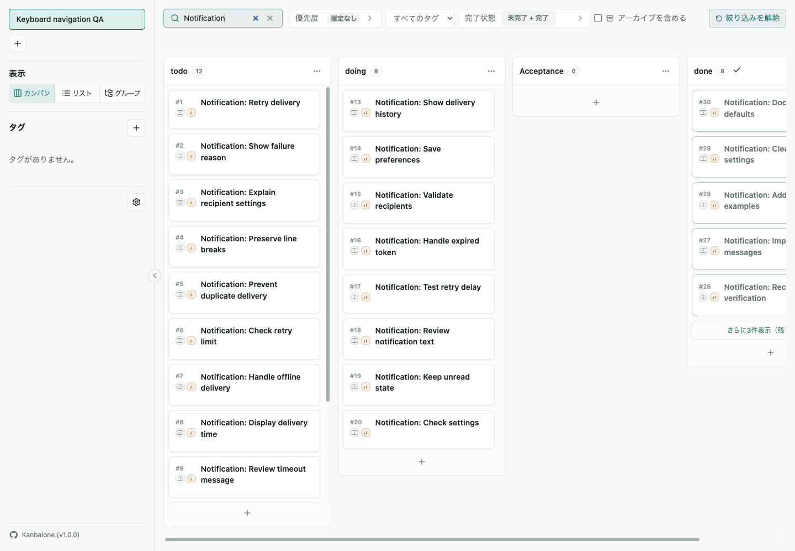 | 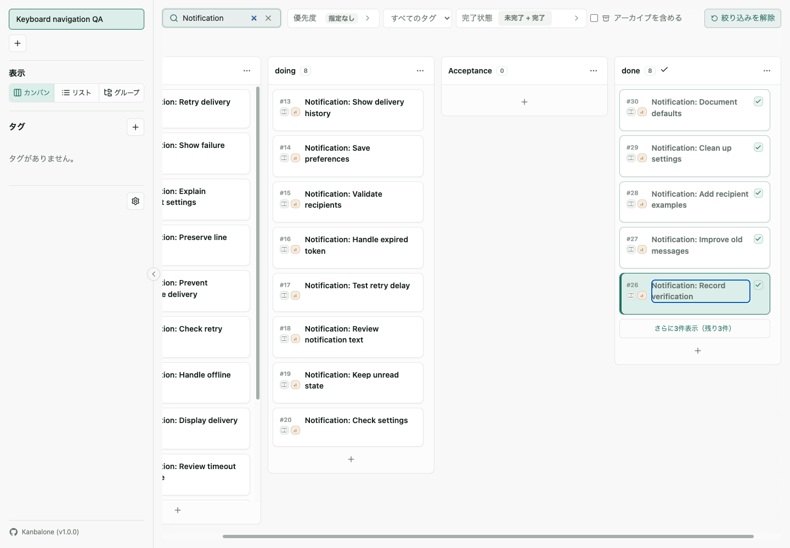 | 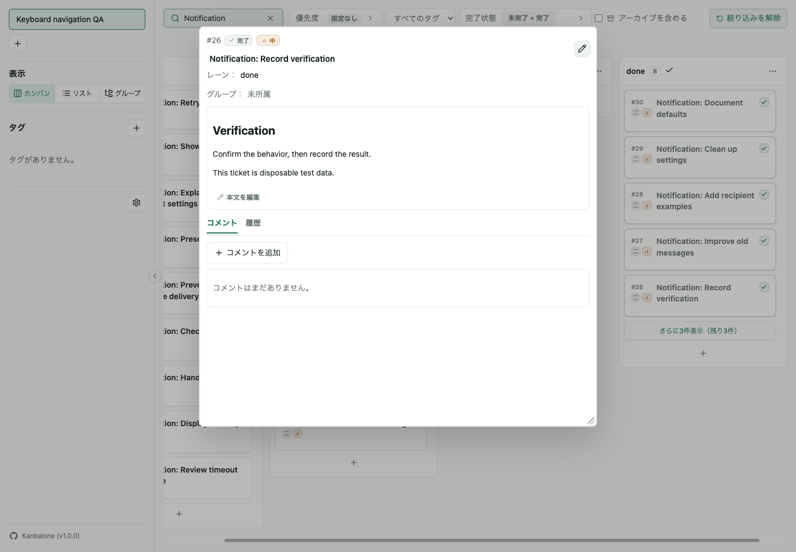 |  |
| English | 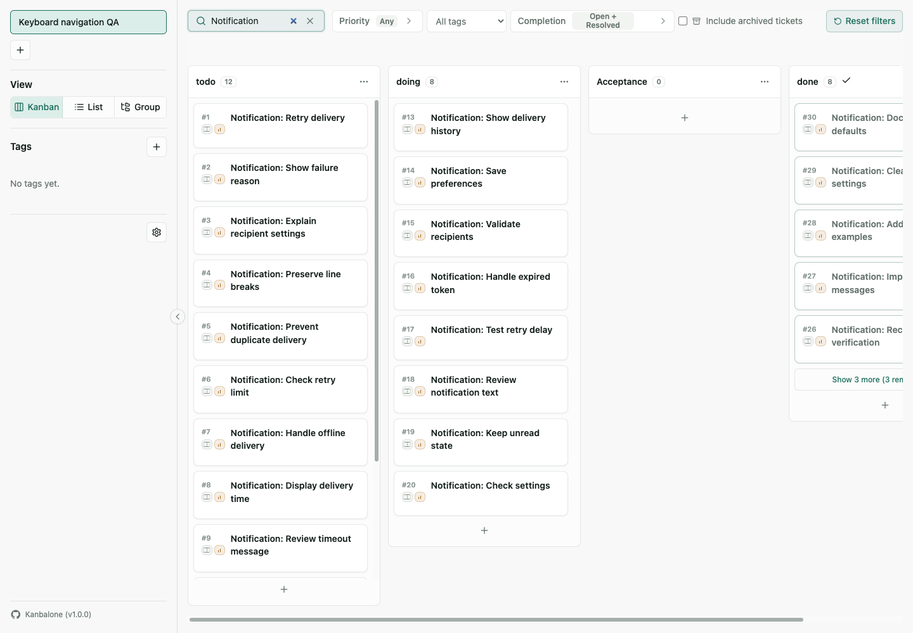 |  | 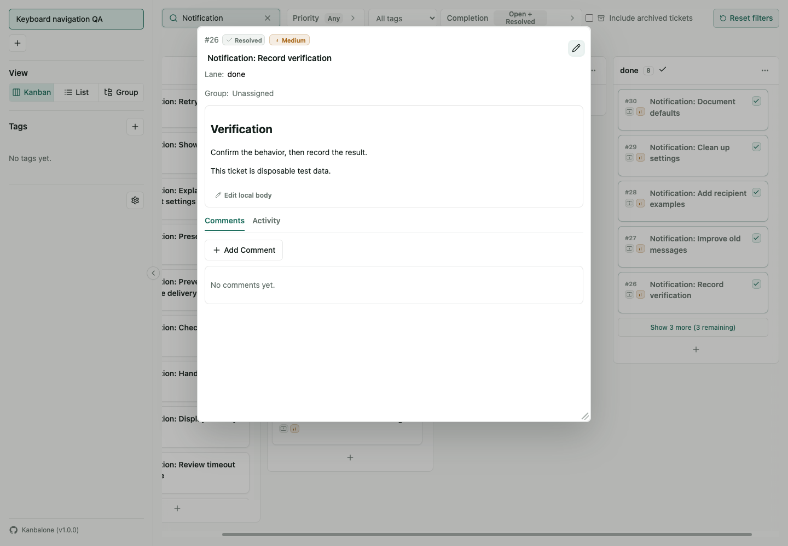 | 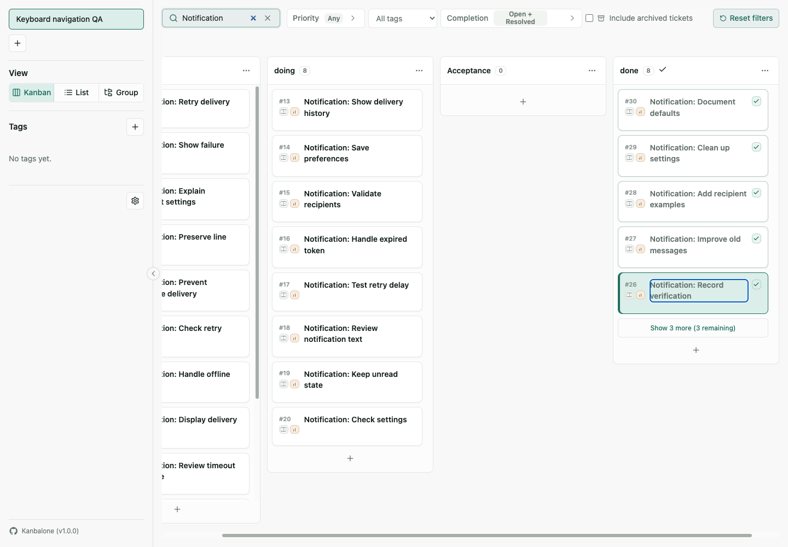 |

追加目視: [List ダーク980](after-list-ja-dark-980.png)、[Kanban ダーク980](after-kanban-ja-dark-980.png)。元画像は加工していない。

## 検証とレビュー

- Node26で `pnpm check`: lint / 単体176件 / build / 既存public型検査 / 日英docs build成功。
- 新規E2E9件成功。通知assert追加後の失敗ケース1件と、最後の詳細復帰修正後の関連6件も再実行成功（`new-tests.log` / `failure-toast.log` / `close-final.log`）。日英、Listの仮想スクロール、Kanbanの空レーン・高さ・完了5件、未保存編集のキャンセル、背景更新・対象消失、IMEイベント・修飾キー・一括選択、遅延／失敗検索、データ非変更を検証。
- 既存関連E2E40件: 初回37件成功、3件は並列実行同士のPlaywright出力ディレクトリ競合によるtrace ENOENT（アプリのassert失敗ではない）。その3件を専用出力先で再実行し全件成功。以後は実行ごとに出力先を分離。
- 独立サブエージェント `keyboard_review` がコード・実画像・操作ログをレビュー。検索失敗時に古い結果を選ぶ問題を修正し、HTTP500注入で再検証。詳細終了と更新待ち・別詳細表示の競合も独立したデータで再検証。残る対応必須指摘なし。
- 既存検索失敗時の通知欠落に、既存toastを利用した日英通知を追加。古いリクエストの失敗は新しい結果に重ねて通知しない。

制限: 実OSの日本語IME、スクリーンリーダー、Firefox/Safari、人による速度・発見性評価は未実施。IME回帰は合成イベント。新コントローラーは既存boardモジュールと同じく厳密なpublic型検査対象外で、構文・E2E・コードレビューで検証。DB/API仕様の変更なし、データ移行不要。

画像は各チケットのコメントにも埋め込み、取得時は `http://127.0.0.1:3582/2026-11-22-keyboard-navigation/` で配信。ローカル配信を止めるとチケット内画像は表示されない。原本はこのディレクトリに保持。コミット・push後の共有時は固定SHAのURLへの切り替えが必要。
