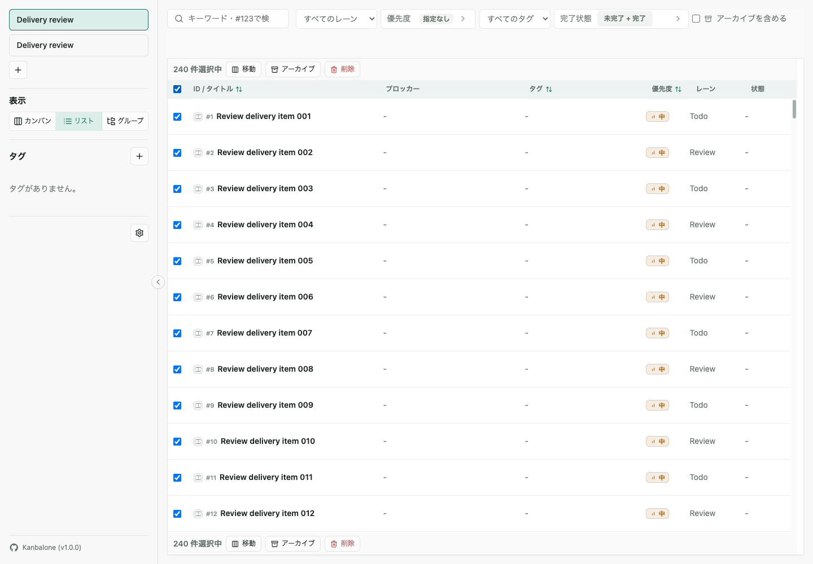
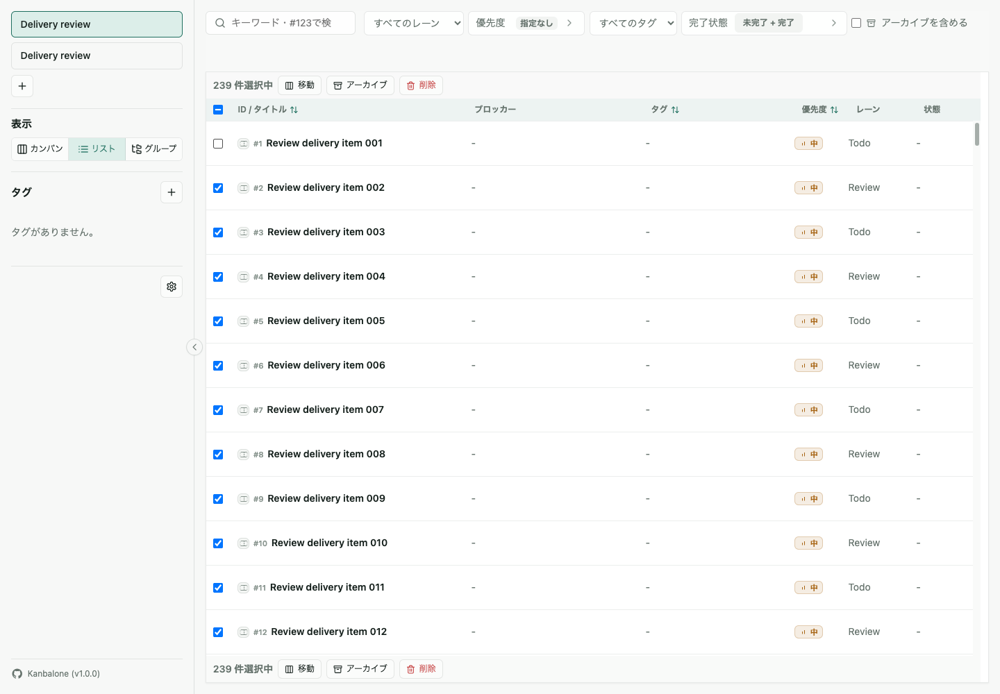
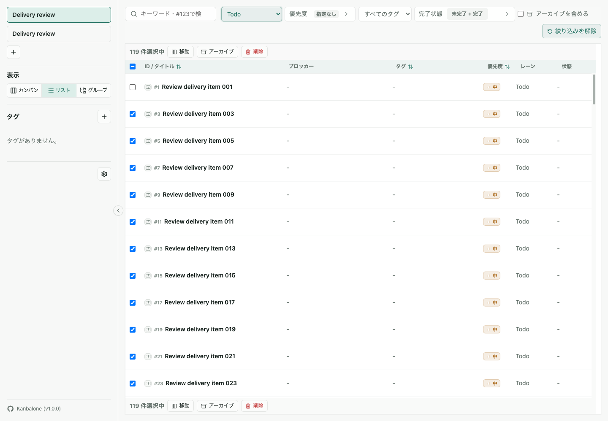
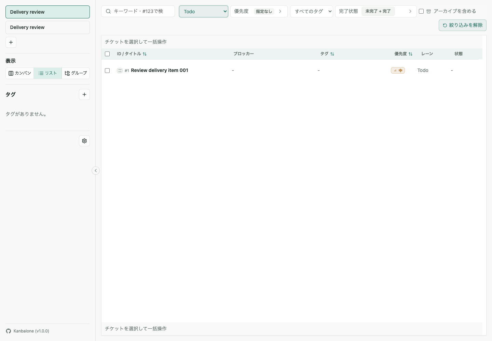
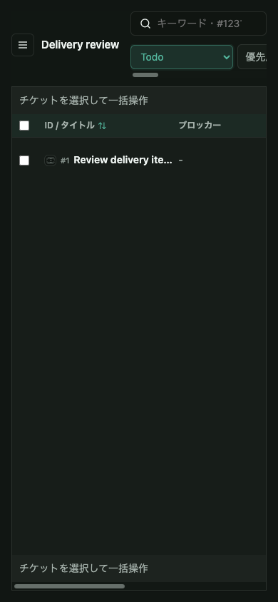
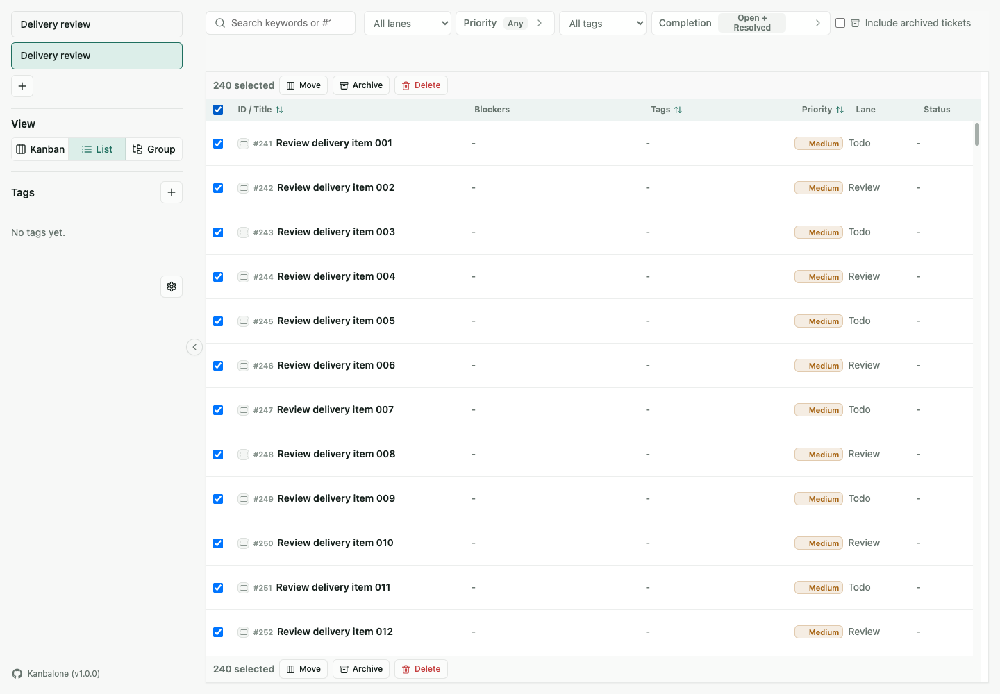
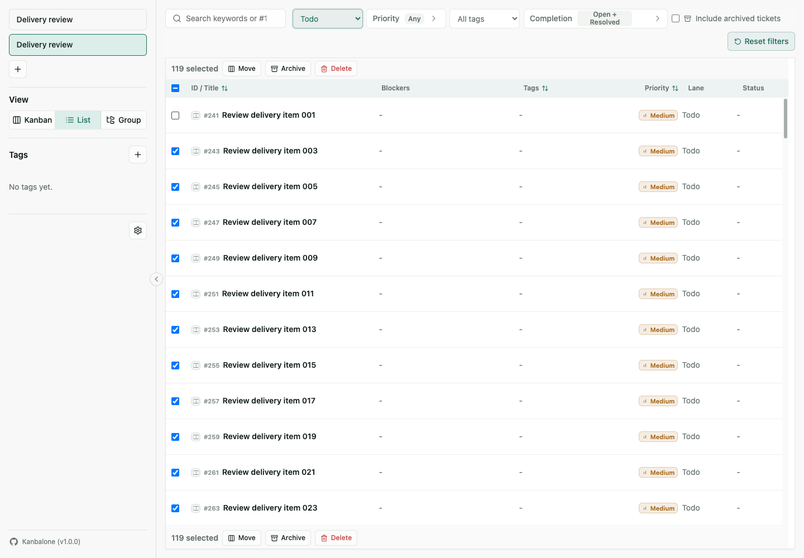
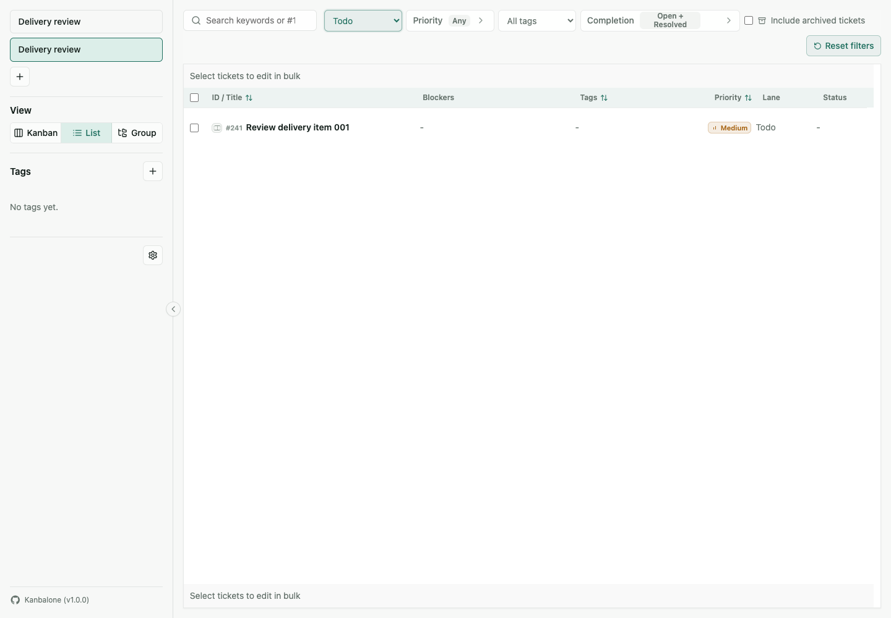
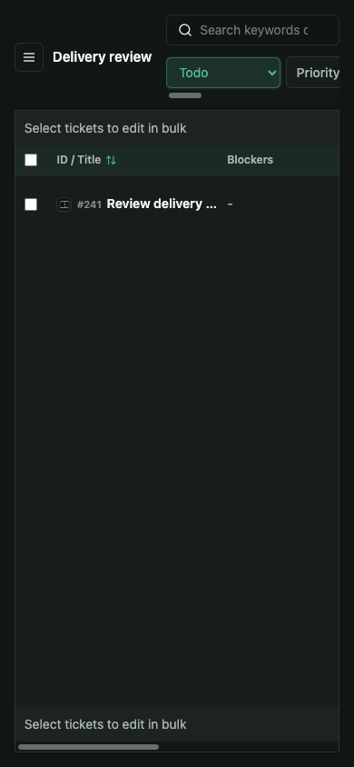

# Keep large List selections responsive

[Implementation PR](https://github.com/wamukat/kanbalone/pull/39)

Selecting all tickets previously compared the selected IDs with the entire ticket collection repeatedly. The change builds temporary Sets for membership checks during rendering, bulk-move setup and parent/child selection. Selection IDs remain an ordered array. The UI, selection scope, API, storage and row order are unchanged.

On the isolated **10,005-ticket** fixture, select-all improved from **907.0 to 105.6 ms**, and deselecting one ticket from **556.3 to 44.6 ms**. These are change-event-to-two-animation-frame medians of five alternating local runs per variant, not human task times or INP. Clear-all did not improve. See [measurement method, results and reproduction](performance.md).

## Actual before / after

Baseline: merged main `963b37bcdd5e773ef01889bbcea9dbd33a21d1bd`. Candidate: the three List modules recorded in the revision files. Separate synthetic databases, matching data and UI state, Japanese and English. Desktop is 1440×1000/light; the narrow comparison uses the viewport and dark theme recorded in [verification](verification.md). Original screenshots are unaltered.

| State | Before | After |
| --- | --- | --- |
| 日本語: All selected |  |  |
| 日本語: One deselected |  |  |
| 日本語: Lane filter |  |  |
| 日本語: Archived and reloaded |  |  |
| 日本語: Narrow / dark |  |  |
| English: All selected |  |  |
| English: One deselected |  |  |
| English: Lane filter |  |  |
| English: Archived and reloaded |  |  |
| English: Narrow / dark |  |  |

Images establish the retained appearance, not speed or persistence. [Interaction and regression verification](verification.md) records selection counts, filter changes, the bulk-write payload, API reads and reload results. [Independent review](review.md) covers source, measurements and actual images separately from user acceptance.

## Remaining performance work

This change does not reduce initial List/Group data collection or Group DOM/layout work. Group already has hierarchy indexing, partial control rendering and optimized retrieval. A previous Group initial-load experiment on older source measured substantial remaining large-Group rendering time; those historical numbers apply to the older baseline. [PR #36](https://github.com/wamukat/kanbalone/pull/36)

Group virtualization or progressive display needs an explicit design decision about variable-height titles, parent/child boundaries, stable scroll position, keyboard navigation and browser text search. The earlier estimated-height content-visibility prototype was rejected for scroll shifts. The first relation search also still collects all candidate pages after deferring candidate collection until search. Server-side candidate search needs matching/sorting compatibility work. These were outside the scope of this selection change. [PR #38](https://github.com/wamukat/kanbalone/pull/38)
