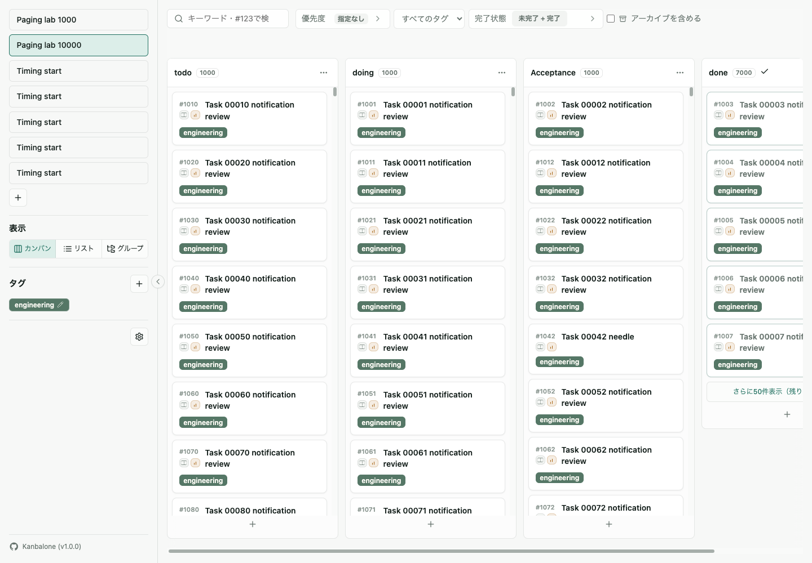
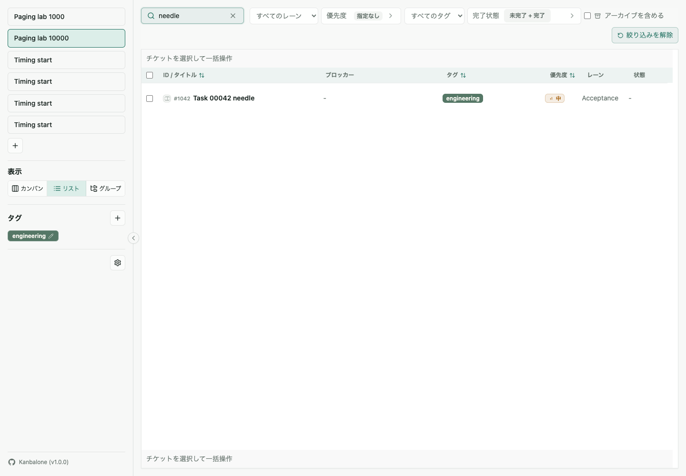

# ページング導入のための性能計測とAPI案

2026-11-22。#1508 の計測結果と計測時点の #1509 の検討案。この計測時点では製品コードを変更していない。合意済み仕様は [ページング仕様](../../../ja/developer/pagination-spec.md)、実装後の検証は [#1510エビデンス](../2026-11-22-pagination/README.md) を参照。以下の「API案」は履歴として残す。

## 結論

一覧のページングは改善候補として妥当。まず完了レーンの「5件＋50件追加」を実際の段階取得にする。10,000件の全件応答は5.23 MBで、完了7,000件が約70%を占める。1件詳細は件数増加による大きな悪化がない。一方、検索は結果が1件でも遅くなるため、ページングだけでは検索の走査コストを解決できない。

## 計測条件

- 現行 v1.0.0 / commit `0bf19d1b21536457e503068c7b6d2340e93b30e3`。Node v26.13.1、macOS、Intel i7-9750H、16 GB RAM。
- ポート3583の専用SQLite。既存ユーザデータとは分離。1,000件と10,000件の別ボード。未完了30%、完了70%、アーカイブなし。本文500文字、タグ1個、5%にコメント1件。親子・Group・外部連携なし。
- HTTP keepalive、逐次取得。各条件3回ウォームアップ＋20回計測、ボード順を交互に変更。リクエスト開始から応答本文の受信完了まで。JSON解析時間は除外。各応答の件数を検証。
- API計測中はブラウザ計測を実行していない。同一マシンの他の常駐プロセスは停止していない。ネットワーク遅延・同時利用・本番Docker性能・低速端末を表す数値ではない。
- Node25と判明した初回の予備計測は採用せず、Node26の絶対パスでサーバを再起動して再計測した。

## API実測

|総件数|操作|返却件数|中央値 ms|p95 ms|応答 bytes|
|---:|---|---:|---:|---:|---:|
|1,000|全件|1000|14.38|16.28|517,539|
|1,000|未完了のみ|300|5.78|6.52|155,280|
|1,000|完了レーン|700|10.07|10.86|362,272|
|1,000|検索1件ヒット|1|3.81|5.27|514|
|1,000|検索0件|0|2.92|4.1|14|
|1,000|詳細1件|1|2.34|3.53|1,677|
|10,000|全件|10000|181.91|192.79|5,231,563|
|10,000|未完了のみ|3000|51.46|57.25|1,569,573|
|10,000|完了レーン|7000|101.57|112.14|3,662,003|
|10,000|検索1件ヒット|1|21.18|21.91|521|
|10,000|検索0件|0|19.07|20.2|14|
|10,000|詳細1件|1|2.42|3.35|1,684|

## 実装から分かる原因

- `src/db-modules/ticket-queries.ts` は `SELECT t.*`、フィルタ後に全行を取得し、LIMITを使わない。本文を返さない一覧でもDBから本文を読み出す。
- Listは表示行を仮想化しても取得データは全件。Kanbanの完了レーンも全件を受信してから5件に切り詰める。
- `public/app-kanban-board.js` の完了順は完了日時の降順、positionの昇順、IDの降順。DBの既定順とは異なるので、LIMITを付けるだけでは現在と異なる5件が表示される。
- 検索はタイトル・本文・参照情報などへの部分一致。0件の応答でも1,000件2.92 ms→10,000件19.07 ms。返却件数だけを減らしても解消しない。

## API案（合意前）

1. **既存クライアントとの互換性を保つ追加仕様**。従来の引数なし取得は当面そのまま。`limit` を指定したときのみページ取得とし、`nextCursor` と `hasMore` を返す。初回はlimit必須、継続はcursorを指定。継続時のlimit変更を許容し、5件の次は50件を取得できるようにする。上限200件を候補とする。
2. **offsetではなくcursor**。対象ボード、フィルタ、順序をcursorに紐付け、異なる条件への流用・壊れたcursorは400。利用者が解釈しない不透明な文字列とする。
3. **順序を明示する**。AIによる走査には `order=id_asc`、完了レーンには現在の画面と同じ `order=completed_desc` を候補とする。最終キーにIDを含める。完了日時NULLの既存データも決定的に並べる。
4. **同時更新の扱いを決める**。初版の完了レーンは、関連データの変更を検知したら取得済み一覧とcursorを破棄して取り直す案を推奨。順序・所属を変える更新後に古いcursorを使った場合は409で再取得を要求する設計を検討する。信頼できる一覧revisionが必要で、既存updatedAtの流用だけで成立するとは扱わない。ID順もフィルタ対象の変更まで含む完全なsnapshotとは呼ばない。
5. **全体件数と取得件数を分ける**。完了レーンの残件表示に使うtotalは対象条件に一致する全件数とする。SQLで件数を数え、全チケットを組み立てない。次ページはlimit＋1件で判定できる。total・ページ・revisionの整合性と計数コストを検証する。
6. **初期適用は完了レーンに限定**。未完了レーン、List、Groupまで一度にページングしない。未取得の親子・依存先を「存在しない」と解釈せず、必要な参照は詳細取得などで補う。既存の件数表示、検索、完了時の即時表示、DnD、SSE再描画、50件追加を回帰確認する。

例（未実装）:

```http
GET /api/boards/4/tickets?lane_id=45&order=completed_desc&limit=5
GET /api/boards/4/tickets?lane_id=45&order=completed_desc&limit=50&cursor=<nextCursor>
```

```json
{"tickets": [], "page": {"nextCursor": null, "hasMore": false, "total": 0}}
```

JSONは形式の説明用。ページング導入による実際の改善量は未測定であり、5件分への比例短縮を保証しない。SQLの絞り込み・インデックス・関連情報の取得まで含めて再計測する。

## 次の判断と作業

- #1508: 今回の計測と証跡。
- #1509: 上記の互換性・順序・更新時の再取得方針を合意してからOpenAPI／日英API例／配布skillまで仕様化する。
- #1510: 完了レーンへの適用。実装前後で同一fixtureを計測し、日英画面と画像エビデンスを確認する。
- 検索のSQL最適化や未完了3,000件の描画改善は別の課題。ページングで解決済みとは扱わない。

## 再現と証跡

- `seed.py`: 空の専用インスタンスへAPI経由で投入。既存DBに対して実行しない。
- `fixtures.json`: 作成したボード／レーン／検証対象ID。
- `api-benchmark.py` / `api-results.json`: 計測スクリプト、環境、全240サンプル。
- `browser-benchmark.py`: 既存画面でのボード切り替え／検索の補助計測。結果は後段に記載。`PAGING_RESUME=1` は完了した条件を中間ファイルから再利用する補助機能。
- DBは `coverage/paging/benchmark.sqlite`、画像・生データには評価用情報のみを含む。

再実行例（Node26をPATH先頭に置き、未使用DBを指定）:

```sh
PORT=3583 KANBALONE_DB_FILE=/absolute/path/to/isolated-benchmark.sqlite node --import tsx src/server.ts
# 別ターミナルで、最初の一度だけfixtureを投入
python3 docs/development/evidence/2026-11-22-paging-performance/seed.py
python3 docs/development/evidence/2026-11-22-paging-performance/api-benchmark.py
python3 docs/development/evidence/2026-11-22-paging-performance/browser-benchmark.py
```

スクリプトは今回のローカル環境のポート・Nodeパスを使用する。別環境では両者を変更し、記録したNodeバージョンが実際のサーバプロセスと一致することを確認する。ブラウザ計測にはagent-browserを使用する。空の開始ボードへページ遷移して状態を初期化した後、計測対象ボードを選択する。準備のナビゲーション時間は計測に含めない。表示モード復元とKanbanのURLを修正する前の失敗した試行は集計から除外した。ListとKanbanは別セッションで取得。

## ブラウザ補助計測

Headless Chrome 158、1440×1000、ライトテーマ、日本語。準備済みの空ボードから対象ボードを選択。各条件1回ウォームアップ＋5回計測。DOMの変化と2回のrequestAnimationFrameを表示の近似指標に使い、CLI待ち時間は除外した。cold start、厳密なpaint完了、INPの測定ではない。各検索結果は1件であることを検証。

|総件数|画面|最初の表示 中央値 ms|描画完了 中央値 ms|1件検索 中央値 ms|
|---:|---|---:|---:|---:|
|1,000|list|107.6|107.6|44.1|
|1,000|kanban|352|352|87.4|
|10,000|list|1658.7|1658.7|60.9|
|10,000|kanban|719.8|5894.7|518.8|

Listの「描画完了」は仮想表示の最初の行が出た時点で、全チケットのDOM生成ではない。Kanbanは未完了＋完了5件の305／3,005枚を生成した時点。両者の完了条件は異なる。

10,000件のKanbanは最初のカードが約0.72秒、全3,005枚の生成まで約5.89秒。完了7,000件の取得を減らす意義はあるが、未完了3,000枚の描画も残る。ページングだけで画面全体の軽快さを保証することはできない。描画の仮想化・段階化は次の改善候補として扱う。

検索時間は入力イベントから1件の結果表示まで。サーバ単体の検索時間との差には既存カードの除去や描画なども含まれるが、今回の計測では内訳をプロファイルしていない。

`browser-results.json` に全40サンプル・中央値・最大値、補助的なlong taskと応答量を保存。`browser-partial.json` は再開用の同じサンプル。ListとKanbanの各1,000／10,000件について、全件表示時と検索時の計8枚のPNGを保存した。画像は状態確認用であり、タイミングの証明は測定ログを参照する。

代表画像:




