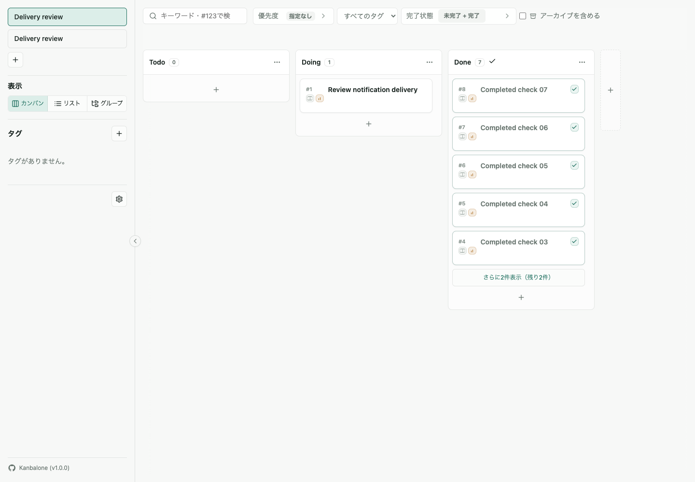
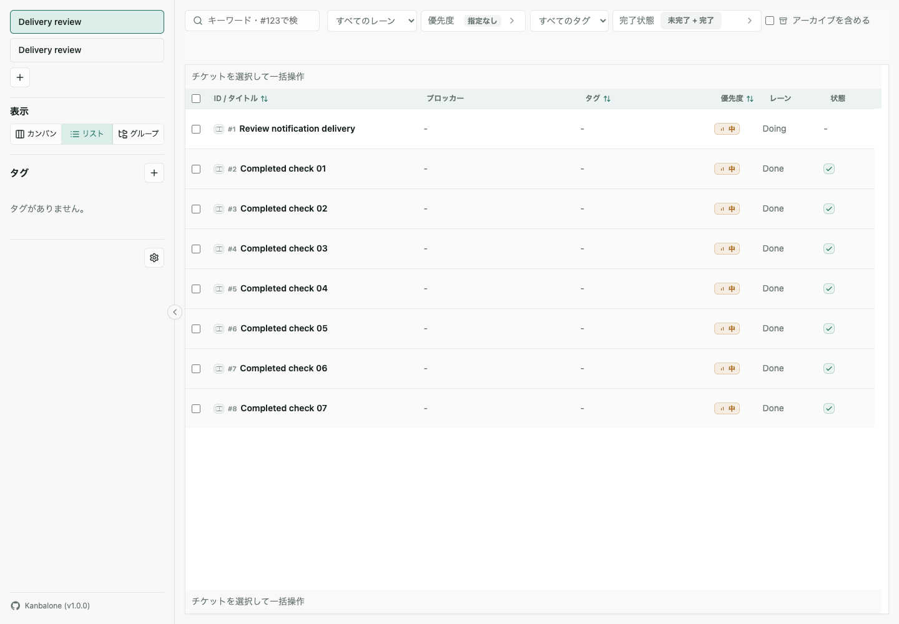
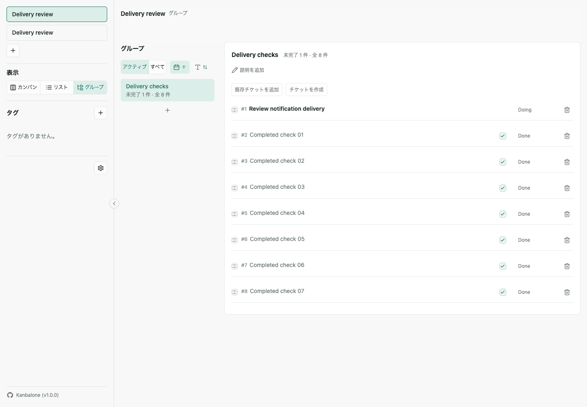
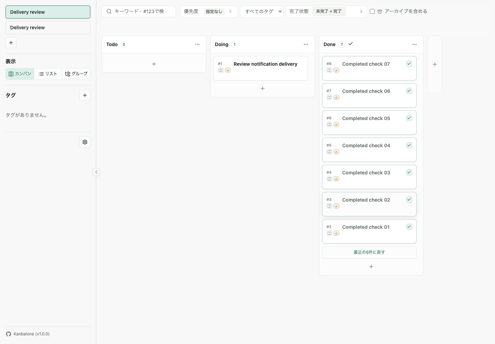
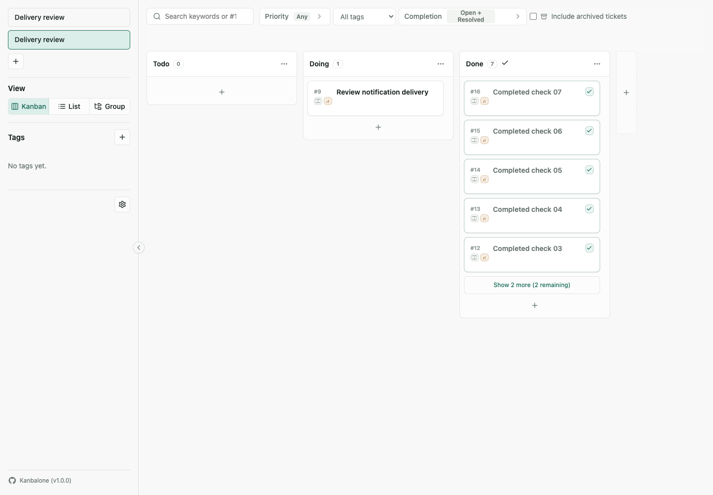
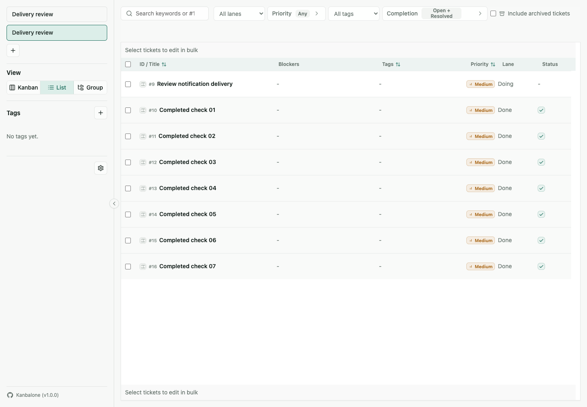
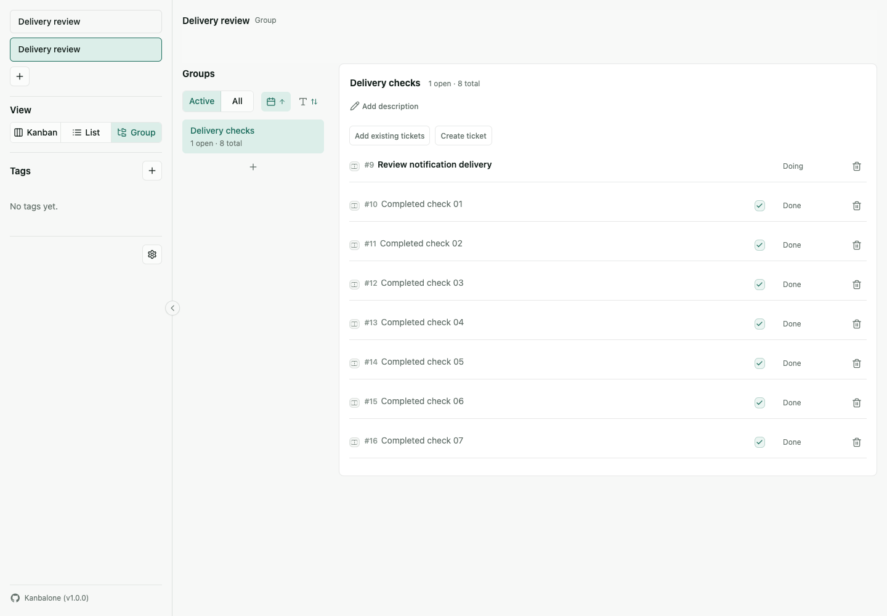
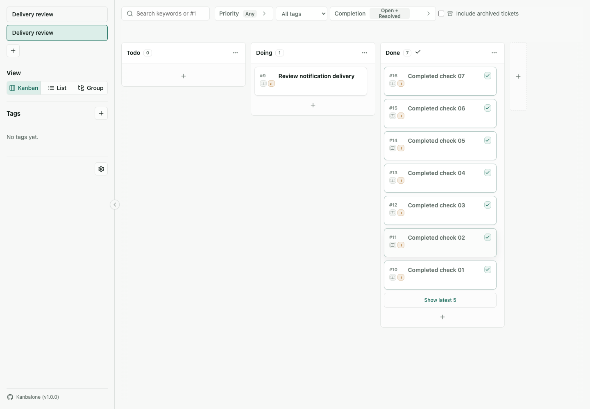

# #1517 — Load the routed board once at startup

Startup previously loaded the remembered/default board, then loaded the URL's destination again. Startup now obtains the board list without fetching its detail; the existing router performs the single destination load. Ordinary `refreshBoards()` calls still refresh detail by default, preserving creation, deletion and import behavior.

## Measurement

[Performance report](performance.md): on the isolated completion-heavy fixture (100 open, 9,900 completed), actual candidate median startup **367.0 → 289.1 ms**, with **8 → 4 ticket requests**. Both versions initially display the same 100 open and 5 completed tickets. These are local observations, not universal latency guarantees. Final production measurements are distinct from the earlier diagnostic prototype and broader investigation.

## Regression checks

[Full check](check.txt): **198 tests passed**, plus lint, build, public JavaScript checking and documentation build. [Focused startup tests](focused-final.txt): **8 passed**. They assert exactly one correct board-detail request, no requests or intermediate title for the wrong remembered board, and preserved per-board preferences for:

- Home with a remembered List view.
- Direct Kanban, List and Group URLs while another board remembers Group and a search filter.
- A ticket deep link to another board.
- Missing-board and missing-ticket fallback.
- Empty startup with no board request, followed by first-board creation and detail refresh.

Full relevant browser regressions: **71 passed (4.6m)**, one worker; [e2e.txt](e2e.txt). Coverage includes board creation/rename/deletion/import/reorder, preferences/history, Japanese/English controls, keyboard creation/navigation, native dragging, completion/archive filters, More pagination, stale pages and retry behavior.

## Actual Japanese / English screens

Baseline: merged-main `1c87193ec553cbbd4bbc563f5a28b7ee67611600`, full backend/static source. Candidate: that source plus the startup change. Each pair uses copied isolated fixture data, 1440×1000 viewport, light theme, matching route and language. [revision.json](revision.json) records source hashes and the two independent servers. Existing user data is never used.

| State | Before | After |
| --- | --- | --- |
| 日本語 Kanban |  |  |
| 日本語 List |  |  |
| 日本語 Group |  |  |
| 日本語 More |  |  |
| English Kanban |  |  |
| English List |  |  |
| English Group |  |  |
| English More |  |  |

[Image comparison](image-parity.json) shows all eight pairs are pixel-identical, comparing original screenshots without editing. Images show the retained final UI; they cannot establish startup timing or saved state.

## Actual interaction / persistence sequence

For each before/after and Japanese/English combination:

1. Clear evaluation browser preferences; set language and remembered board explicitly. Open Kanban, List and Group directly, wait for target content and capture. Record resource request URLs and queried DOM ticket IDs. The raw ID query includes hidden stale Kanban cards in baseline List/Group and does not collect List IDs; it is not a visible-row count. Only Kanban IDs are compared directly. Final List/Group contents are checked through actual rendered rows, pixel comparison and E2E tests.
2. Return to Kanban; verify five completed tickets initially. Click More and verify all seven fixture completion tickets are visible.
3. Focus the existing ticket link, press **N**, verify title focus, type a unique title and press **Ctrl+Enter**.
4. Verify editor closure and original ticket focus. GET the saved ticket; verify Doing lane and no Group membership for a Kanban creation. Reload and verify visibility.

[Before records](before-verification.json) and [after records](after-verification.json) retain actual saved API responses and assertions. Native dragging and detailed ticket opening/return are exercised by the existing E2E suite; the capture script does not claim to perform them. The before fixture's startup request list demonstrates duplicate/default-board work; the after list and focused tests establish its removal separately from appearance.

## Reproduction

From the repository root with Node 26.13.1, dependencies and agent-browser:

1. Create `coverage/single-startup-load/before`; extract `git archive 1c87193 src public` there.
2. Start `node --import tsx docs/development/evidence/2026-11-22-single-startup-load/interaction-server.mjs before` on 3619.
3. Run `interaction-seed.py` with Python once. It seeds two language boards, each with one open and seven completed tickets, and uses SQLite backup for a separate candidate DB.
4. Start the server script with `after` on 3620.
5. Run `interaction-capture.py before`, then `after`, and `image-parity.py`. Use fresh isolated DBs for a repeated capture.

Independent keyboard saves have different timestamps/edit tokens; comparison uses matching task content and displayed state, not post-write DB byte identity. Initial harness attempts used incorrect serialized preference fields, a nonexistent `/kanban` suffix and a nonfocusable article selector; these harness errors were corrected before final runs. No production workaround was needed.

## Limits and review

This narrow startup change does not optimize initial DOM/layout cost or change API defaults, visible ordering, pagination policy or completion capacity. Synthetic localhost observations do not measure all devices, assistive technology or real-user workloads. [Independent review](review.md) is separate from user acceptance and required CI checks.
