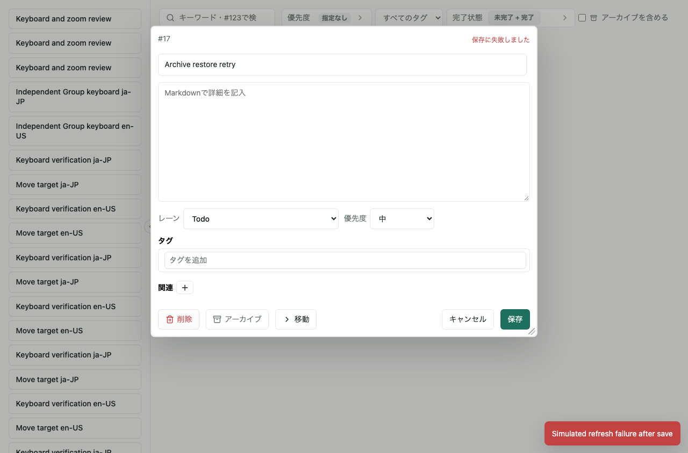
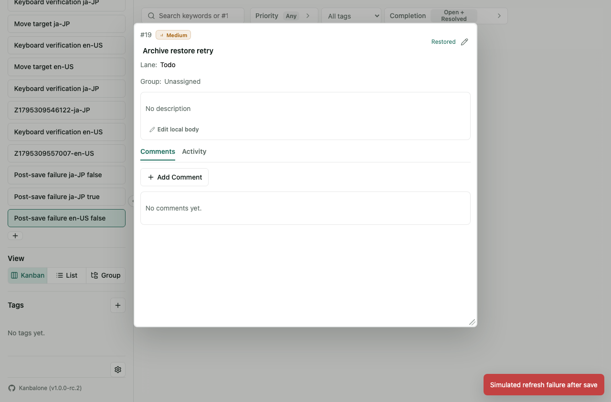
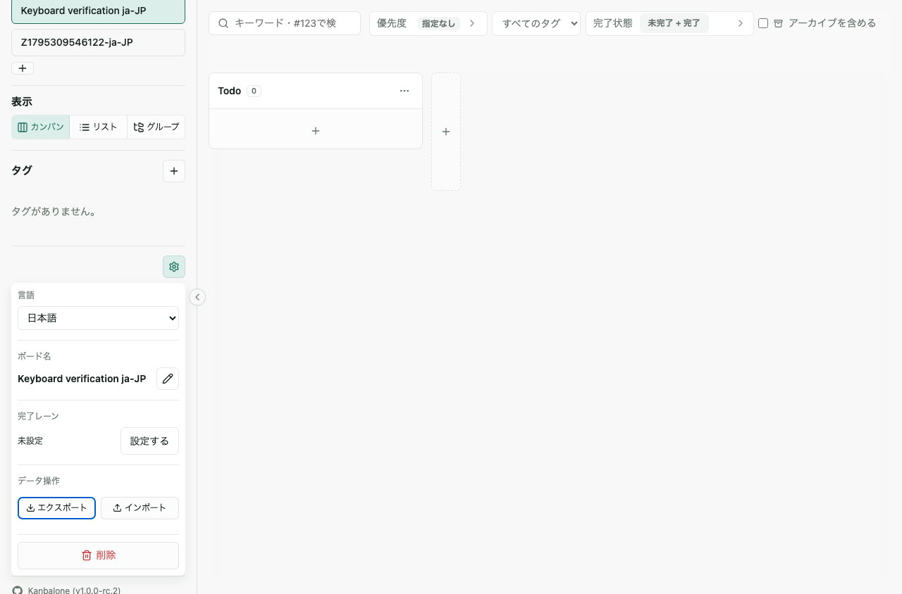
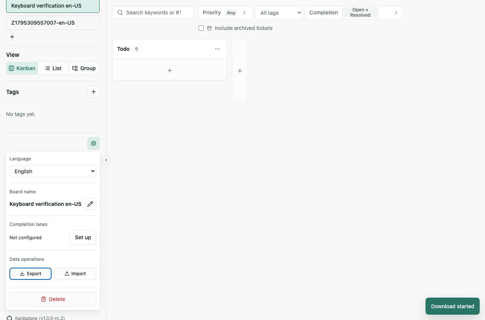
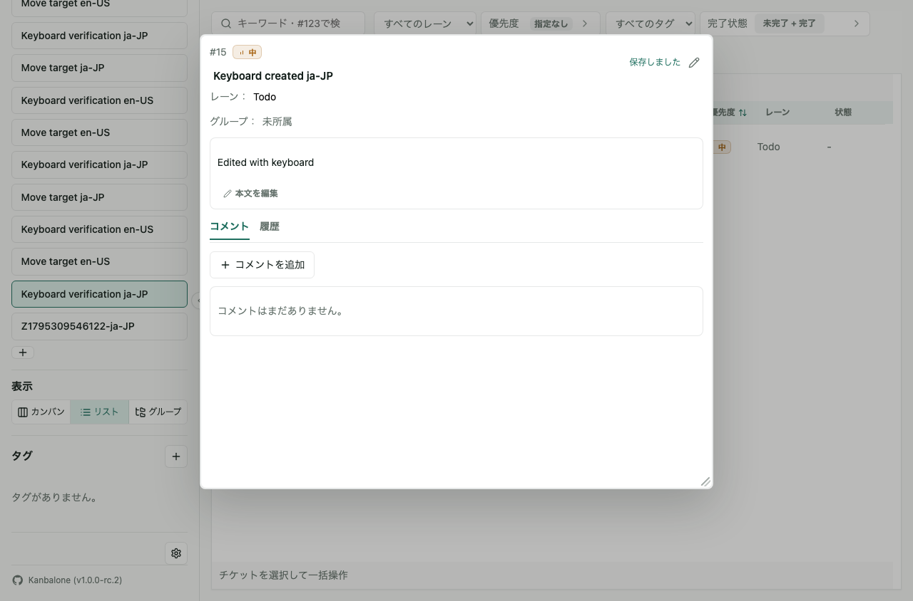
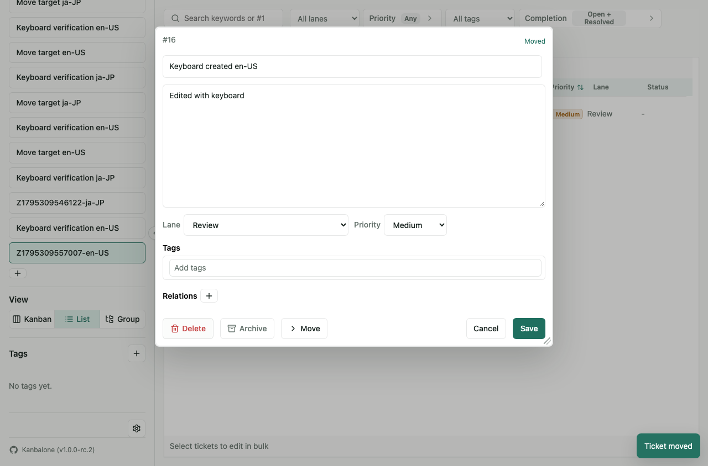
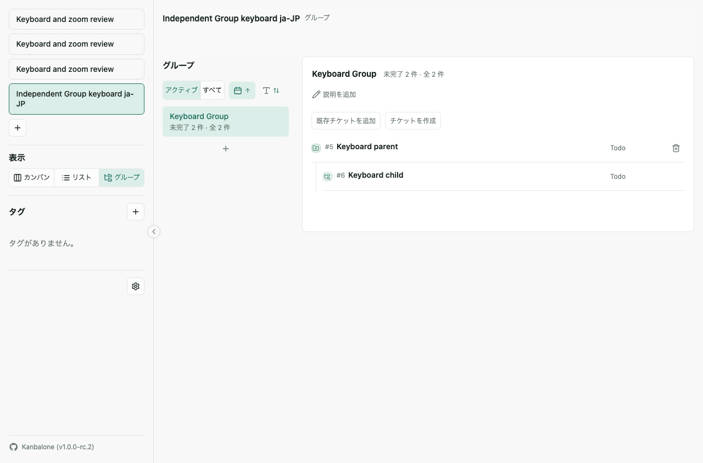
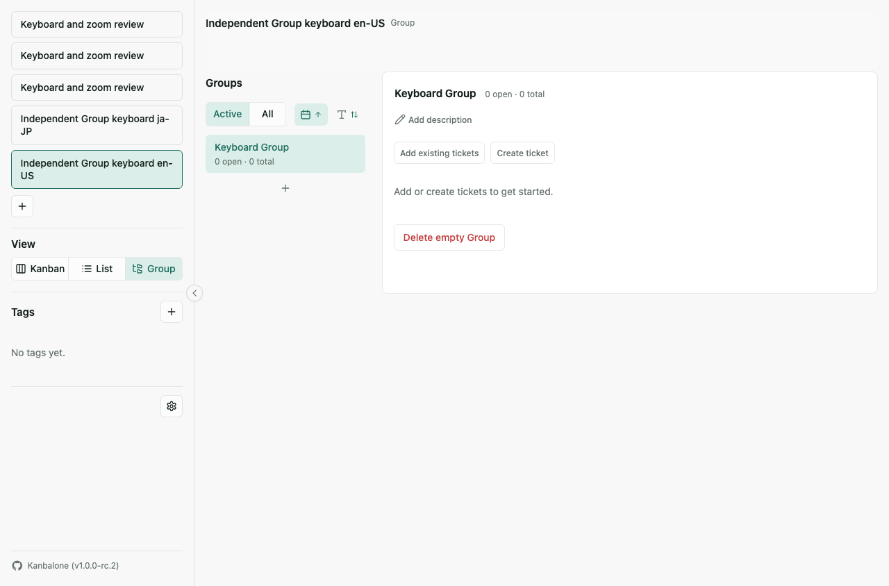

# #1486 v1.0前の必須検証（2026-11-22）

**判定: 操作と保存を確認できたが、4件の必須修正が残る。正式リリースへ進める状態ではない。**

ユーザー合意により後続対応は #1498 実スクリーンリーダー、#1499 実利用者評価、#1500 実外部サービス障害・長時間遅延、#1501 Preview処理中表示へ分離。これらを未確認のまま完了とは扱わず、v1.0の必須条件から外すことに合意した。

## 環境・方法

- SHA `24920cc1313b995bc857a48964aa5b3512898a37`、製品コード変更なし。
- 独立環境 http://127.0.0.1:3556 、合成データのみ。運用3470は課題登録以外に触れていない。
- Chromium、1280×844、ライトテーマ、ja-JP/en-US。
- APIでfixtureを作成した後、直接URLを開き、Tab/Shift+Tab/文字入力/Enterで操作。障害注入・フォーカス追跡・保存結果比較にPlaywrightを使用。
- 500はブラウザで注入した模擬障害。保存前のPATCH失敗と、PATCHは成功した後の一覧GET失敗を区別する。
- ネイティブselectへの矢印操作は最小HTMLでも検証ブラウザ上で値が変わらなかった。最終実行は正規の文字入力選択(typeahead)を使用し、選択値と移動先boardIdを確認。途中の選択ミスを製品不具合と数えていない。旧ハーネス失敗の画像は最終証拠に含めない。

## 確認結果

| 操作 | 保存・動作の結果 | 残った問題 |
| --- | --- | --- |
| キーボードで新規作成→編集→Move | 日英とも期待ボードに作成、本文更新、指定ボード/レーンへ移動。APIで本文とboardId確認 | 各操作成功後にfocusがBODYへ落ちる |
| Archive/RestoreのPATCH500→再試行 | 失敗時は状態を保持しエラー通知。再試行で期待状態へ更新、再読込確認 | 失敗後・成功後ともfocusがBODYへ落ちる |
| Archive/Restore保存後の一覧GET500→再試行 | 最初のPATCHは期待通り保存される | 画面は保存失敗と古いボタンを表示。同じボタンで再試行すると状態が逆転する |
| Export GET500→再試行 | 再試行で正常JSONを実ファイルに保存、board名確認 | 初回失敗に画面の通知なし、unhandled rejection |
| Group検索追加/解除（親子2件） | 日英のキーボード操作完了、取消時は状態保持。親子groupId変更・本文/関係保持・再読込確認 | 成功後はfocusがBODY。取消時のfocus復帰は正常 |

`results.json`は日英10ケース（各ケース内に複数操作）、`post-save-results.json`はArchive/Restore両方向×日英4ケース。`group/results.json`は独立担当の2言語の全操作ログ。`issue`は不具合観測を意味し、ハーネス実行失敗ではない。Groupのpassedは操作/保存assertの成功でありfocus品質の合格ではない。

今回Exportした元ボードはチケットを移動した後なので空。今回の主張はJSON保存成功とboard名の一致に限定する。チケット/Group入りExportの内容確認は前回 `../2026-11-22-ux1486/export.json` を参照する。

## 登録した必須修正

1. **#1502: 保存後の再取得失敗で再試行が逆操作になる（高優先）**

   
   
   

   画像と`post-save-results.json`を併読。Archiveはfalse→true(保存成功)→false(再試行)、Restoreはtrue→false→true。初回の古いラベルとSave failed表示が保存実態に一致しない。

2. **#1503: Export失敗が画面に通知されない**

   
   

   失敗後もExportボタンは操作できるがtoastなし。再試行でDownload startedとなりファイル保存できる。実OSディスク不足の検証ではない。

3. **#1504: チケット操作後・Archive/Restore失敗後のfocus消失**

   
   

   各言語focus-logおよびresults内createdFocus/editedFocus/movedFocus/failedFocus/successFocusでBODYを記録。詳細がモデルレスで背景へTab移動できる既存仕様とは分けて扱う。

4. **#1505: Group追加・解除成功後のfocus消失**

   
   

   [独立実施記録](group/review.md)参照。取消は良好で成功時のみ改善が必要。

## 独立レビュー

ux1486_audit_review が最終10ケースと保存後再取得失敗4ケースのharness・JSON・実画像を照合。4分類での登録と#1502の高優先化に同意。Groupは同担当が独立して日英を実操作した。ソース修正は行っていない。

## 次の対応

#1502 → #1503 → #1504 → #1505を修正し、日英の同条件比較・保存結果・独立レビューを実施する。今回の画像は**修正前の現状**であり、修正後の証拠ではない。#1486はDoingを維持する。

再現スクリプトは本ディレクトリの`verify.mjs`、`post-save.mjs`、`group/verify.mjs`。Node26、インストール済みPlaywright、合成データ専用3556を用いる。毎回新規fixtureを作り結果を上書きするため再実行前に証拠を退避する。チケット内の現状画像は未pushのためlocalhost:3558で配信し、原本は本ディレクトリに保持する。コミット・push時に固定SHA URLへ置換して表示を再確認する。
