# #1495–#1497 比較検証（2026-11-22）

順に #1495 サイドバー、#1496 取り込みパネル、#1497 フィルターを修正。通常の操作・配置を維持し、不可視領域のフォーカスと狭幅の読みやすさを直した。

## 環境

- 修正前: v1.0.0-rc.2 / dd3707027c55c7bfbfd3b17e5c540787293586ca、独立候補環境3552。
- 修正後: 同SHAをベースにした作業ツリー、独立環境3556。対象4ファイルのSHA256は`fingerprint.json`。
- Chromium、ライトテーマ、1280×844、ja-JP/en-US。1497はChrome拡張による実200%ズーム（CSS viewport640、DPR2）。
- 合成ボード「Keyboard and zoom review」、同じTodo/Doneとチケット内容。環境ごとの自動採番IDだけ異なる。運用中3470のユーザーデータは使用しない。
- `capture.mjs before`と`capture.mjs after http://127.0.0.1:3556`で再取得できる。リポジトリルートでNode26から実行。毎回専用ボードを追加する。既存証拠を上書きするため再実行前に退避する。

## #1495: 閉じたサイドバー

1. サイドバーを閉じた設定でListを開く。
2. Tabを押す。修正前は画面外x=-264のボードボタンに移動。修正後は表示中の再開ボタンに移動。
3. 再開→閉じる。修正後は開閉に対応した見えるボタンへフォーカスが戻る。

| | 日本語 | English |
| --- | --- | --- |
| Before | 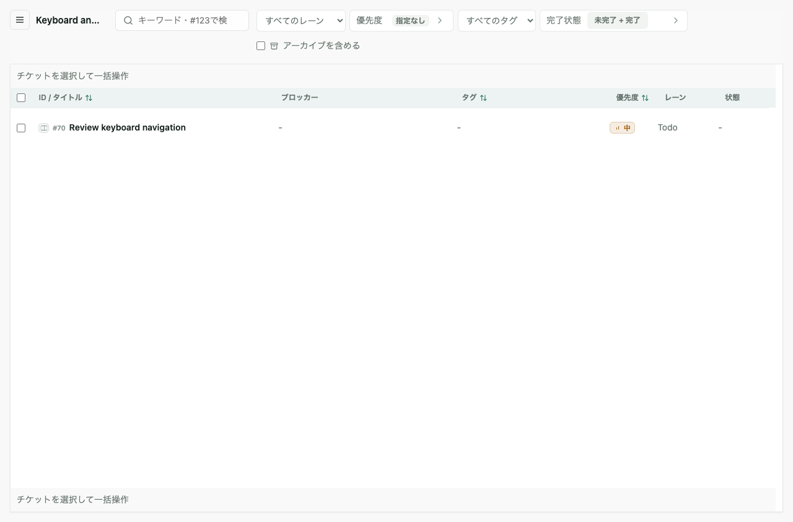 | 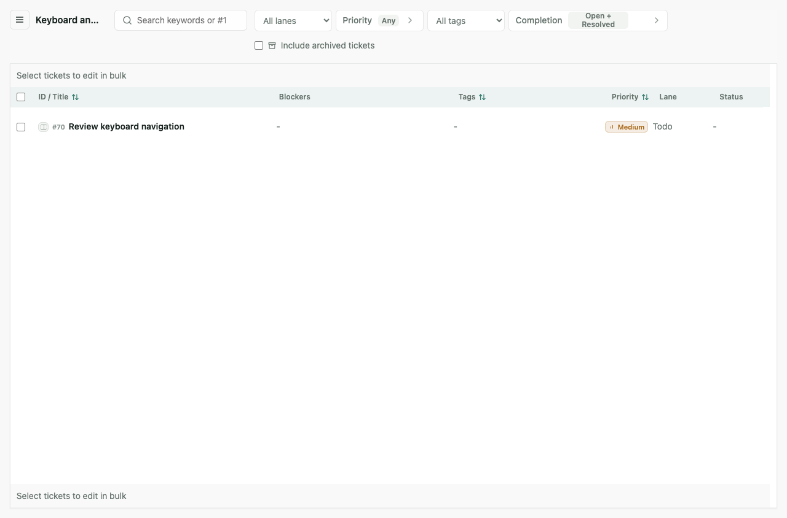 |
| After | 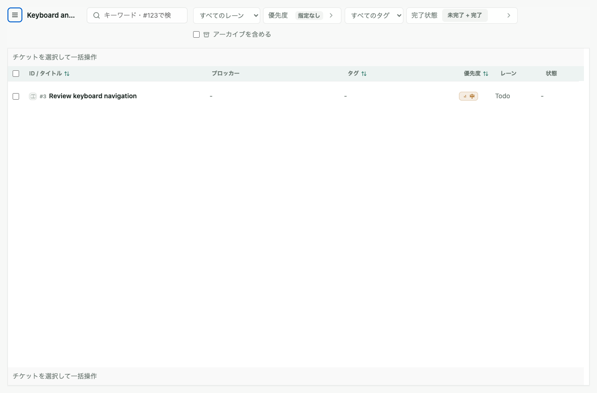 | 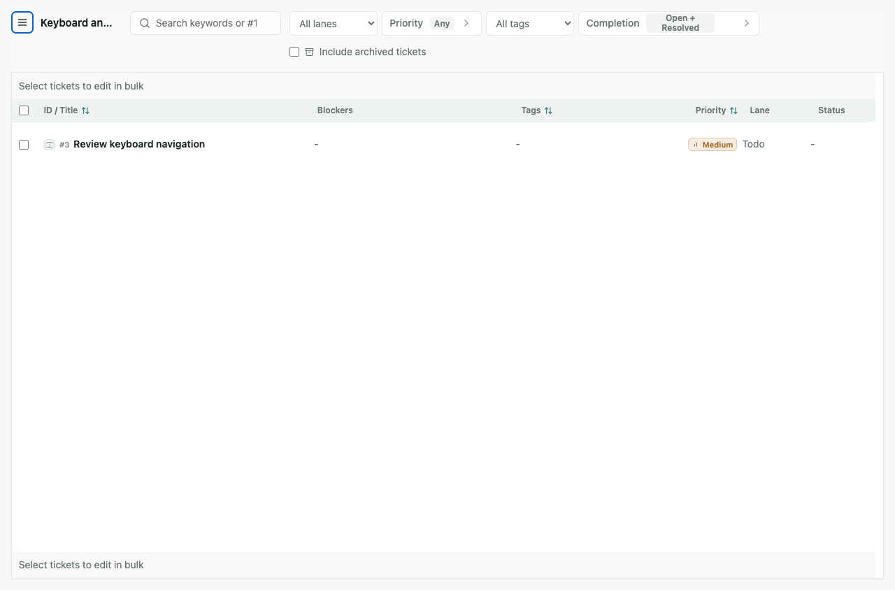 |

## #1496: 非表示の取り込みパネル

1. チケット詳細が表示されるのを待ち、編集ボタンを同じ開始点としてTabで巡回する。
2. 修正前は不可視のsheet内へ移動。修正後は40Tabでsheetへ一度も移らない。
3. 新規チケット→取り込みを開くとURLへフォーカスし、キャンセルすると取り込み開始ボタンへ戻ることも日英で確認。

修正後画像は最初のTabで「本文を編集」にフォーカスした状態。除外の証明は一枚の画像ではなく`before.json`/`after.json`の巡回ログと組み合わせる。詳細は既存のモデルレス仕様で、背景へのTab移動も可能。今回はモーダル化や背景フォーカス封じ込めを変更していない。

| | 日本語 | English |
| --- | --- | --- |
| Before | 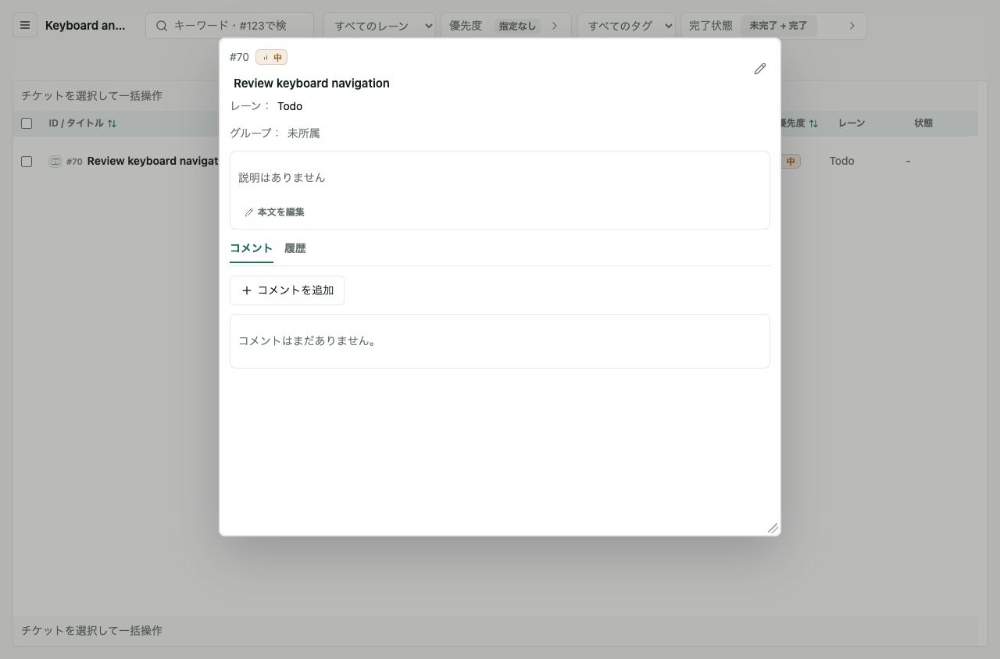 | 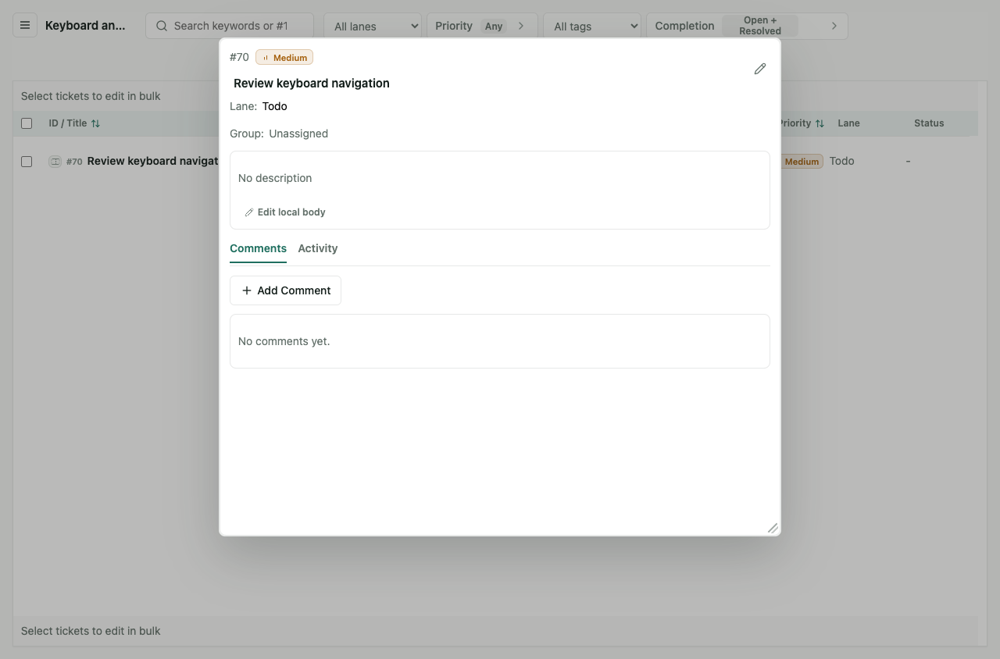 |
| After | 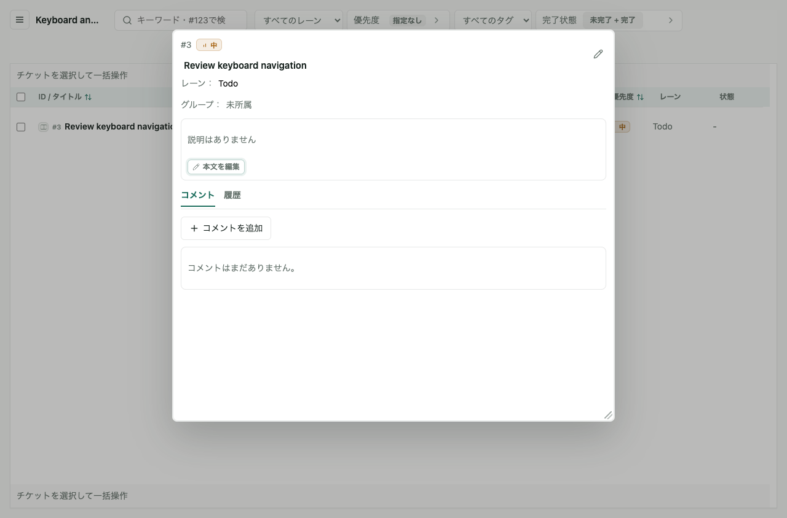 | 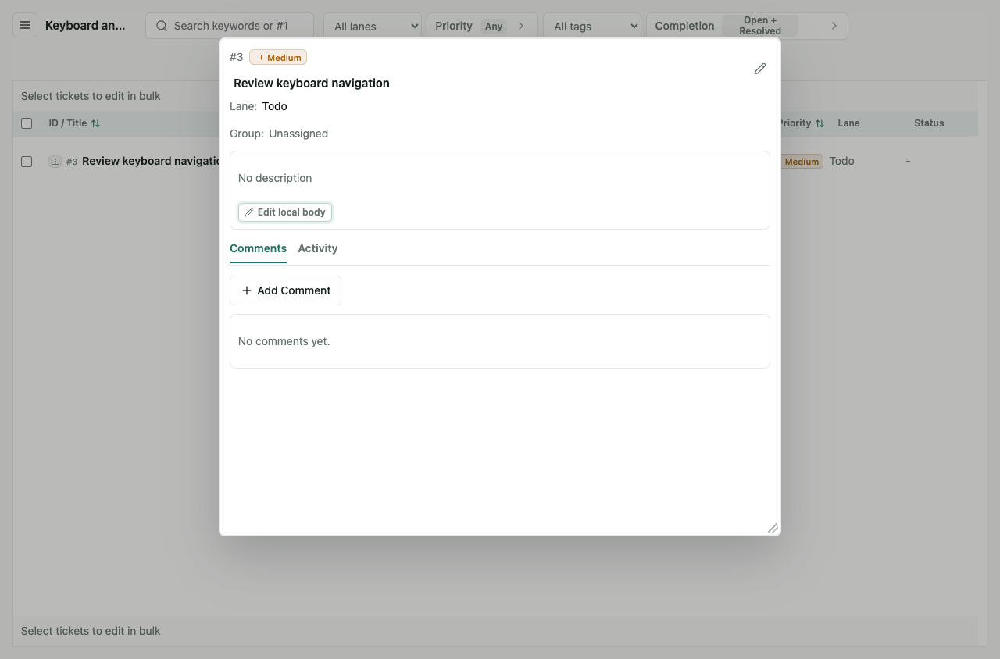 |

## #1497: 200%のフィルター

1. 同じListを実200%ズームで表示する。
2. 修正前は日本語「指定なし」等が一文字ずつ折り返される。
3. 修正後は各フィルターの幅を保ち、既存の横スクロールで操作する。画面外の条件があること自体は既存仕様。

| | 日本語 | English |
| --- | --- | --- |
| Before | 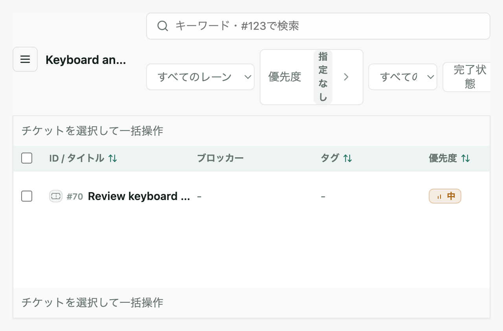 | 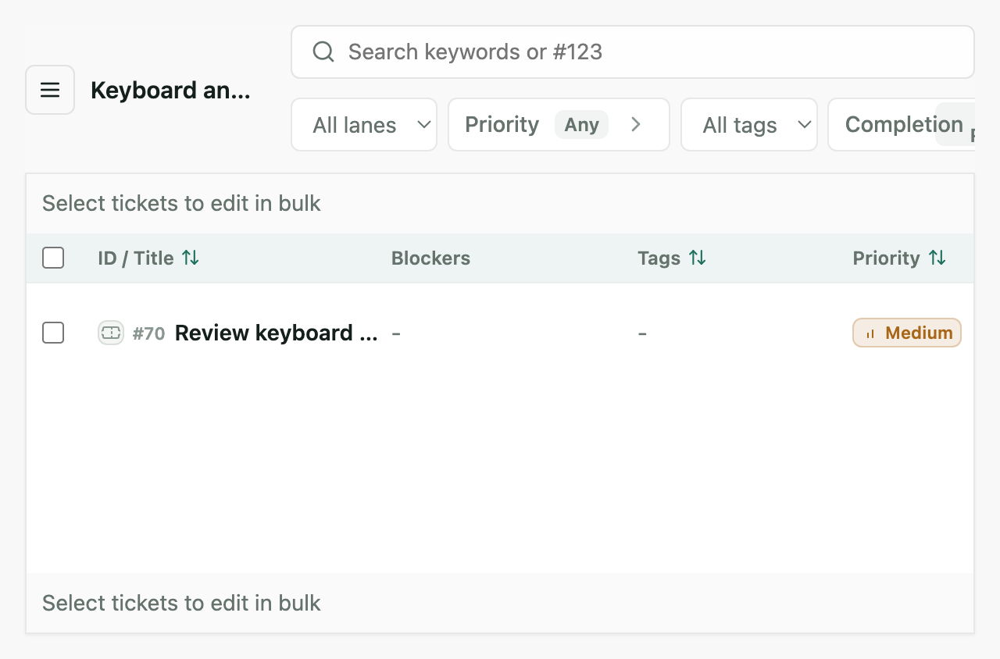 |
| After | 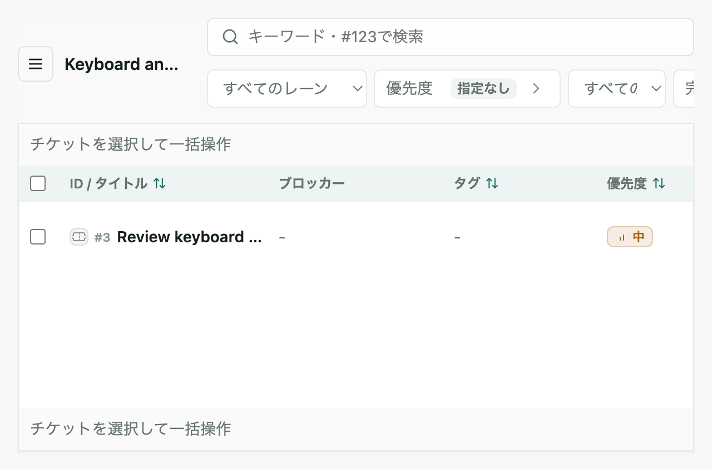 | 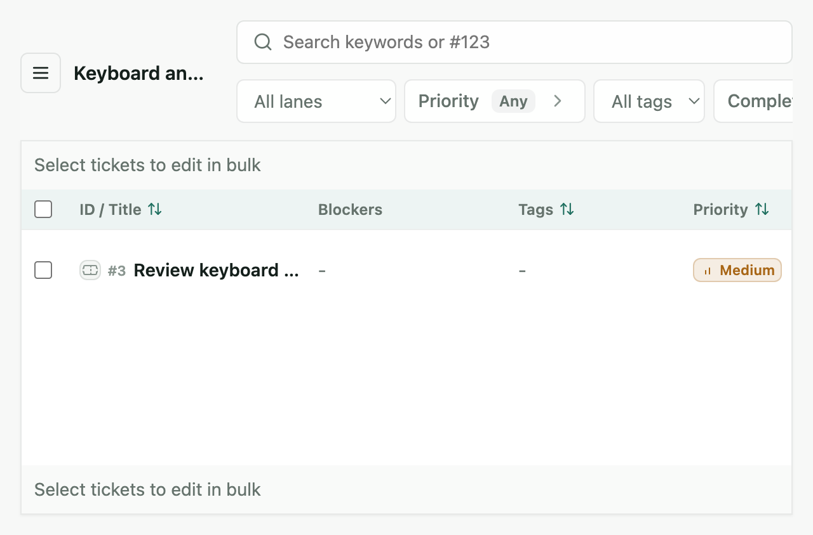 |

## 検証と限界

- 日英の新規回帰E2E2件成功。閉じた領域へのTab除外、開閉後のfocus、Escape後の戻り先、640pxのfilter高さを確認。
- 既存sidebar4件とremote-import4件成功。取り込みパネルの開閉と重複取り込み等への影響を確認。
- 完了/アーカイブフィルター関連E2E14件成功（日英・ダークモード・390/980/1280px・View切替）。関連E2E合計24件成功。
- 単体テスト176件、public TypeScript検査、ビルド成功。
- 画像レビューで1496の撮影位置が不適切と指摘され、開始点・表示待ち・撮影位置を揃えて再取得した。
- 元のE2E仮定「詳細内だけにTabを閉じ込める」は既存モデルレス仕様と異なるため修正。今回の合格は非表示sheetを除外することを指す。
- 実スクリーンリーダーの読み上げは未確認。#1486の残確認として保持する。

画像はチケットコメントに埋め込み、agent-browserで3件×4画像すべての読み込みを確認済み（`attachments.json`）。取得時は `http://127.0.0.1:3557/` のローカル配信を使用した。`attachments.json`はその時点の記録。PR作成時にチケットの画像参照を固定コミットSHAの公開URLへ置換して再確認し、その結果をチケットに記録する。原本は本ディレクトリに保持する。
