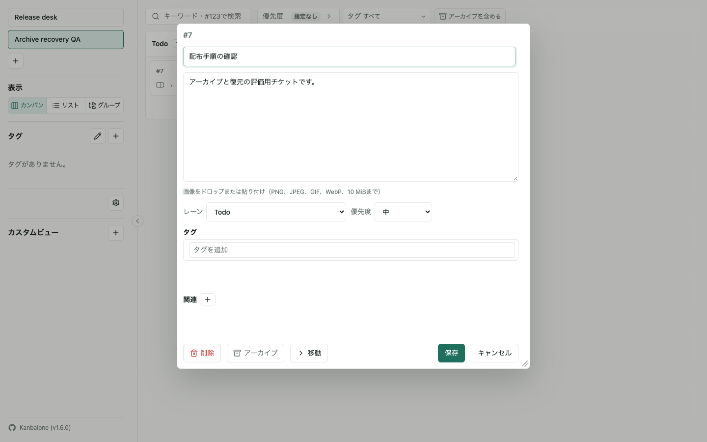
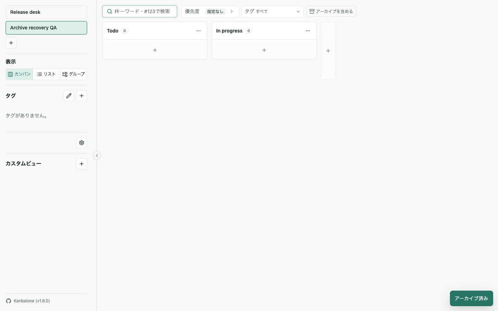
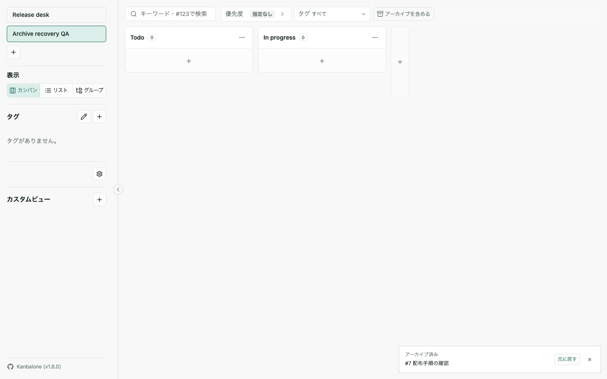
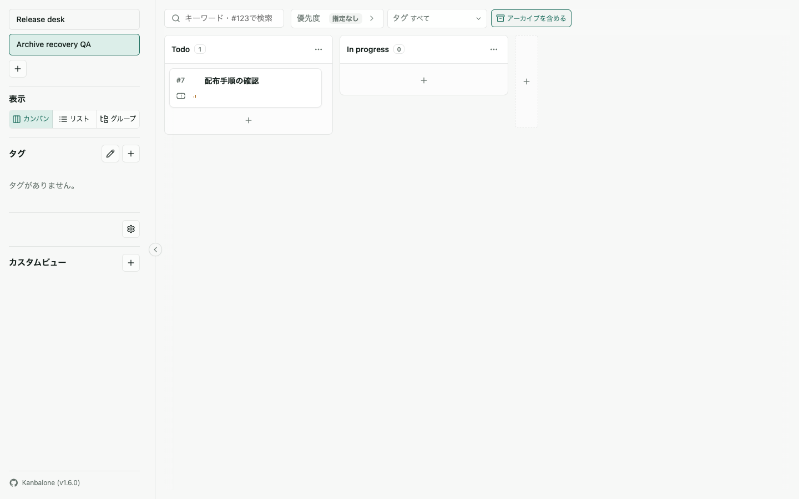
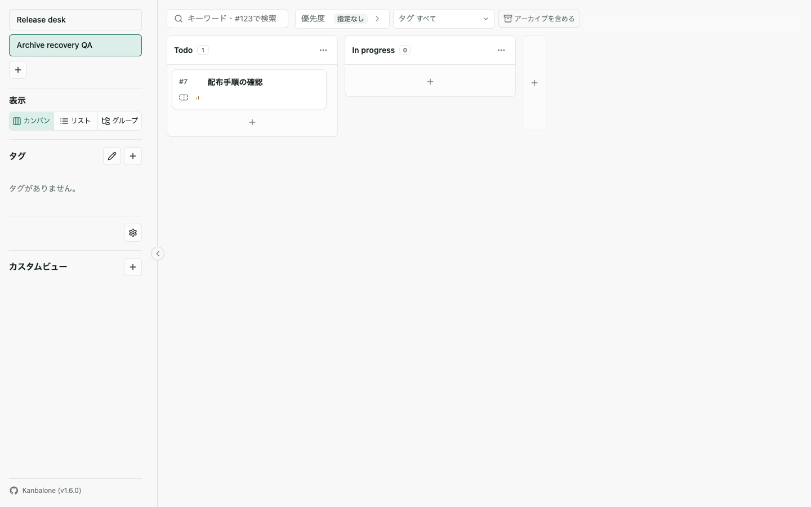
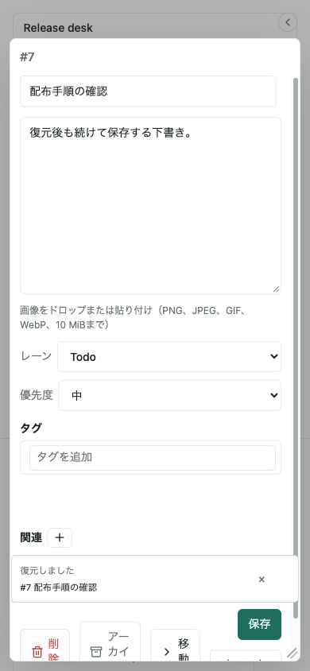
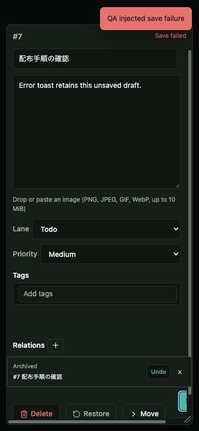

# Archive recovery evidence

Captured 2026-11-28 JST using agent-browser 0.26.0, Headless Chromium 158 on macOS 26.7.3. Synthetic board “Archive recovery QA”, ticket “配布手順の確認”, Todo/In progress lanes. No personal task data was used.

Before: `92571d1e2fcef1a37d630fa02733e7f2c2ce0b83` (product source identical to base `aa81c6f`). After: `f725bad6395ea00a166816dae0c9f819b8034bd9`. All 253 candidate public/src files matched the Git revision; hashes are in [final-version.json](final-version.json). The package footer still says 1.6.0 and is not the sole version evidence.

## Comparable desktop sequence

Japanese/light, 1440×900, same synthetic board/title/body/lane and equivalent states. Open the ticket, enter edit mode, archive it, then restore and reload. Before restoration uses Include archived tickets → ticket → Archived → Restore ticket. After restoration uses the notification's Undo. Existing restoration is retained.

| State | Before | After |
| --- | --- | --- |
| Before archive |  |  |
| Archived |  |  |
| Restored and reloaded |  |  |

Expected: only archive state is reversed, with no rollback of notes or lane changes. Observed: the candidate notification identifies the ticket, Undo restores it, and reload/API readback retains the original notes and lane. [Reset](final-fixture-reset-api.json), [archived](final-archived-api.json), and [restored](final-restored-api.json) capture archive generations 12 → 13 → 14 and false → true → false. Screenshots alone do not prove persistence.

## Supplemental interaction checks

With Include archived tickets enabled, archive while details remain open, enter a body draft, then Undo and Save. The draft survives, and [the saved result](final-draft-save-api.json) is unarchived with the new body. The notification sits 8px above Save instead of covering it.

A browser fetch wrapper simulated HTTP503 for an ordinary editor save; archive recovery still used the real server. The ordinary error toast and recovery notification do not overlap. Undo followed by keyboard Save persisted the draft: [stored result](final-error-recovery-save-api.json).

These supplemental captures are 390×844 and contain intentional drafts, so they are not exact before/after pairs. Existing English footer horizontal overflow occurs at the same coordinates in the baseline and candidate; keyboard Save works. It is a separate low-priority follow-up. Desktop workflows are the primary target, and no additional narrow-layout work is claimed here.

## Verification and limits

- `pnpm check`: 314 unit/API tests, lint, OpenAPI, CSS tokens, build, public types and documentation build passed.
- `test/e2e/archive-recovery.spec.ts`: 12 cases passed, including retained drafts and subsequent Save, concurrent body-edit rejection, lost responses, saved restore/failed refresh, multiple target identities, controlled timer pauses, late navigation, virtualized lane focus and lane-filter preservation.
- The server's generation guard rejects archive/restore/archive cycles and board round trips, including changes through existing generic and bulk APIs. Restoration uses existing ordering rules; it does not restore an old position snapshot.
- [Upgrade verification](upgrade-verification.json): actual v1.6.0 synthetic database upgraded with every old stored field retained, integrity/FK checks passed, generations survived reopen, and a consistent backup reopened unchanged in the previous release.
- Independent runtime QA repeated the primary desktop sequence and draft/save/error-notification checks on the final product. Earlier implementation observations were not relabeled as final verification. Timer/concurrency coverage above refers to automated tests, not inferred screenshot behavior.
- Baseline and an earlier candidate could show Kanban counts without cards after reload; switching to List displayed the saved tickets. Final primary captures rendered normally. This unrelated limitation is not claimed fixed.

[Image revisions and hashes](manifest.json) · [Stored-result summary](final-results.json) · [SHA-256 manifest](SHA256SUMS). Original screenshots are unmodified.
