# Kanbalone User Guide

Organize your work by moving tickets as it progresses. Use Kanbalone on your own or with an AI assistant.

Start by creating a board. If you are upgrading with existing data, check the [migration guide](./migration-guide.md) for backup instructions first.

## Quick Demo

See how to create, move, and search tickets, and add comments.

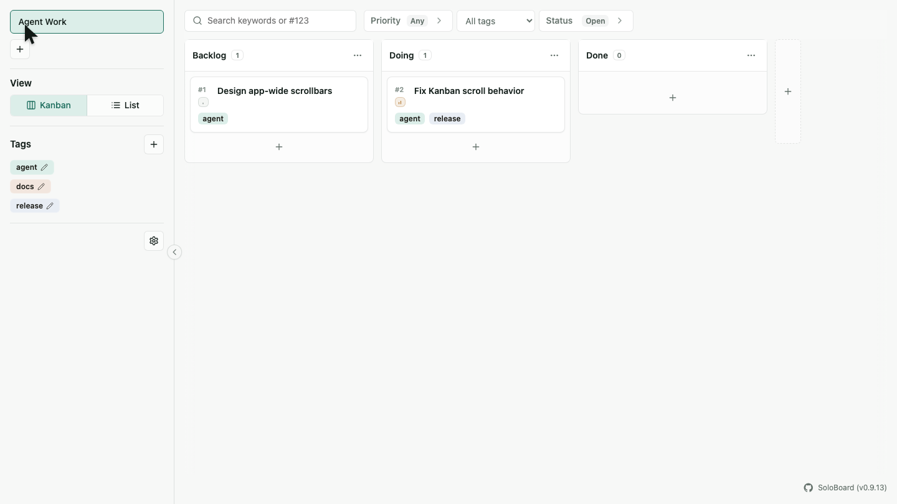

## 1. Create Your First Board

Click **＋** in the upper-left sidebar, enter a board name, and press **Enter**.

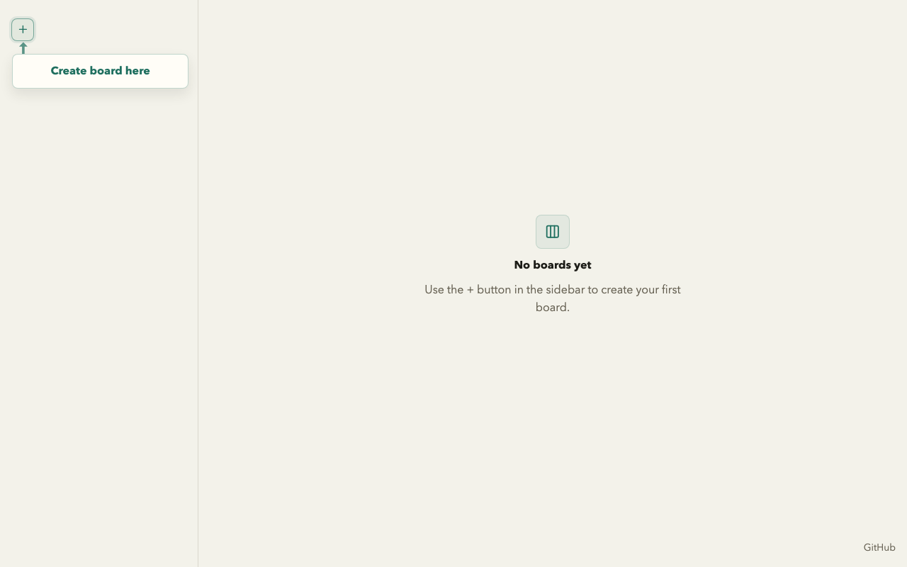

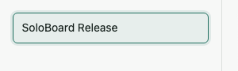

## 2. Learn The Workspace

Choose a board and switch views in the left sidebar.

- **Kanban**: drag tickets between lanes as work progresses.
- **List**: review tickets in a table and act on several at once.
- **Group**: see tickets with a shared purpose together.

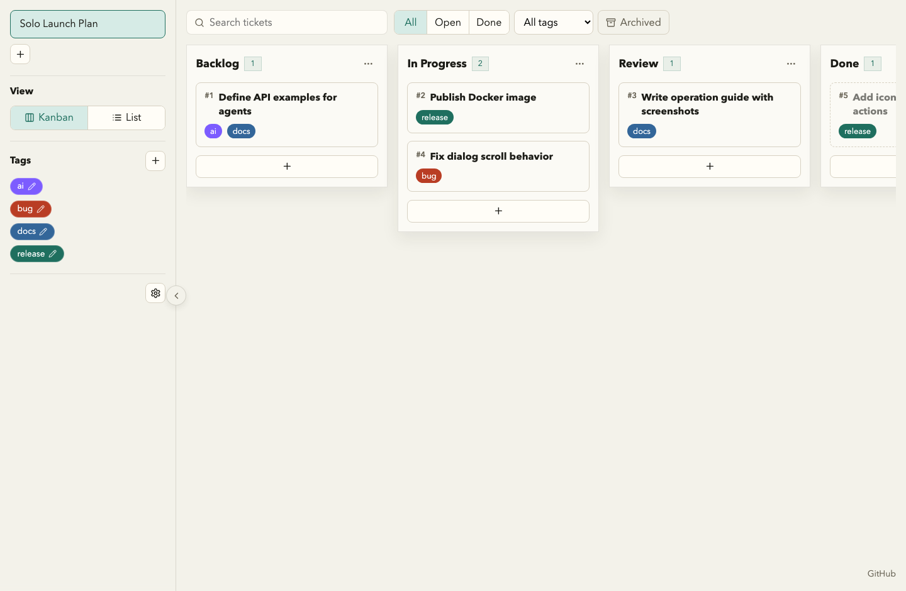

## 3. Set Up Lanes

Click **＋** at the bottom of the board, enter a lane name, and press **Enter**. Create lanes for your work stages, such as Todo, Doing, and Done.

Use the buttons at the top right of each lane to rename or delete it. Choose which lanes mark work as complete under **Completion lanes** in the sidebar gear panel.

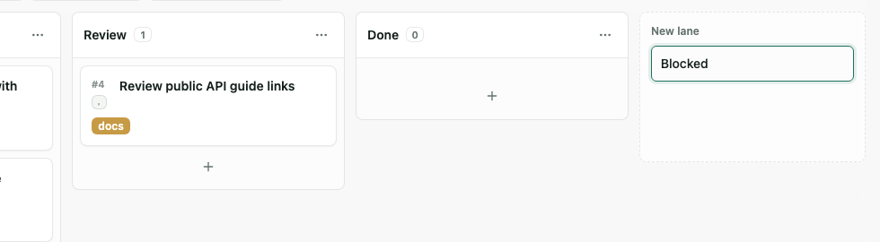

## 4. Create A Ticket

Click **＋** in a lane and enter a title and body. The body supports Markdown. Use `- [ ]` and `- [x]` to display unchecked and checked tasks.

Set **Lane**, **Priority**, and **Tags** as needed. Under **Relations**, you can choose a parent ticket or blockers—tickets that must be finished first.

Click **Save** to add the ticket.

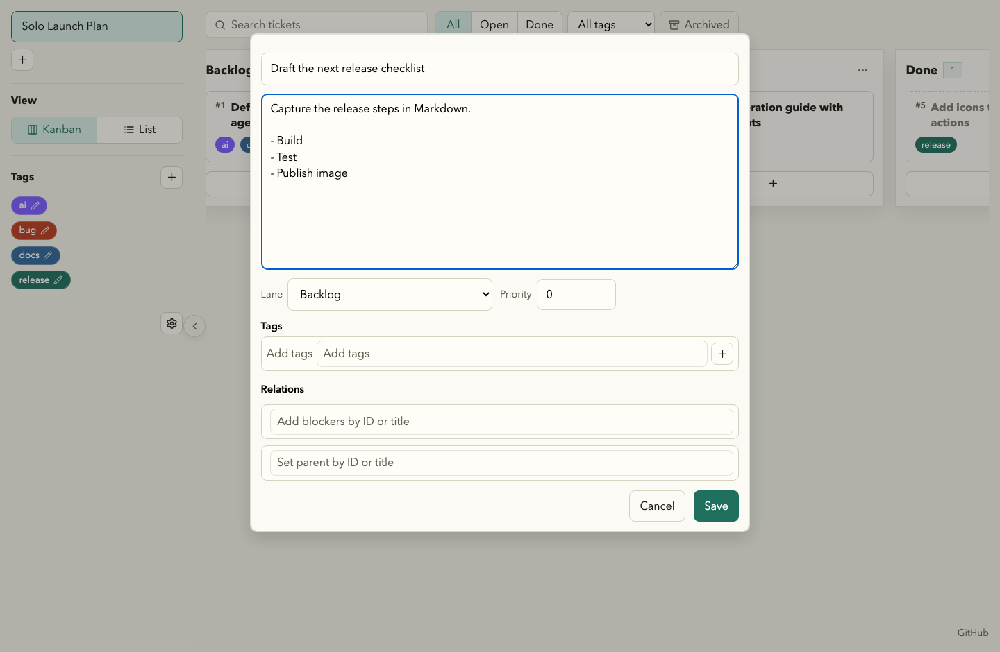

### Create With The Keyboard

Focus a ticket title and press **N** to open a new ticket. Enter a title and press **Ctrl+Enter** (**⌘+Enter** on Mac) to save and return to your starting point.

- **Kanban**: create in the focused ticket's lane.
- **List**: create in the board's first lane.
- **Group**: create in the first lane and the displayed Group. You can also focus the selected Group name and press **N**.

Check or change **Lane** before saving. A ticket created in a completion lane is completed immediately. Press **Esc** to cancel; if you have unsaved changes, confirm whether to discard them.

## 5. Read A Ticket

Click a ticket to read its body, related tickets, and comments. Open the **Activity** tab to see its history.

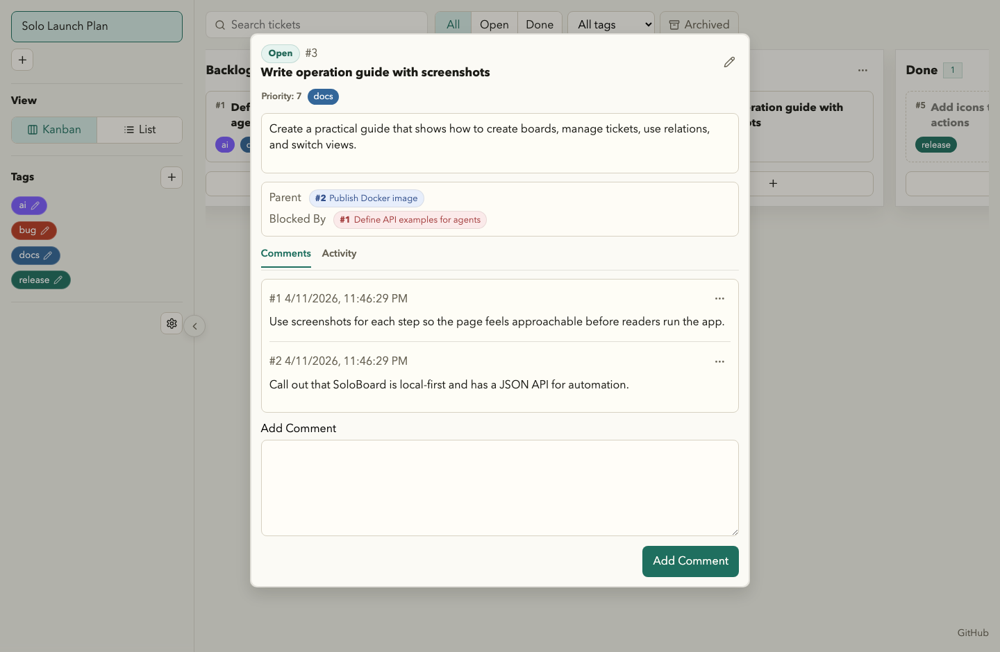

## 6. Edit A Ticket

Click the pencil icon at the top right of ticket details. Change the body, lane, priority, tags, parent-child relationships, or blockers. Click **Save** or press **Ctrl+Enter** (**⌘+Enter** on Mac).

If you have unsaved changes, confirm before closing. Choose **Cancel** to keep editing or **Discard changes** to discard them.

Choose **Lane** in the editor to move within the same board. Use **Move** to send a ticket to another board. Moving to another board clears parent-child relationships, blockers, and Group membership. Tags with matching names are kept.

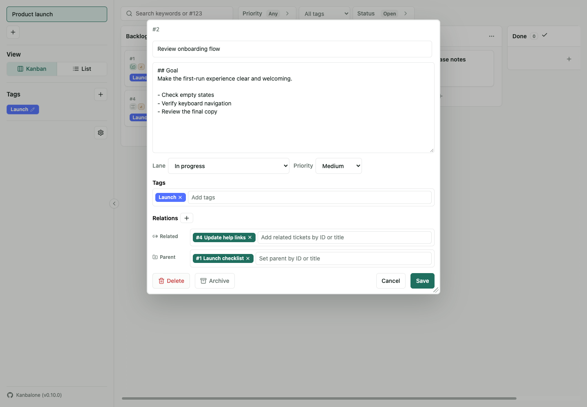

## 7. Use Comments And Activity

Add comments in ticket details to record progress and notes. While composing a new comment, press **Ctrl+Enter** (**⌘+Enter** on Mac) to post it. The **Activity** tab shows changes to tickets and comments.

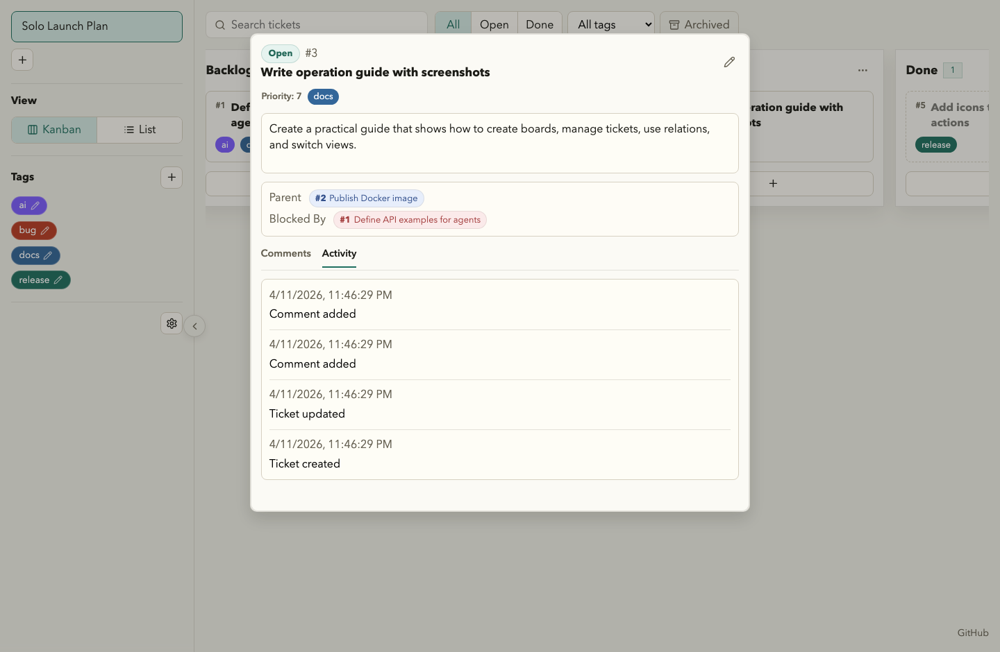

## 8. Import Issues From Other Services

Import issues from GitHub Issues, GitLab, or Redmine to work on them in Kanbalone. Read the original issue, keep your own notes, and send selected comments back.

### 8.1 Import An Issue

Click the import icon at the top right of the ticket creation screen. Choose the service (**Provider**), enter the **Issue URL**, select a destination lane, and click **Import**.

The service must be connected before you can import issues. If the icon is missing, check the connection settings used to start Kanbalone.

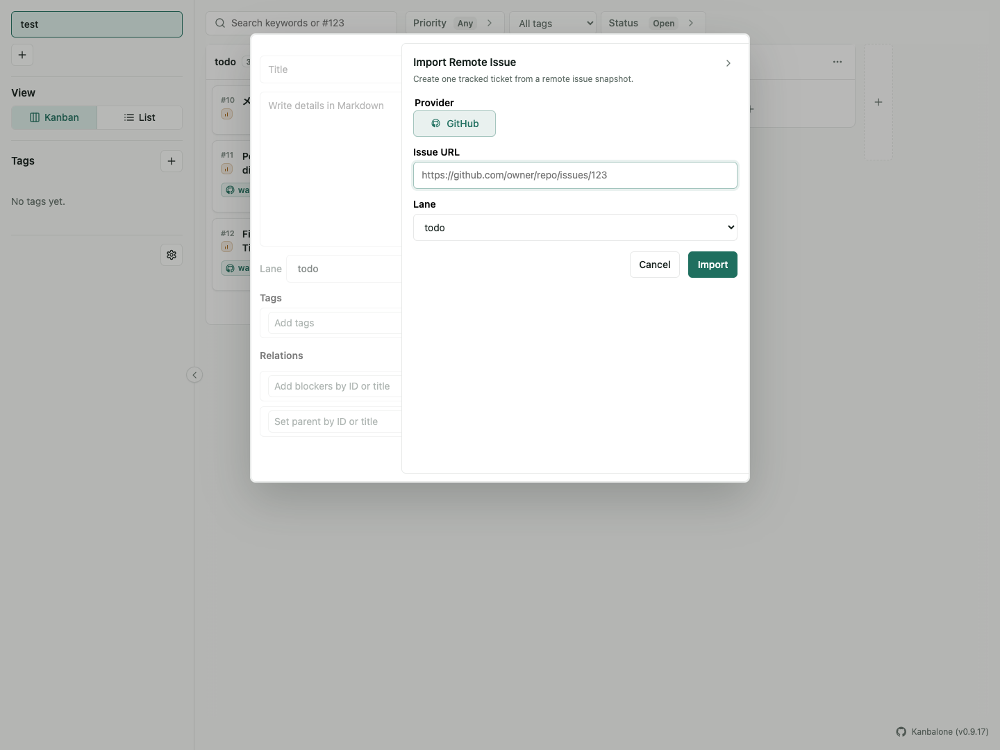

### 8.2 Read The Issue

Imported tickets have two body tabs:

- **Local Body**: write your work plan and notes.
- **Remote Body**: read the original issue.

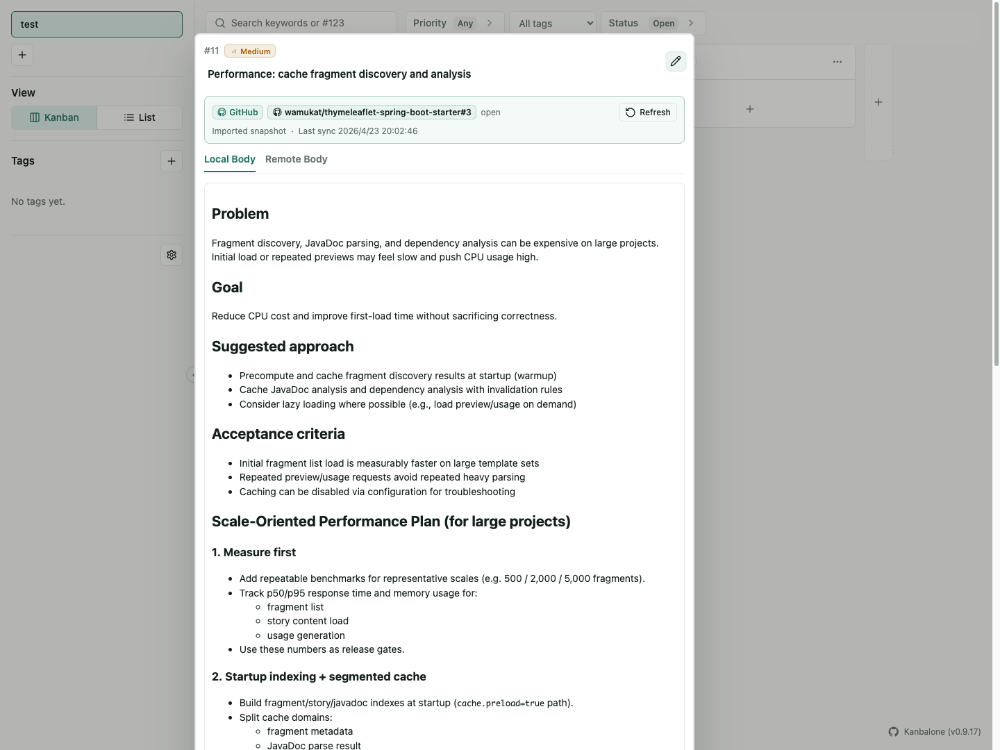

### 8.3 Edit The Ticket

Use the pencil icon to edit **Local Body**, lane, priority, tags, and related tickets.

To change the title or **Remote Body**, edit the issue in its original service, then click **Refresh** in Kanbalone.

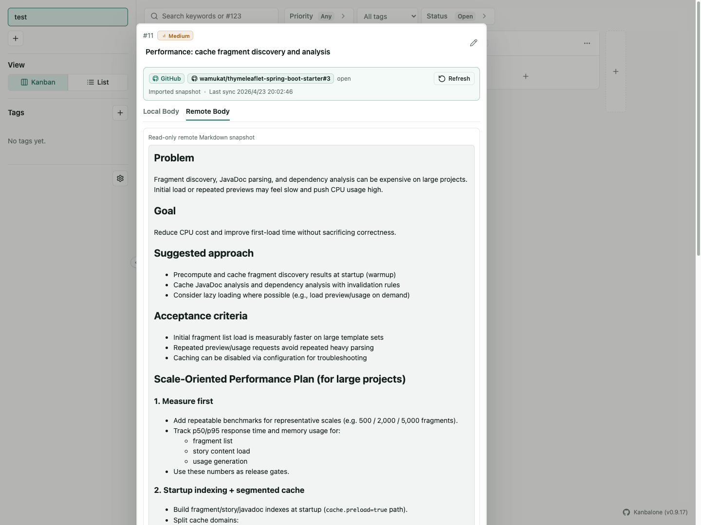

### 8.4 Send A Comment Back

Comments are saved in Kanbalone first. Click **Push to remote** on a comment you want to send to the original issue.

- **Pushed**: the comment was sent.
- **Push failed**: sending failed. Click to see why.

Sent comments cannot be edited or deleted. To make a correction, add and send a new comment.


### 8.5 Get The Latest Issue

Click **Refresh** to update the issue's title, body, and status. Your own notes, comments, lane, priority, tags, and related tickets are kept.

## 9. Resolve And Organize Tickets

Move finished work to a completion lane to mark it **Resolved**. Move it back to a normal lane to reopen it.

Set completion lanes under the sidebar gear → **Completion lanes**. Naming a lane “Done” alone does not make it a completion lane.

Use **Archive** in ticket details to hide a ticket from your everyday view.

Kanban and List initially show both open and resolved tickets. Click **Completion >**, then toggle **Open** and **Resolved**. Select both to show both, or use **×** to reset the selection.

Check **Include archived tickets** to also show archived tickets that match the selected completion state.

Completion lanes in Kanban show the five most recently completed tickets. Use **Show 50 more** to reveal the next batch, or **Show latest 5** to collapse it. Newly completed tickets appear first. Completion lanes use completion order rather than manual drag ordering. This limit does not apply to List.

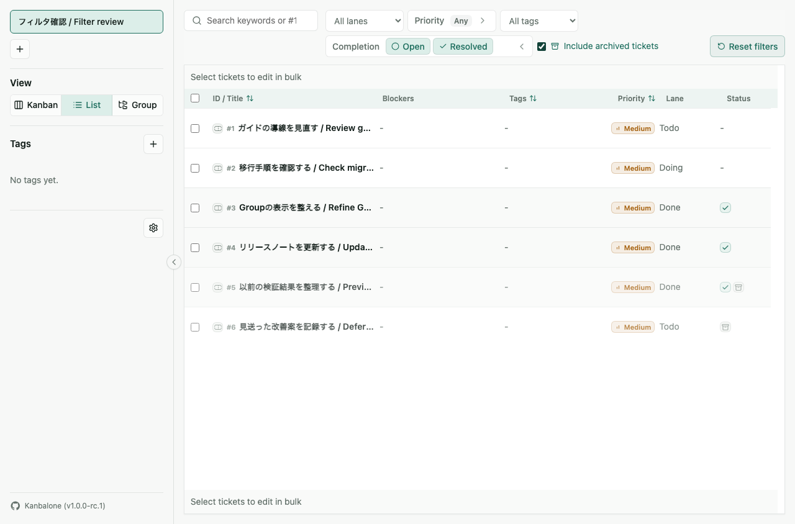

## 10. Find Tickets

Type in the search field above Kanban or List to narrow down tickets.

- **Keywords**: search titles and bodies, for example `login`.
- **Ticket numbers**: `#123` or `123`.
- **External issue numbers**: `gh#123`, `github#123`, `ext#123`, or the reference shown on the ticket.

Use **Priority >** to select Low, Medium, High, or Urgent. You can choose more than one.

Click **×** at the right of the search field to clear your search.

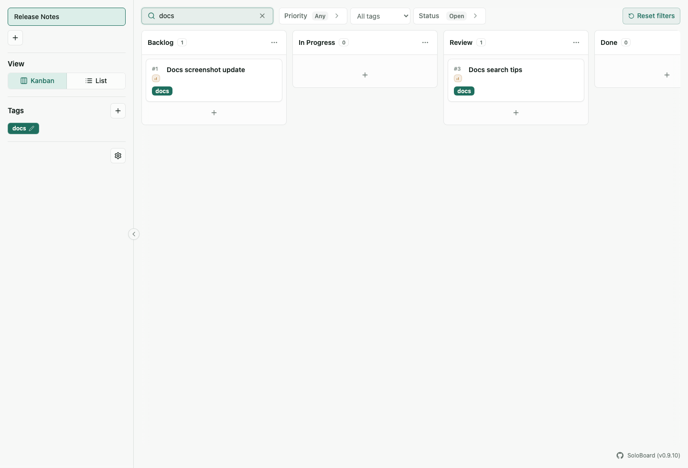

Large Kanban lanes and Group views render cards and rows around the visible area. The browser's Find command searches only the rendered content. Use Kanban's search field to search all tickets in the current filters. In a large Group or No Group view, use that view's ticket search to find a ticket by title or `#ID`, including rows outside the visible area.

### Find And Open Tickets With The Keyboard

Press **/** to focus search in Kanban or List. In Group and No Group it focuses the ticket search when that field is available. You can use the shortcut while working on the board outside a text field or a dialog.

In Kanban or List, press **↓** in the search field to select a displayed ticket.

- **List**: use ↑↓ to move between tickets.
- **Kanban**: use ↑↓ within a lane and ←→ between lanes. Lanes with no matching tickets are skipped.
- **Enter**: open the selected ticket.
- **Esc**: close the detail and return to the same ticket and scroll position. Press it again on the ticket to return to search.

Your filters stay in place, so you can continue to the next ticket. If the original ticket is no longer displayed, focus returns to search. Use **Show more** to reveal more tickets in a completion lane.


## 11. Classify Work With Tags

Add tags to classify tickets by type or purpose. Use the tag filter to show tickets with a particular tag.

- **Create a tag**: click **＋** under **Tags** in the sidebar.
- **Change its color**: click the tag.
- **Add it to a ticket**: choose it under **Tags** when editing. To create a new tag there, enter its name and click **＋**.

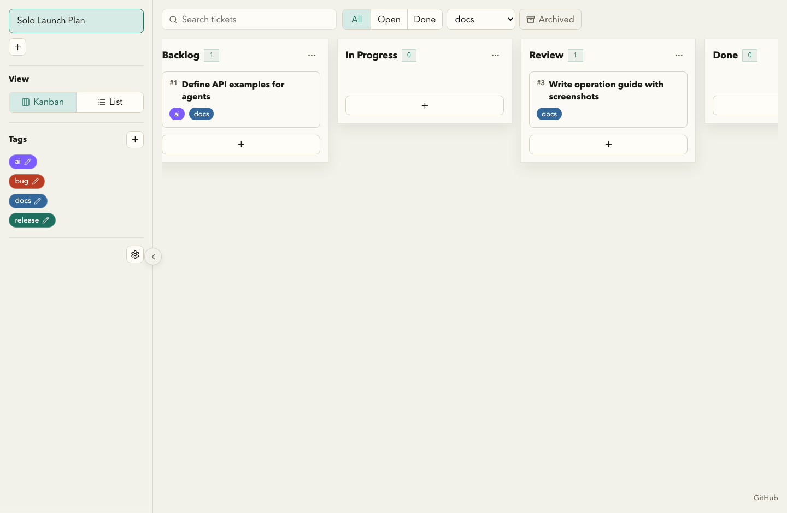

## 12. Review In List View

Open **List** in the sidebar to see ticket priorities and resolved or archived states in a table.

Choose a lane to narrow the list. If the lane and completion state do not match, such as a completion lane with Open selected, the empty list explains why. Choose **Include resolved tickets** or **Clear lane filter** to adjust the selection. Your search and tag filters stay in place.

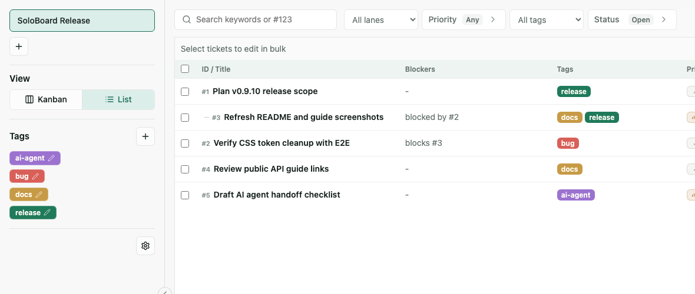

Check tickets to reveal bulk actions.

- **Move**: move the selected tickets. Choose a completion lane to mark them all resolved.
- **Archive**: hide them from the list.
- **Restore**: remove their archived status.

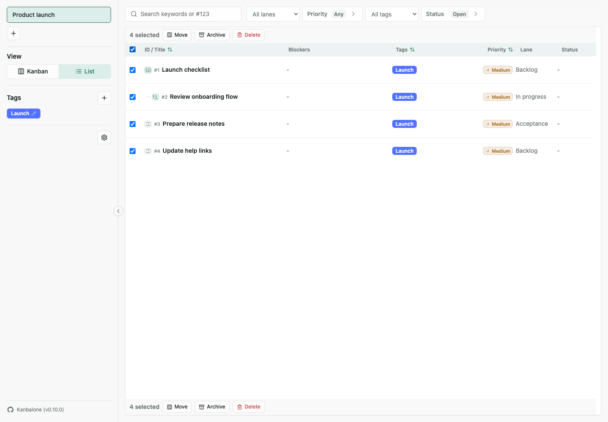

## 13. Organize work with Groups

Bring tickets with a shared purpose together in a Group.

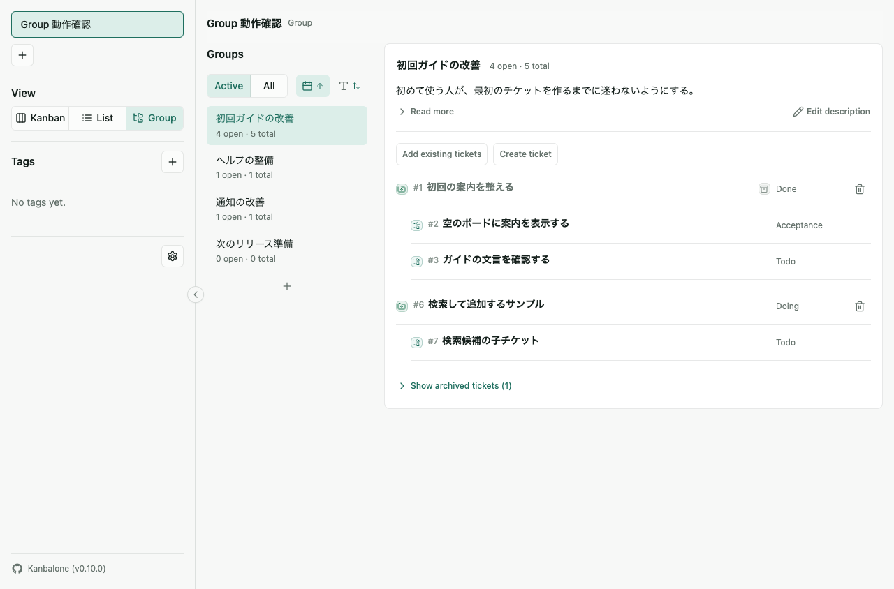

1. Open **Group** in the sidebar and use **＋** below the Group list to create one.
2. Choose **Add existing tickets** to add tickets, or **Create ticket** to make a new one.
3. Select a Group on the left to see its tickets.

Click the Group name to rename it, or **Add description** to write a Markdown description. You can also open a Group from its link in ticket details.

- **Sort Groups**: use the calendar or text icon to sort by creation date or name. Press again to reverse the order.
- **Remove membership**: use the trash icon on a ticket row. This does not delete the ticket. To move a ticket to another Group, remove it first, then add it there.
- **View archived tickets**: choose **Show archived tickets**. An archived parent remains visible when it has unarchived children, so their relationship stays clear.

By default, completed tickets stay in the list with a check mark and subdued text. Unfinished children remain emphasized even when their parent is completed.

**Active** shows Groups with unresolved, unarchived tickets, plus empty Groups. Find Groups whose work is finished under **All**.

Starting in v1.4.0, use **Open only** above the ticket list to hide completed tickets in the selected Group or **No Group**. It starts off, and this browser remembers the choice separately for each board. **Show archived tickets** remains an independent condition. A completed parent with an open child stays as a labelled, non-interactive reference row so the relationship remains visible. To open that parent’s details, turn the filter off and enable **Show archived tickets** if the parent is archived.

This filter changes the ticket list; Group-wide progress and membership counts still describe the whole Group. The Group’s open count continues to exclude archived tickets. It does not change ticket completion or Group membership, and it does not change the completion filters in other views.

A ticket can belong to one Group. Parent and child tickets are added or removed together. When connecting tickets from different Groups, choose which Group they should share.

Groups belong to a board. Moving a ticket to another board removes its Group membership. To delete a Group, first remove all its tickets, including archived ones.

## 14. Settings

Open the sidebar gear to rename the board, set completion lanes, export or import data, or delete the board.

**Rename the board**: click the pencil beside its name, edit it, and press **Enter** to save. Press **Esc** to cancel.

**Set completion lanes**: under **Completion lanes**, click **Set up** (or **Change**), select lanes, and click **Save**. If ticket completion states will change, review the counts before confirming.

**Language**: choose **日本語** or **English** in the gear panel. Kanbalone initially follows your browser language and remembers your choice in this browser. Board names and ticket content stay as you wrote them.

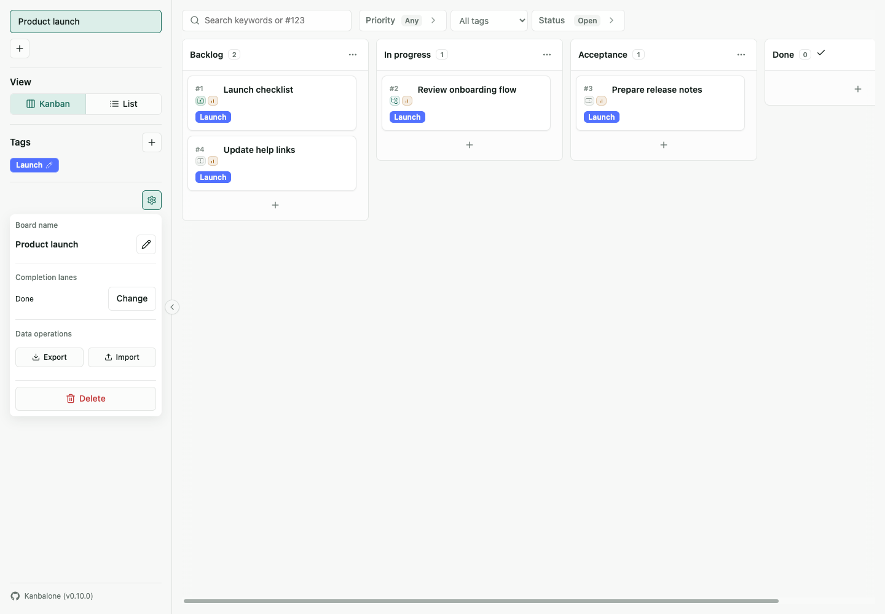

## 15. Dark Mode

Set your OS or browser appearance to dark mode, and Kanbalone switches automatically.

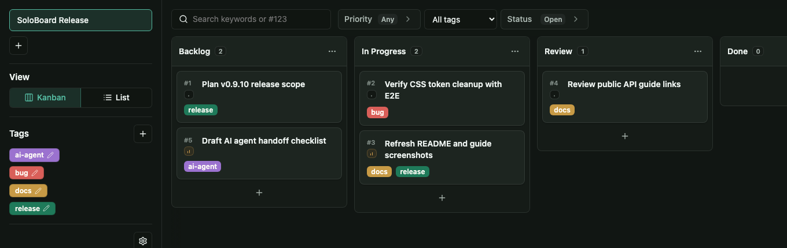

## Try With Docker

```bash
docker run --rm \
  -p 3000:3000 \
  -v kanbalone-data:/app/data \
  ghcr.io/wamukat/kanbalone:v1.4.0
```

Open:

```text
http://127.0.0.1:3000
```

This command saves data in `kanbalone-data`, so it remains available when you recreate the container.

Kanbalone does not include authentication. Do not expose it directly to untrusted networks.

## Custom views across boards

Custom views are available starting in v1.4.0.

Open **Custom views** in the sidebar to save a named list across boards. Choose all boards or specific boards, then configure tags separately for each board. Tags on one board match with OR; a ticket appears once even if several tags match.

- **Not configured** or all tag checkboxes off: that board contributes no tickets.
- **Do not filter by tags**: include tickets regardless of their tags. Select this explicitly.
- **All boards** includes newly created boards as configuration choices. They contribute no tickets until their tag rule is set.

Choose open, completed or all completion states. Archived tickets are excluded. The list keeps board sections and the existing board, lane and ticket order. Total and board counts describe all matching tickets, including those on later pages.

Show or hide the body and latest comment independently. These display changes are temporary until saved; **Revert** restores the saved settings. Reloading restores the saved view. Expand an excerpt to read the original text. The latest comment includes its posting time, without an author field; tickets without comments say so.

Open a title to use the usual ticket details, comments and lane controls. Posting a comment does not change its lane or tags. A ticket stays in the view as long as it matches the conditions. When it stops matching, closing the details returns focus to a nearby ticket or the view heading.

Renaming a board or tag preserves the selection. Deleted references are shown for repair and never turn into an unrestricted filter; recreating the same name does not reconnect it. Deleting a custom view only deletes its settings.

Saved views belong to the database and are included in a full database backup. A single-board JSON export or import does not transfer cross-board view settings.
