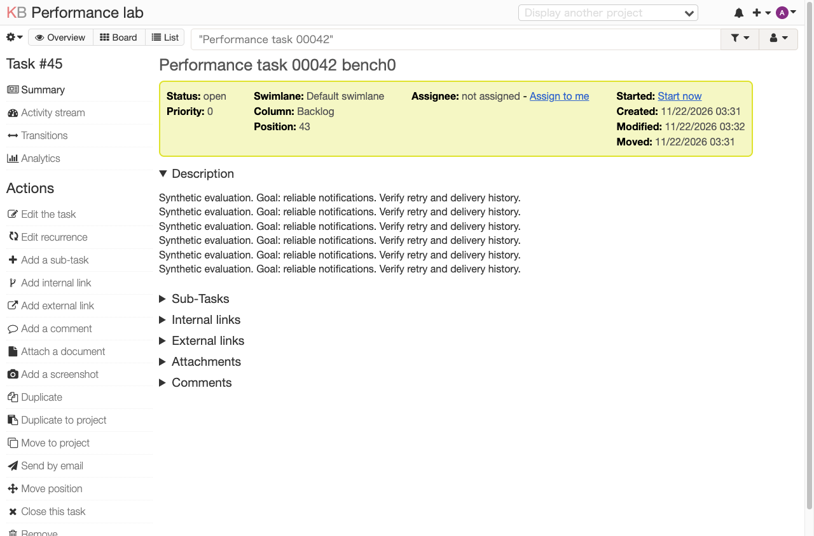
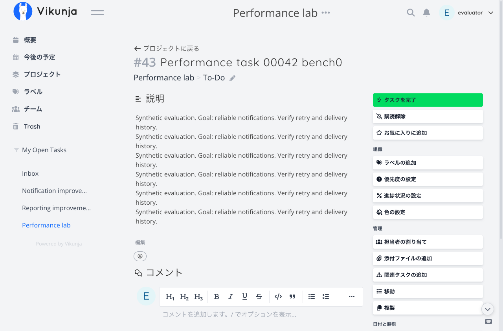
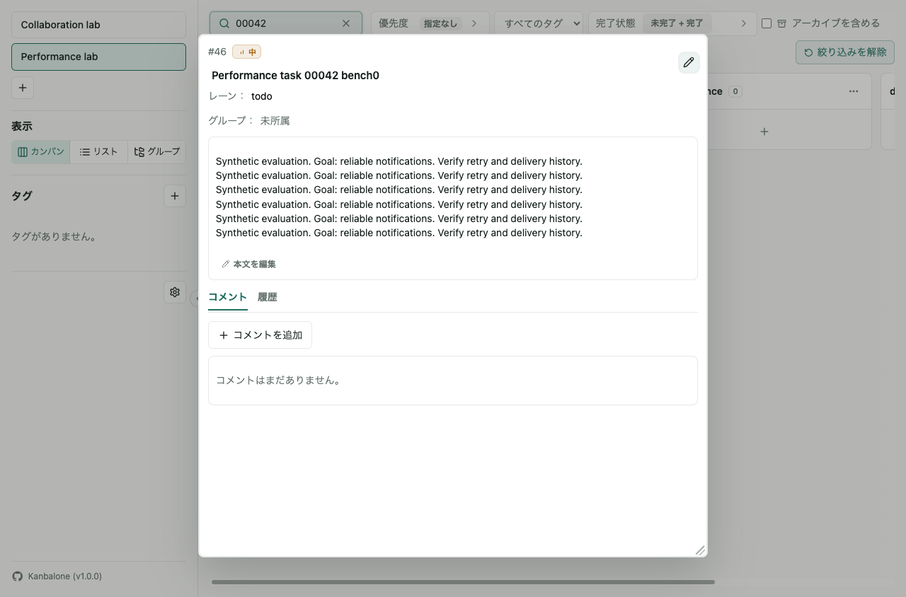

# API応答性能とブラウザ操作の比較

実施日: 2026-11-22。Kanboard 1.2.58 / Vikunja 2.8.0 / Kanbalone 1.0.0。

更新確認: 2026-11-28。本書の数値・画像・操作観察はすべて上記の旧版による歴史的記録であり、現行版の再計測結果ではない。現在の実装状況は末尾に分けて記載する。

**今回の100件・ローカル環境では、KanbaloneのAPI読み取りは速かった。ただし他2製品も通常は数十ms以内で、以前感じられた重さをAPIだけで説明する結果にはならなかった。見た目の整理、操作の手数、画面側の反応は別に評価する必要がある。**

## 1. APIの実測

同じ本文522文字・タイトル形式の未完了チケット100件を、各製品の専用ボード／プロジェクトに作成。SQLite、同一Dockerホスト（4 CPU、約8 GB）、localhost HTTP。既存ユーザーデータは操作していない。既存の他コンテナも稼働しており、占有環境のベンチマークではない。

各操作はウォームアップ3回＋計測30回。製品の順序を循環させ、一度に1リクエスト、HTTP開始から本文受信完了までを計測した。接続は都度作成、JSON解析時間は除外。ログイン時間は含めない。認証方式やレスポンス内容は製品固有のまま。

単位ms。各欄は **中央値 / p95**（30回の近順位法）。数値はこの実行の結果であり、将来の性能保証ではない。

| 操作 | Kanboard | Vikunja | Kanbalone |
| --- | ---: | ---: | ---: |
| 100件取得 | 17.97 / 27.45 | 30.77 / 37.84 | 9.78 / 14.24 |
| 1件詳細取得 | 9.85 / 11.78 | 9.14 / 11.48 | 7.19 / 8.46 |
| 1件に絞る検索 | 10.77 / 12.76 | 9.21 / 10.75 | 6.13 / 7.56 |
| タイトル変更 | 34.85 / 44.01 | 15.81 / 25.07 | 15.06 / 26.23 |

Vikunjaの一覧は`per_page=100`でも標準設定で50件となったため、2ページを逐次取得した合計。ほかは1リクエストで100件。API単発の処理時間比較ではなく、「100件を取り切る」作業時間の比較である。検索結果は全製品1件、一覧は100件であることを毎回検証した。

Kanbaloneの一覧は要約で、他製品の一覧は本文などを含む。レスポンス量は計測JSONに記録している。転送量が小さい設計は一覧用途の利点だが、同じ全情報を返すエンジン性能の比較とは言えない。タイトル変更も、Kanboardは成功真偽、他はオブジェクトを返すなど差がある。

全360計測は正常応答。速度は本文受信完了までで、UI反映・ディスクへの障害耐性までは表さない。書込p95ではKanbaloneがVikunjaを上回る時間だった。全操作で常に最速とは主張しない。

[生データと条件](../../development/evidence/2026-11-22-api-ui-performance/api-benchmark.json)・[計測コード](../../development/evidence/2026-11-22-api-ui-performance/benchmark.py.txt)。当時のコードを非実行の抜粋として保存している。必要な私的APIヘルパー・認証ファイルは同梱しておらず、このファイル単体では再実行できない。[資料の範囲と再計測条件](../../development/evidence/2026-11-22-api-ui-performance/README.md)を参照。

### 更新APIの扱いで見つかった差

VikunjaへタイトルだけをPOSTすると、既存のdescriptionが空になった。部分更新として扱った最初の試行は公平な比較から外し、GET済みのオブジェクトのタイトルだけを変更して送る方式で再計測した。表の更新時間には先行GETは含めない。最新状態を都度GETする運用では、その往復が追加になる。古い全体を戻す場合の競合も別途検証が必要である。

KanboardとKanbaloneでは、このタイトル変更で本文522文字を保持した。これは今回確認したフィールドの結果で、全フィールドへの一般化はしない。Vikunjaの仕様差を保存障害とは呼ばないが、AIからの小さな変更に必要な知識・実装量としては評価対象になる。

## 2. ブラウザで実際に行った操作

agent-browserでログインし、100件の一覧から検索→詳細→本文編集→保存を実施した。保存後はAPIで本文を再取得し、3製品とも入力した確認文を保存できた。[保存結果](../../development/evidence/2026-11-22-api-ui-performance/gui-save-readback.json)

Vikunjaのrich text欄ではツールのfillが既存本文への追記となったため、他2製品と完全に同じ置換操作とは扱わない。検索欄もfill直後に候補が更新されず、通常キー入力後に更新された。これらはブラウザ自動操作との差の可能性があり、製品の入力バグと断定していない。

軽快さについて、クリックから詳細の見出しが現れるまでを補助的に観察した。Kanbaloneは約373ms、Vikunjaは約548ms（見出し検出後2フレームまで）、Kanboardは約100ms（遷移先DOMContentLoadedまで）。**終点が異なる各1サンプルなので、順位付けには使わない。** APIが7〜10ms程度でも、画面が同じ時間で反応するわけではないことを示す探索値である。描画・アニメーション・バックグラウンドタブのスケジューリングを分解した測定ではなく、INPでもない。

[観測値と制限](../../development/evidence/2026-11-22-api-ui-performance/browser-observations.json)・[ブラウザ側の観測コード](../../development/evidence/2026-11-22-api-ui-performance/observe-detail.js.txt)。ブラウザツールの起動時間や応答待ちをUI処理時間として計上していない。

## 3. 見た目と操作品質の評価

以下は2026-11-22の旧版を同一1280×844・ライトテーマの画面を実際に操作し、画像を見て行った専門的判断。人間の嗜好調査ではない。「古い見た目だから遅い」「機能が多いから品質が悪い」とは扱わない。

1. **Kanboard: 情報の優先順位が弱い。** 詳細左側に編集、繰返し、リンク、添付、複製、メール、移動、終了などが縦に並び、上部には状態・担当・日時が強い色面に集まる。本文を読んでメモする用途では、目的以外の情報も同じ強さで視界に入りやすい。一方、操作名が常時読めるので発見性は高い。画面遷移も今回すばやく、見た目を理由に「遅い」とは評価しない。
2. **Vikunja: 余白は整っているが、本文の場所を操作群が圧迫する。** 左ナビと右側の多数の操作ボタンに挟まれ、同じ本文が細く折り返される。Kanboardでは6行の本文が、今回のVikunja画面では約12行になった。本文の編集やコメントへの移動が縦に長くなりやすい。横断検索・キーボード導線は優れており、そこはKanbaloneも学ぶべきである。
3. **Kanbalone: 読む情報と操作を絞れている。** 詳細は本文とコメントを中心に構成し、低頻度操作の常時表示が少ない。今回の用途との適合だけでなく、視覚的な優先順位の違いとして確認できた。ただし一覧では空のレーンも幅を使い、詳細を開く速度もAPI速度だけからは保証できない。キーボードから探して連続処理する導線には依然改善余地がある。
4. **API性能と「サクサク感」を別々の品質指標にする。** 検索結果の表示まで、詳細を開いて入力可能になるまで、保存完了が分かるまでを測る。操作が成功しても目線移動やスクロールが多ければ、その負担は残る。用途の違いだけで不満を説明しない。

### 同じ本文を表示した詳細画面

Kanboard:

Vikunja:

Kanbalone:

## 4. 今回の結果からの判断

開発の出発点だった不満は、製品の目的の違いだけで片付けるべきではない。本文に集中できる情報配置、少ない往復、素早い反応は、それ自体で磨くべき品質である。

ただし、今回のバージョン・100件・localhostでは、KanboardやVikunjaのAPIに深刻な遅さは再現しなかった。以前の体験を否定する結果でもない。当時のバージョン、件数、DB、ホスト性能、ネットワーク、連携方法による差は未確認である。

Kanbaloneの強みは「競合が遅い」ではなく、**人が読む・判断する・少し書く操作と、AIが必要な情報を取り出して更新する操作の両方を軽くすること**として育てたい。今回の読み取り速度はその材料になるが、1000件以上・長文／多数コメント・同時更新・ネットワーク遅延下の測定を経るまでは大規模性能を宣伝しない。UIは同一の描画完了条件で反復測定することが次の検証になる。

## 5. 現行実装との関係（2026-11-28）

Kanbalone main `92571d1` ではページングとKanban／Groupの仮想化、一覧のキーボード移動、作成・レーン移動・ダイアログ確定、詳細の前回表示からの変更が実装済みである。[現行の改善状況](improvement-roadmap.md)と[キーボード操作](keyboard-workflow-plan.md)に根拠をまとめる。1000件の仮想化回帰試験は操作と表示範囲の確認であり、上記のAPI p95やブラウザ観測値の更新ではない。

現在も、同一の描画完了条件による製品横断の反復測定、人間の作業時間・見落とし率の比較は未実施。この調査の旧版画像を、現在の画面や公開版v1.6.0の評価画像として流用しない。
