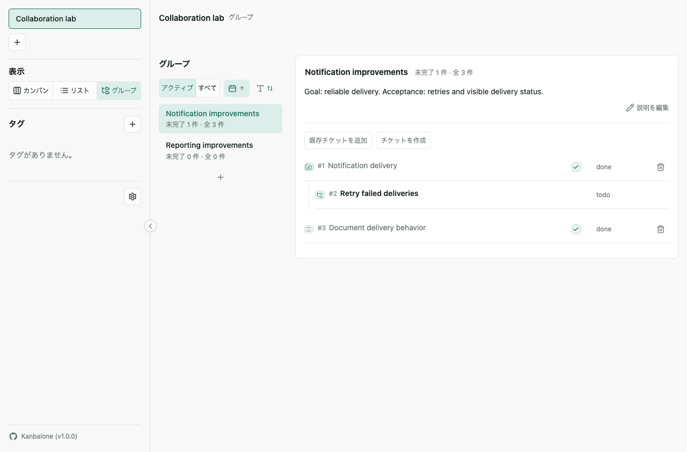
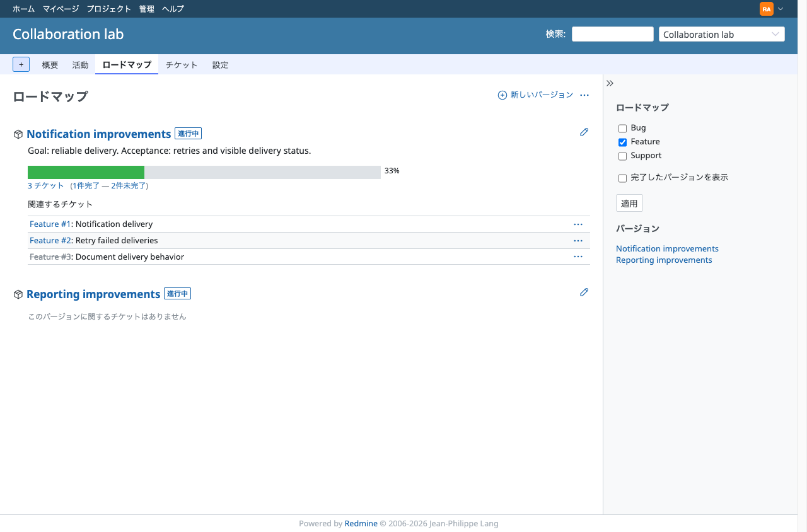
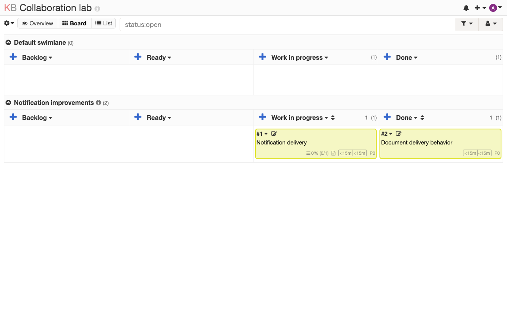
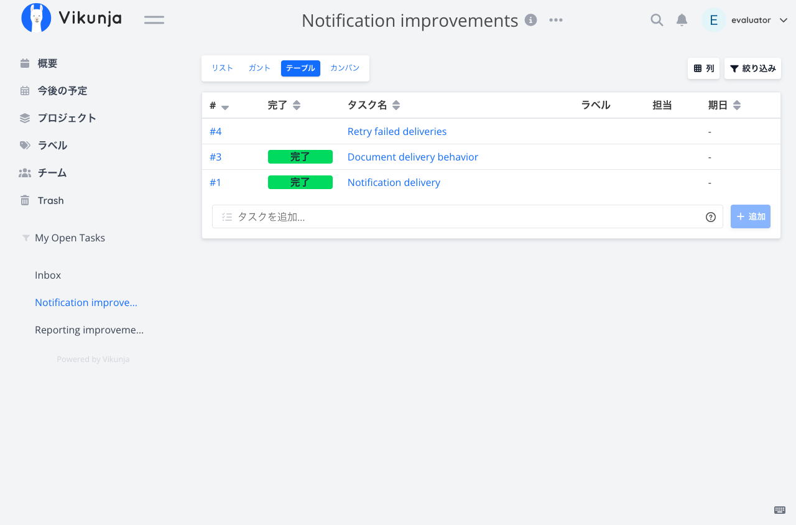

# ローカル実機での協調作業比較

実施日: 2026-11-22。対象: Kanbalone 1.0.0、Redmine 7.0.3、Kanboard 1.2.58、Vikunja 2.8.0。

更新確認: 2026-11-28。以下の実測と画像は2026-11-22の指定バージョンによる記録であり、現行版同士の再評価ではない。Kanbaloneの現在の進捗は[改善状況](improvement-roadmap.md)を参照。

## 結論

**GUIとAPIで作業を引き継ぐことは、今回動かした4製品すべてでできた。Groupの価値は、分類機能の有無よりも「目的に沿った作業を散らさず、残件を見失わない」ためのルールと表示の組み合わせにある。**

Redmineのロードマップでも、目的の説明・完了件数・未完了件数・関連チケットをまとめて見られた。KanboardのSwimlaneでも目的別に作業を分けられた。Vikunjaではプロジェクトと親子関係で整理でき、キーボードから横断検索できた。「目的でまとめられる」「人とAIが同じ記録を使える」だけでは、Kanbaloneならではの強みとは言えない。

一方、今回の標準構成では、**単一所属、親子の所属統一、完了した親を残した残件表示、残件由来のActive**が一つの仕組みとして揃ったのはKanbaloneだった。これは調査した構成内の差であり、業界唯一という意味ではない。

## 1. 方法と限界

同じ架空の「通知改善」を、各製品で自然な単位に置いた。

- 目的: 通知の配送を安定させる。再試行と配送履歴を確認する。
- 親: `Notification delivery`。子: `Retry failed deliveries`。別の完了作業: `Document delivery behavior`。
- APIから作業メモを追加し、GUIで読み、GUIから確認コメントを返し、APIで保存結果を読む。
- 親子の所属変更、親だけの完了、全作業完了、再起動後の保持を確認する。

GUIもAIがブラウザ操作した。人間の参加者による理解度・満足度・作業速度の測定ではない。コメント中の `Human review` はGUI側の模擬レビューであり、実際に通知システムを実装・検証した記録ではない。APIとGUIは同じ利用者の認証で操作し、AI専用ユーザーの権限分離は評価していない。

設定・データは専用コンテナと専用ボリュームに隔離。既存の通常利用環境には書き込んでいない。ブラウザは1280×844、ライトテーマ。標準言語はブラウザに任せたため、Kanboardは英語、他は日本語。日英翻訳の網羅比較ではない。SQLiteと少数データによる機能検証であり、本番DB構成、負荷、長期安定性、複数人の同時編集の保証には使えない。

Jiraは実機未検証。Data Centerの新規試用ライセンス発行終了と利用可能なライセンスがないことを確認し、ユーザー合意で対象外とした。Jira Cloudのカタログ比較をローカル実測に混ぜない。[公式案内](https://confluence.atlassian.com/adminjiraserver107/get-a-jira-data-center-trial-license-1595114470.html)

## 2. 構築結果

| 製品 | この試験で必要だった設定 |
| --- | --- |
| Kanboard 1.2.58 | 公式イメージ、データボリューム、初期adminログイン。GUIでプロジェクトとSwimlaneを作成。設定画面でAPIトークンを取得 |
| Vikunja 2.8.0 | 公式イメージ、PUBLICURL、DB・添付ファイル用ボリューム。UID 1000の書込権限を設定後に起動。GUIから評価アカウントを登録 |
| Redmine 7.0.3 | Docker Official Image、SQLite・添付ファイル用ボリューム。初期パスワード変更、GUIで標準設定ロード、REST API有効化 |
| Kanbalone 1.0.0 | 正式公開イメージと空の専用データボリューム。ボード作成で標準レーンが揃う |

Vikunjaの初回失敗はマウント先の所有者設定によるもの。修正後は起動したため、「アプリが不安定」の証拠にはしない。Vikunjaの署名シークレットはこの実験では明示固定していない。再起動後のAPI試験では再ログインしており、セッション継続性は評価していない。

導入時間の順位は付けない。イメージの取得待ち、ツールの操作ミス、製品への習熟差が含まれるためである。

構築の参照先: [Kanboard](https://docs.kanboard.org/v1/admin/docker/)、[Vikunja](https://vikunja.io/docs/full-docker-example/)、[Vikunja設定](https://vikunja.io/docs/config-options/)、[Redmineイメージ](https://hub.docker.com/_/redmine)。実行イメージID・ポート・ボリュームは[環境記録](../../development/evidence/2026-11-22-product-comparison/environment.json)に保存した。

## 3. GUIとAPIの往復

| 確認 | Kanbalone | Redmine | Kanboard | Vikunja |
| --- | --- | --- | --- | --- |
| APIからチケットと作業メモを登録 | 成功 | 成功 | 成功 | 成功 |
| GUIでAPIのメモを読む | 成功 | 成功 | 再読み込み後に成功 | 再読み込み後に成功 |
| GUIで確認コメントを投稿しAPIで再取得 | 成功 | 成功 | 成功 | 成功 |
| 親子と目的別のまとまりを作る | Group＋親子 | 対象バージョン＋親子 | Swimlane＋埋込サブタスク | プロジェクト＋親子関係 |
| 再起動後の取得JSON | 再起動前と一致 | 再起動前と一致 | 再起動前と一致 | 再起動前と一致 |

KanboardとVikunjaでは、詳細画面を開いたままAPIから追加した最初のコメントは、観察中には表示されず、再読み込みで表示された。更新通知全般の不具合とは断定しない。KanbaloneとRedmineでは、その最初のコメントの投稿後に詳細を開いており、同じ条件での自動反映速度比較には使わない。

KanboardとVikunjaで最初のGUI投稿が保存されなかった場面は、画面外の送信ボタンをブラウザ操作ツールがクリックできていなかった。スクロールして実際にボタンを押すと保存された。製品の保存障害として数えない。

[往復のAPI保存結果](../../development/evidence/2026-11-22-product-comparison/handoff-results.json)と[再起動比較結果](../../development/evidence/2026-11-22-product-comparison/restart-check.json)を根拠とする。画像だけで永続化を証明しない。

## 4. Groupに近い仕組みを実際に使った結果

| 観点 | Kanbalone Group | Redmine 対象バージョン | Kanboard Swimlane | Vikunja プロジェクト |
| --- | --- | --- | --- | --- |
| 目的と説明をまとめる | できた | できた。ロードマップに説明・進捗・関連課題 | できた。ボード内を横方向に分割 | できた。複数ビューで作業を見る |
| 親子を別のまとまりに分ける | 子だけの直接上書きは409。解除プレビューは親子2件を対象にした | 子だけ対象バージョンを変更できた。親は元のバージョン | サブタスクは親内部の項目で、独立したSwimlane所属ではない | 子だけ別プロジェクトへ移動できた。親子関係は残った |
| 親だけ完了、子は未完了 | できた。完了親を残して子を強調表示 | この標準設定ではClosedへ変わらず、Resolvedのまま。子の完了後はClosedになった | `closeTask`により子もDoneになった | できた。標準Listでは未完了の子だけが残る |
| 完了と未完了を一緒に見る | Groupの通常表示。アーカイブのみ別操作 | ロードマップで完了課題に取り消し線、完了／未完了件数 | Done列とclosedは別。closedの親は標準`status:open`ボードから消えた | Tableで両方表示できた。完了欄が明示される |
| 全作業完了後 | GroupがActive一覧から外れ、Allで取得できる。子を再開すると戻る | バージョンはopenのまま | Swimlaneはactiveのまま | プロジェクトは未アーカイブのまま |

Redmineでは、APIのHTTP成功だけでは希望したステータスになったと判断できなかった。初期作成時のClosed指定や未完了の子がある親のClosed指定は、取得結果で反映されていないことを確認した。AI側は他製品でも更新後の状態を読み直す必要がある。設定・ワークフローを変えた場合の挙動までは一般化しない。

Vikunjaの標準Listにはビュー自身の`done = false`条件があった。画面の追加フィルターに`done = true || done = false`を入れても完了分は増えず、Tableへの切替で全件を確認できた。「完了を表示できない」のではなく、ビューと追加フィルターの関係を理解する必要がある。子をプロジェクト間で往復させると、内部IDは2のまま、画面のプロジェクト内番号は#4になった。APIと画面の番号を同一視しない点も運用上の学びとなった。

Kanboardのサブタスクは、独立したチケットよりチェック項目に近い。独立したチケット間の内部リンクもあるが、今回はその方式での再設計や自動アクション・プラグインは試していない。埋込サブタスクの結果を、すべての関連タスクへ一般化しない。

[所属と親子の記録](../../development/evidence/2026-11-22-product-comparison/group-semantics.json)・[全件完了後の記録](../../development/evidence/2026-11-22-product-comparison/completed-collections.json)・[Kanbaloneの解除／再所属／Active判定](../../development/evidence/2026-11-22-product-comparison/kanbalone-group-lifecycle.json)。

### 比較画像

Kanbalone: 完了した親と未完了の子を同じまとまりのまま見る。

Redmine: ロードマップでも説明、件数、完了課題と残件をまとめて確認できる。この価値はGroupだけのものではない。

Kanboard: Swimlaneで目的と作業段階を同時に見渡せる。

Vikunja: Tableで未完了・完了を一緒に確認できる。

## 5. キーボード操作から得たこと

Kanboardではボード上の`n`で新規作成を開けた。Vikunjaでは`Cmd+K`から検索欄を開き、`Retry`で対象を探せた。候補にはプロジェクト名と親の文脈も表示された。

これは当時のKanbaloneが伸ばすべき領域だった。「軽量だからキーボードでも速い」とは現状言えない。単なるショートカット数より、目的の作業へ入る→読む→メモを残す→次の作業へ移るという流れを短くすることが重要。

[Kanboardの作成画面](../../development/evidence/2026-11-22-product-comparison/kanboard-keyboard-create.png)・[Vikunjaの検索](../../development/evidence/2026-11-22-product-comparison/vikunja-keyboard-search.png)。この4製品比較での、検索後のキーボードだけによる全作業完遂や実利用者の時間比較は未実施。

2026-11-28のmain `92571d1` では、`/`、矢印、`N`、Kanban/Listの`M`、ダイアログのCtrl/Cmd+Enter、表示対象のGroup検索が実装済み。[現在の操作と検証範囲](keyboard-workflow-plan.md)を参照。旧版の比較画像から、これらが現在も未実装だとは判断しない。一方、上記4製品の作業速度を再比較した結果でもない。

## 6. Kanbaloneの強みとして何を言えるか

### 強みにしてよい表現

> **目的ごとの作業を、親子ごとひとまとまりに。終わった経緯を残しながら、人とAIが次に進める残件を見渡せる。**

Groupは、独立したチケットの作業段階を維持しながら、所属だけを揃える。親を完了しても子を勝手に完了させず、親子の所属変更はまとめて扱う。残件がなくなればActiveから外れるため、目的のまとまりを別途「終了」にする管理も要らない。

AIにとっては「どの範囲を取得・変更するか」が定まりやすく、人にとっては「残りはどれか」を確認しやすい、という価値仮説を支える実機結果になった。ただし、再説明回数や見落とし率の削減はまだ測っていない。

### 同時に伝える制約

- 複数のテーマにまたがる仕事には単一Groupが不便な場合がある。横断分類はタグなど別の手段が必要。
- 親子を別の目的に分けたい利用者には、RedmineやVikunjaの柔軟さが適する。
- 別Groupへの移動に「解除→追加」が必要で、単純な付け替えより手数は増える。安全性だけを取り上げず、この負担も扱う。
- 空GroupはActiveに残る。放置した空Groupの整理が完全に不要になるわけではない。
- 複雑な階層、権限、進捗集計を必要とする組織に、Groupだけで足りるとは言わない。

### 伸ばす順番

1. **Groupの文脈へ短く入れる。** キーボードからチケットを探し、所属Group・親子・残件へ移れる導線を磨く。
2. **AIへの引き継ぎ品質を確かめる。** Groupの目的、残件、最新の検証コメントから、別セッションのAIが次の作業を特定できるかを測る。取得量と読み直しの負担も比較する。
3. **更新の確かさを磨く。** 古い画面を開いたまま別主体が更新した場合、競合や最新状態が分かるかを同条件で検証する。
4. **外部トラッカーとの併用価値を実証する。** Redmine単独とRedmine＋Kanbaloneで、原文更新・ローカル検討・選択報告の往復を比較する。今回の実験ではこの連携までは行っていない。

## 7. 運用に耐えると言える範囲

今回確認できたのは、小規模な作業記録の受け渡し、親子・所属ルール、通常の再起動後の保持まで。4製品とも、この範囲の基本運用は成立した。SNSの不満をそのまま再現結果とは扱わない。特にVikunjaの長期的な不安定さを裏付ける結果は今回得ていない。

長期運用の判断には、同時編集、ネットワーク断と再送、数百件での一覧・並べ替え、バックアップからの復元、バージョン更新、AI権限の制限、実利用者による受入判断を追加する必要がある。この2026-11-22の4製品実験では故障注入、復元試験、MCP接続、AIによるコード実装、外部サービスへの送信は行っていない。「本番運用を保証した」「総合的に他製品より優れている」とは結論しない。

評価環境は当時、通常利用環境とは分離して構築した。公開資料は履歴のJSON・画像であり、稼働中の環境・認証情報・復元可能なボリュームを配布するものではない。再検証では新しい隔離環境と合成データを用意する。保存資料の範囲は[証拠一覧](../../development/evidence/2026-11-22-product-comparison/README.md)を参照。

## 応答性能とUI品質の追加評価

[100件でのAPI計測とブラウザ評価](api-ui-performance-comparison.md)で、応答時間と視覚的な操作負担を分けて確認した。
