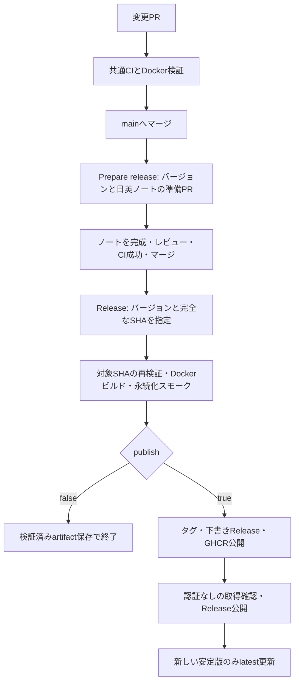

# CIからリリースまでの自動化

ローカルKanbalone #1489の実装仕様です。操作手順は[リリース手順](./release.md)を参照してください。ワークフローの実装と、GitHub上での導入確認は区別します。リポジトリ設定、Actionsでの実行、RC公開の確認は別途必要です。

## 1. 公開までの流れ

人が決めるのは、変更の受け入れ・バージョン・リリースノート・公開開始です。公開用ワークフローは`main`からのみ起動でき、指定SHAが`main`に含まれることを対象コードの実行前に確認します。

## 2. 実装したワークフロー

| ファイル | 起動 | 処理 |
| --- | --- | --- |
| `verify.yml` | `workflow_call` | frozen install、配布スキル検査、`pnpm check`、Chromium E2E |
| `ci.yml` | PR / main push / 手動 | 共通検証、Dockerビルド・スモーク、固定名 **Required checks** への集約 |
| `prepare-release.yml` | mainから手動 | `codex/release-VERSION`でバージョン・現行配布例・日英ノートの雛形を更新しPR作成 |
| `release.yml` | mainから手動 | 指定SHAの検証、イメージ保存、任意でタグ・GHCR・GitHub Releaseの公開 |
| `pages.yml` | 従来の起動条件 | 製品リリースと独立したドキュメントサイト公開 |

旧`docker-image.yml`、`openapi-lint.yml`、`docker-publish.yml`は置換し、タグpushから直接イメージを公開する経路を廃止しました。

共通検証は[再利用可能なworkflow](https://docs.github.com/en/actions/how-tos/reuse-automations/reuse-workflows)として実装しています。通常の検証はcontents read、準備PR作成はcontents／pull requests write、公開jobだけがcontents／packages writeを使用します。

## 3. 検証と配布の境界

- 必須CIにパスフィルターはありません。前提ジョブの失敗・中断・skipは集約チェックを失敗させます。
- `pnpm check`でOpenAPI・単体/API・型・docsを確認し、含まれていないChromium E2Eは別ジョブで実行します。ログ・レポートの保存期間は30日です。
- Gitアーカイブに含めるスキルは`skills/kanbalone-api`のみです。`dev/skills`などが混入したら失敗します。Dockerにはスキルを含めません。
- リリース準備で日英ノートを雛形として生成します。レビュー前のマーカーやプレースホルダーが残っていると公開できません。過去の移行例やエビデンスは一括置換しません。
- 対象SHAとpackage/OpenAPIのバージョンを照合します。実行途中にmainの最新へ追従しません。
- `linux/amd64`のDockerイメージをビルドし、隔離した新規volumeで起動・作成・更新・再起動後の読み戻しを検証します。既存ユーザーのデータは使用しません。
- 検証済みイメージをSHA・イメージID・アーカイブのハッシュとともにartifactへ保存します。公開jobはこれを読み込み、再ビルドしません。
- dry-runは公開せずartifact保存まで実行します。後日の公開実行では再度検証・ビルドし、その実行で検証したartifactを公開します。
- GHCRの`vVERSION`／`VERSION`を認証なしでpullし、イメージID・revision・versionを確認します。registry digestとローカルimage IDは別々に記録します。
- RCはlatestを変更しません。安定版でも現在のlatestより新しい場合のみ更新します。

Dockerスモークは[公開前のイメージ検証](https://docs.docker.com/build/ci/github-actions/test-before-push/)に、Kanbaloneの書き込みと永続化確認を加えたものです。既存データのmigration・バックアップ・復元検証（#1490）の代替ではありません。

## 4. 途中失敗と再実行

公開を伴う実行は共通のconcurrencyで直列化し、後続の実行で中断しません。同名タグ・Release・GHCRタグに異なる内容があれば上書きせず停止します。

途中失敗時は同じActions実行の失敗ジョブを再実行し、保存済みartifactを使用します。全ジョブの再実行ではイメージも再ビルドされるため、公開が始まった実行の復旧には使いません。artifactの保持期間は30日です。失効して元の成果物を復旧できない場合、公開済みタグを移動せず新しいpatch版を準備します。

ユーザーDBのロールバック、稼働コンテナの更新、ローカルKanbaloneのチケット操作はGitHub runnerから行いません。

## 5. GitHubで残る導入確認

1. mainのルールでPRレビューと **Required checks** を必須化し、実際のPRにチェックが紐付くことを確認する。
2. ActionsによるPR作成を許可する。GitHub Appを使用する場合は、必要な権限でインストールし、変数`RELEASE_APP_ID`とシークレット`RELEASE_APP_PRIVATE_KEY`を設定する。
3. App未設定時は`GITHUB_TOKEN`で準備PRを作成し、承認待ちのCIを承認する。App使用時に追加承認なしでCIが動くことも確認する。[GitHub公式のトークン仕様](https://docs.github.com/en/actions/concepts/security/github_token)
4. マージ済みSHAでdry-runを実行し、CI・E2E・Docker・artifactを確認する。
5. 明示的な公開判断後にRCを公開し、タグ・日英ノート・GHCRの認証なし取得と、latestが変わらないことを確認する。途中失敗の再実行も検証する。
6. #1490で決める既存データの更新・バックアップ・復元検証を隔離fixtureで追加する。

これらのリモート設定・実行確認と復旧検証、人間による受け入れが揃ってからv1.0.0の公開を判断します。
