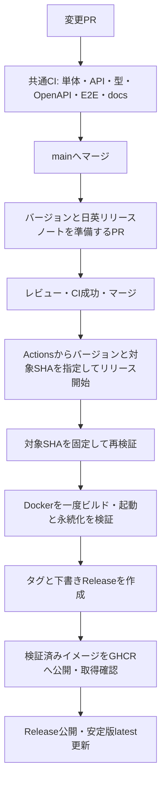

# CIからリリースまでの自動化案

検討チケット：ローカルKanbalone #1489。2026-11-21時点の設計案であり、ワークフロー・GitHub設定はまだ変更していません。現行手順は[リリース手順](./release.md)を参照してください。

## 1. 推奨する流れ

人が決めるのは、変更内容の受け入れ・リリース番号・リリースノート・公開開始です。バージョン編集、検証、タグ、GHCR、GitHub Release、公開結果照合はActionsで実行できる形にします。リリース開始の後に別の承認を重ねることは初版の必須条件にしません。

## 2. 現状と不足

| 現状 | 不足 | 対応案 |
| --- | --- | --- |
| `docker-image.yml` はPR/mainでビルド | 起動・書き込み・再起動確認なし | 配布イメージのスモークテストを追加 |
| `openapi-lint.yml` は限定パスで実行 | 単体/API/E2E/public型検査をCIで保証していない | 共通検証workflowへ統合 |
| `pages.yml` はdocs生成・公開 | サイト公開と製品リリースの対象が混同されやすい | docs生成を共通CIでも実行。Pages公開は別用途として維持 |
| `docker-publish.yml` は `v*` tag pushで直接公開 | 検証への依存、バージョン照合、Release作成なし | 手動起動するrelease workflowへ置換 |
| GitHub Release作成、バージョン更新、チェックはローカル作業 | 作業漏れ、検証と公開のSHAずれ | 準備PRと対象SHA固定、実行結果の記録 |

`pnpm check` にE2Eは含まれないため、CIではPlaywrightを別ジョブで必ず実行します。必須チェックにするworkflowにはpaths条件を付けず、テスト・skill・workflowだけの変更もチェック対象とします。

## 3. ワークフローの責務

| 案のファイル | 起動 | 処理 | 書き込み権限 |
| --- | --- | --- | --- |
| `verify.yml` | `workflow_call` | frozen install、OpenAPI、単体/API、server/public型、docs生成、Chromium E2E | なし |
| `ci.yml` | PR / main push | 共通検証、Dockerビルドとスモーク、結果を集約する固定名の必須チェック | なし |
| `prepare-release.yml` | 手動、次バージョン入力 | `codex/release-X.Y.Z`でバージョン・配布例を更新、日英ノートのたたき台を作りPR化 | contents/PR writeのみ |
| `release.yml` | 手動、バージョン・完全なコミットSHA入力 | 共通検証、イメージ検証、タグ、下書きRelease、GHCR公開、公開確認 | 公開ジョブのみcontents/packages write |
| `pages.yml` | 現行用途を維持 | ドキュメントサイト公開 | pages/id-token writeのみ |

共通検証は`workflow_call`で再利用する案です。[GitHub公式：再利用可能なworkflow](https://docs.github.com/en/actions/how-tos/reuse-automations/reuse-workflows)

### 必須チェックの内容

- Nodeはリポジトリが指定するLTSバージョン。pnpmはpackageManagerと一致させる。
- `pnpm install --frozen-lockfile`、OpenAPI lint、単体/API、TypeScript server/public、docs build。
- Playwright Chromiumを依存ライブラリ込みで準備し、全E2Eを実行。日英・入力内容保持・破棄確認を含む。
- Playwrightレポート・失敗画像・trace、テストログをartifact化。保存期間の案は30日。
- テスト不成功を`continue-on-error`や条件式で成功に見せない。結果集約ジョブも前提ジョブの失敗・中断・予期しないskipを失敗として扱う。
- 公開用jobに進むのは、同一SHAの全必須検証が成功した場合だけ。

### リリース準備

- バージョン、`package.json`、OpenAPIの`info.version`、公開用Docker例の整合性を検査する。歴史的な移行例・旧エビデンスは一括置換しない。
- リリースノートは変更の効果、破壊的API変更、移行方法、既知制約を日英で記載する。自動生成のコミット一覧だけで確定しない。
- workflow入力をシェルへ直接埋め込まない。バージョンとSHAを検証して環境変数・構造化引数で受け渡す。
- 準備PRをbotが作った場合のCI起動を確認する。現在のGitHub公式仕様では、`GITHUB_TOKEN`で作成・更新されたPRのopened/synchronize/reopenedイベントは、実行承認待ちのworkflowを作る。追加の実行承認なしにPR検証を自動化する場合は、対象repoのcontents/PR権限だけを持つGitHub App installation tokenで準備PRを作る案を推奨する。App導入前はGITHUB_TOKEN＋PR画面の実行承認を明示的な暫定手順にする。`workflow_dispatch`は別workflowの起動に使えるが、対象refの実行結果がPRの必須チェックへ正しく結び付くことは別途確認する。[GitHub公式：GITHUB_TOKENによる起動](https://docs.github.com/en/actions/concepts/security/github_token)

## 4. 検証したものを公開する

1. 指定SHAがmainに含まれることと、そのSHAのバージョン・リリースノートを検証する。実行途中でmainの最新へ追従しない。
2. 既存の同名タグ・Release・GHCRタグがあれば、対象SHAと既知digestを照合する。違う内容なら停止し、上書きしない。
3. 対象SHAからDockerを一度ビルドし、ローカルへloadする。初版は現行の`linux/amd64`を対象にする。
4. 隔離したvolumeで起動し、health/metaだけでなくボード・チケットの作成、更新、再起動後の読み戻しを確認する。バージョンとrevisionラベルも照合する。
5. 検証したイメージを保存し、対象SHA、イメージID、artifactのハッシュ、検証結果をrelease manifestに記録する。別ジョブに渡す場合もそのartifactを使い、公開段階で再ビルドしない。
6. 対象SHAを指すタグと下書きReleaseを作る。タグ作成を契機とした旧公開workflowは無効化済みでなければならない。
7. 同じイメージを`vX.Y.Z`／`X.Y.Z`としてGHCRへpushし、registry digestを記録。未ログインでpullでき、実体のイメージID・revision・versionが一致することを確認する。ローカルimage IDとregistry manifest digestは別の識別子なので、同一文字列として比較しない。
8. 日英ノート・digest・検証記録を含むGitHub Releaseを公開する。
9. 安定版かつ現在のlatestより新しい場合だけ、その公開済みdigestへlatestを付ける。RCではlatestを更新しない。

Docker公式は公開前のイメージ検証を案内しています。本案では、その処理をKanbaloneの永続化確認まで広げます。[Docker公式：Test before push](https://docs.docker.com/build/ci/github-actions/test-before-push/)

## 5. 途中失敗・再実行

| 失敗位置 | 状態 | 再開方法 |
| --- | --- | --- |
| 検証前／検証中 | 公開なし | 修正後のSHAで再検証 |
| タグ・下書き作成後 | タグ／下書きがある場合あり | 同じSHAであることを確認して継続。タグは移動しない |
| イメージpush後、Release公開前 | バージョン付きイメージのみ公開済みの場合あり | digestを照合し、同じ成果物でRelease処理を再開 |
| Release公開後、latest更新前 | 固定バージョンは利用可能 | Release・digestを確認し、latest更新だけ再試行 |
| 検証済みartifactが失効 | 同一イメージを再現できるとは限らない | 公開済みdigestを利用・再検証する。取得できなければ停止し、公開済みタグを上書きせず新しいpatch版を準備 |

同時公開はrelease共通のconcurrencyで直列化し、公開中の処理を新しい実行でキャンセルしません。公開済み版の不具合は新patchで直します。ユーザーDBのロールバックをCIから自動実行しません。

## 6. GitHub側で確認・設定すること

- mainに必須チェックとPRレビューのルールを設定する。現在の設定状況は、この棚卸しでは未確認。
- 通常CIは`contents: read`。forkのコードを公開権限付きで実行しない。
- Release作成にcontents write、GHCR pushにpackages writeを公開jobだけで与える。[GitHub公式：workflow構文とpermissions](https://docs.github.com/en/actions/reference/workflows-and-actions/workflow-syntax)
- リリース準備PRをActionsから作成できる設定・認証方法を確認する。
- 認証なしの公開イメージ取得を成功条件にし、package visibility設定漏れを検出する。
- タグpushから直接公開する旧経路と新経路を同時運用しない。切替PRで公開経路を一本化する。

## 7. 導入順と完了条件

1. 共通CIを作り、PR・mainで単体/API/型/docs/E2Eを必須化する。
2. Dockerの起動・永続化スモークを追加する。
3. バージョンとノートの準備PRを作る手順を自動化し、bot起点PRのチェックが実行されることを確認する。
4. 公開せずに対象SHA・artifact・manifestを確認するdry-runを実装する。
5. 失敗注入で、検証失敗時に公開されないこと、再実行時にタグ・イメージをすり替えないことを確認する。
6. 新しい公開経路へ切り替え、RCでタグ・GHCR・Release・公開取得を通し、RCがlatestを変えないことを確認する。
7. #1490で決めた更新・バックアップ・復元の検証を、隔離fixtureでCIへ追加する。

v1.0.0の公開条件は、上記の必須検証・復旧検証と人間の受け入れが揃うこと。ローカルKanbaloneのチケットやユーザーの実行環境をGitHub runnerから操作することは、この自動化に含めません。
