# Kanbalone ユーザーガイド

Kanbalone は、チケットを動かしながら作業の進み具合を整理するツールです。ひとりでの作業にも、AIとの共同作業にも使えます。

初めて使う方は、ボードの作成から始めてください。既存のデータを引き継いで更新する方は、先に[移行ガイド](./migration-guide.md)でバックアップ手順を確認してください。

## 全体デモ

チケットの作成から、移動・検索・コメントまでの操作を動画で確認できます。


## 1. 最初のボードを作る

左上の **＋** を押し、ボード名を入力して **Enter** で作成します。


## 2. 画面の基本を知る

左のサイドバーでボードを選び、表示を切り替えます。

- **Kanban**：チケットをドラッグして、作業の進み具合に合わせてレーンを移動します。
- **List**：チケットを表で確認し、まとめて操作します。
- **Group**：同じ目的のチケットをまとめて確認します。

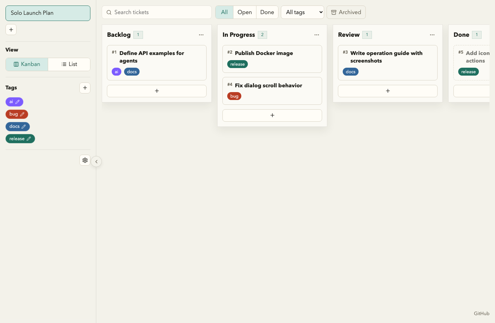

## 3. レーンを用意する

ボード下部の **＋** を押し、レーン名を入力して **Enter** で追加します。「Todo」「Doing」「Done」など、作業の段階に合わせて作ります。

名前の変更や削除は、各レーン右上のボタンから行います。完了扱いにするレーンは、サイドバーの歯車にある **Completion lanes** で設定します。


## 4. チケットを作る

各レーンの **＋** を押し、タイトルと本文を入力します。本文にはMarkdownを使えます。

必要に応じて、**Lane**（レーン）、**Priority**（優先度）、**Tags**（タグ）を設定します。**Relations** では、親チケットや、先に終える必要があるチケット（ブロッカー）を指定できます。

**Save** を押すとチケットが作成されます。

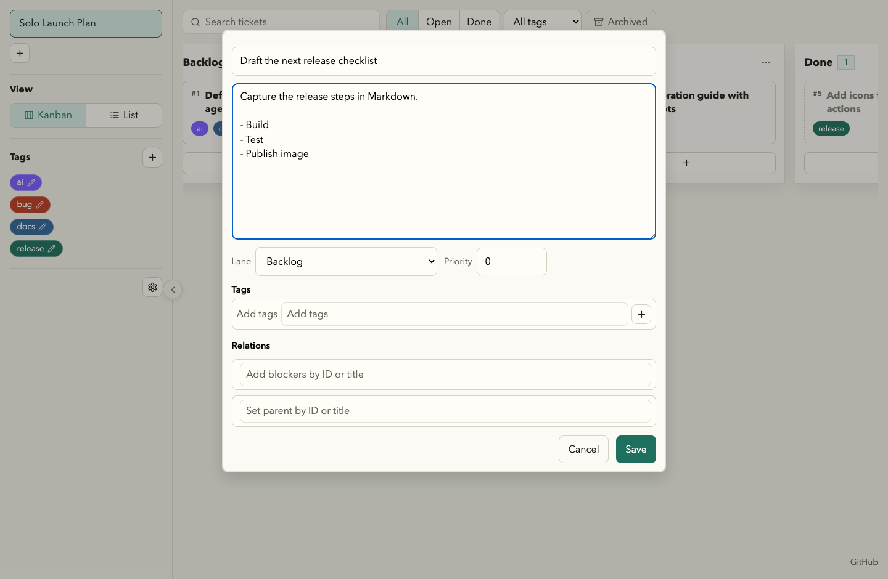

## 5. チケットを読む

チケットをクリックすると詳細が開き、本文・関連チケット・コメントを確認できます。変更履歴は **Activity** タブで確認します。


## 6. チケットを編集する

チケット詳細の右上にあるペンアイコンを押します。本文、レーン、優先度、タグ、親子関係やブロッカーを変更し、**Save** で保存します。

別のボードやレーンへ移すときは、詳細画面の **Move** を使います。別のボードへ移すと、親子関係・ブロッカー・Groupの所属は解除されます。同名のタグは引き継がれます。

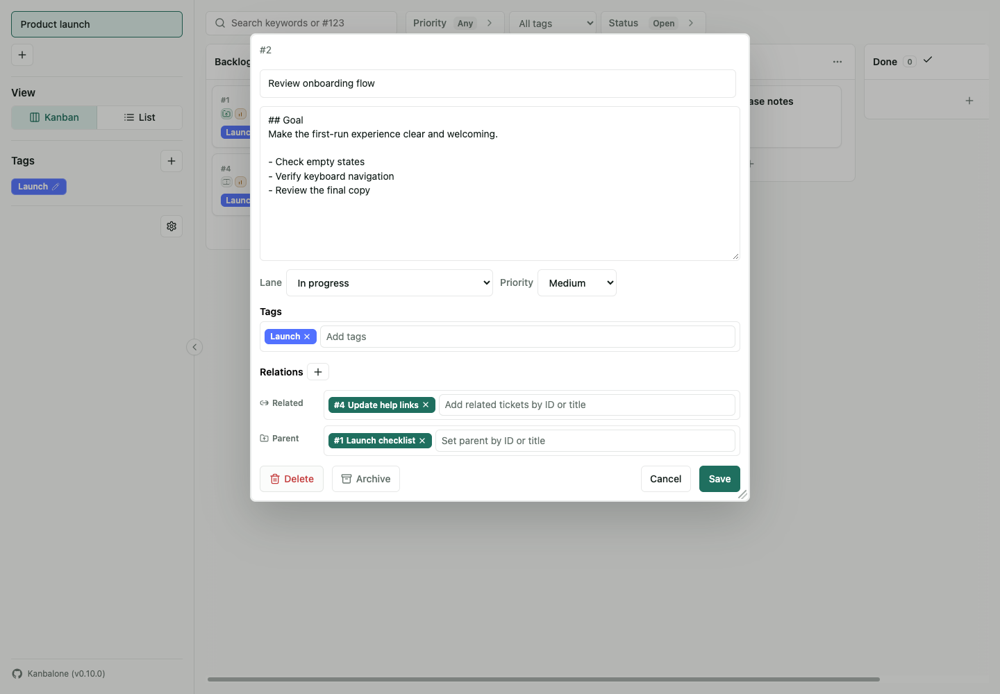

## 7. コメントと履歴を見る

チケット詳細から、進捗やメモをコメントとして残せます。**Activity** タブでは、コメントやチケットの変更履歴を確認できます。

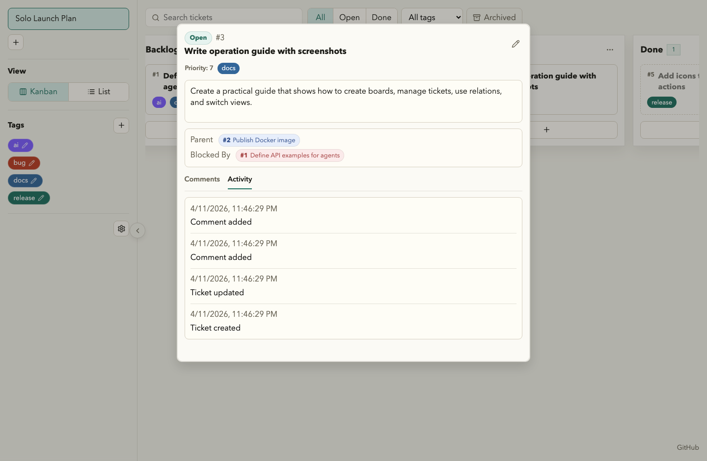

## 8. 外部サービスのIssueを取り込む

GitHub Issues・GitLab・RedmineのIssueを取り込み、Kanbaloneで作業を進められます。取り込んだ内容を確認しながら自分用のメモを書き、必要なコメントを元のIssueへ送れます。

### 8.1 Issueを取り込む

チケット作成画面の右上にある取り込みアイコンを押し、サービス（**Provider**）、**Issue URL**、登録先レーンを指定して **Import** を押します。

取り込みには、利用するサービスの接続設定が必要です。アイコンが表示されない場合は、Kanbaloneの起動時の接続設定を確認してください。


### 8.2 本文を確認する

取り込んだチケットでは、2つの本文を切り替えられます。

- **Local Body**：自分の作業方針やメモを書きます。
- **Remote Body**：元のIssueの内容を確認します。

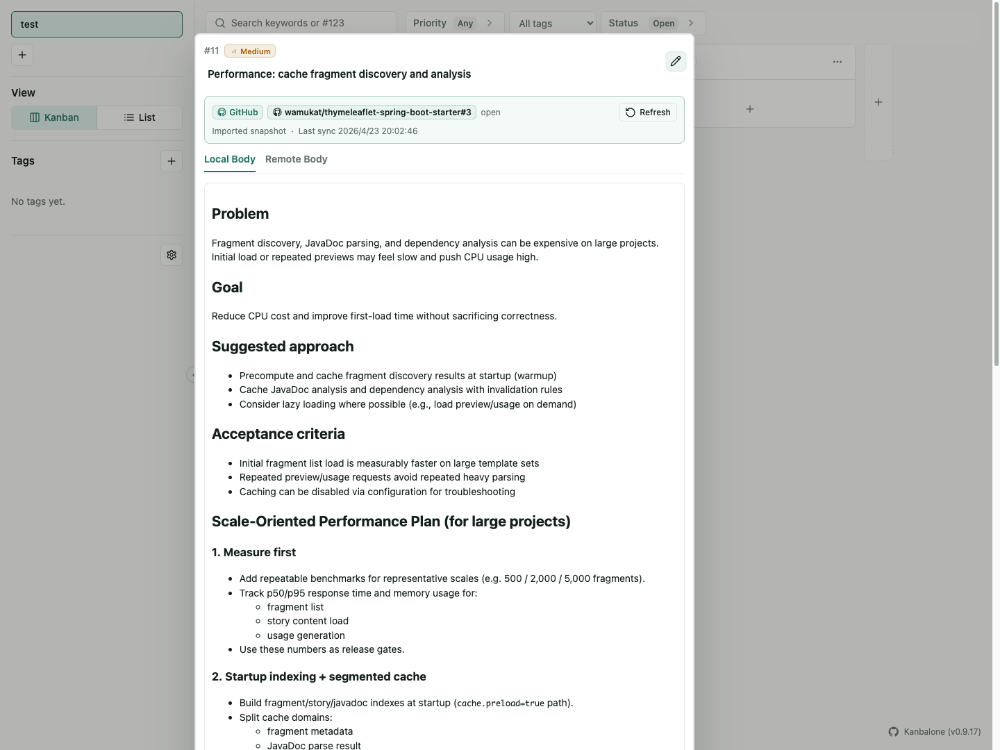

### 8.3 チケットを編集する

ペンアイコンから、**Local Body**、レーン、優先度、タグ、関連チケットを編集できます。

タイトルや **Remote Body** を変更したい場合は、元のサービスで編集し、Kanbaloneで **Refresh** を押します。


### 8.4 コメントを元のIssueへ送る

コメントはまずKanbaloneに保存されます。送信したいコメントの **Push to remote** を押してください。

- **Pushed**：送信済みです。
- **Push failed**：送信できませんでした。クリックすると理由を確認できます。

送信済みコメントは編集・削除できません。訂正するときは、新しいコメントを追加して送信してください。


### 8.5 最新の内容を取り込む

**Refresh** を押すと、元のIssueのタイトル・本文・状態を更新できます。自分で書いた本文やコメント、レーン・優先度・タグ・関連チケットはそのまま残ります。

## 9. チケットを完了・整理する

作業が終わったら、チケットを完了レーンへ移します。**Resolved**（完了）になり、通常のレーンへ戻すと未完了に戻ります。

完了レーンは、サイドバーの歯車 → **Completion lanes** で設定します。「Done」という名前にするだけでは完了レーンになりません。

普段の一覧から隠したいチケットは、詳細画面の **Archive** でアーカイブします。

完了済み・アーカイブ済みのチケットを探すときは、Kanban／List上部の **Status >** で **Resolved**／**Archived** を選びます。フィルター内の **×** で条件を解除できます。

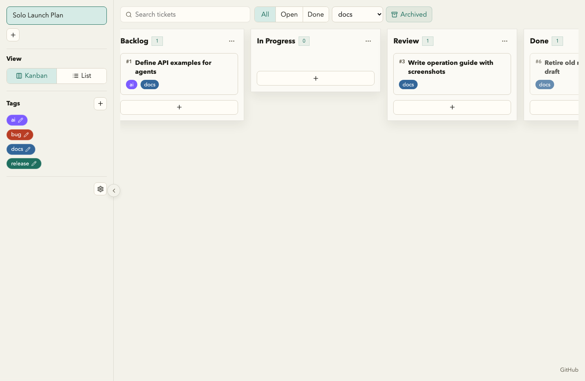

## 10. チケットを探す

Kanban／List上部の検索欄に入力して、チケットを絞り込みます。

- **キーワード**：タイトルと本文を検索します。例：`login`
- **チケット番号**：`#123` または `123`
- **外部Issueの番号**：`gh#123`、`github#123`、`ext#123`、またはチケットに表示された参照番号

**Priority >** では、Low／Medium／High／Urgentから優先度を選べます。複数選択もできます。

検索欄の右端の **×** で、入力を消して絞り込みを解除します。


## 11. タグで分類する

種類や用途で分類したいときは、チケットにタグを付けます。タグフィルターで、そのタグのチケットだけを表示できます。

- **作成**：サイドバーの **Tags** にある **＋** を押します。
- **色の変更**：タグをクリックします。
- **チケットに追加**：編集画面の **Tags** で選びます。新しい名前を入力して **＋** を押すと、タグを作成できます。

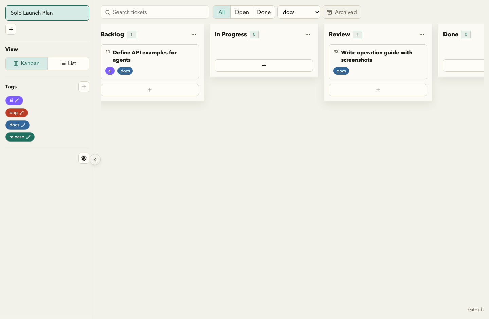

## 12. リスト表示でまとめて整理する

サイドバーの **List** を開くと、チケットの優先度や完了・アーカイブ状態を表で確認できます。

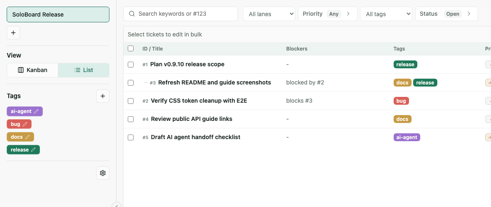

チケットにチェックを入れると、一括操作のボタンが表示されます。

- **Move**：選択したチケットを移動します。完了レーンへ移すと、まとめて完了にできます。
- **Archive**：一覧から隠します。
- **Restore**：アーカイブを解除します。

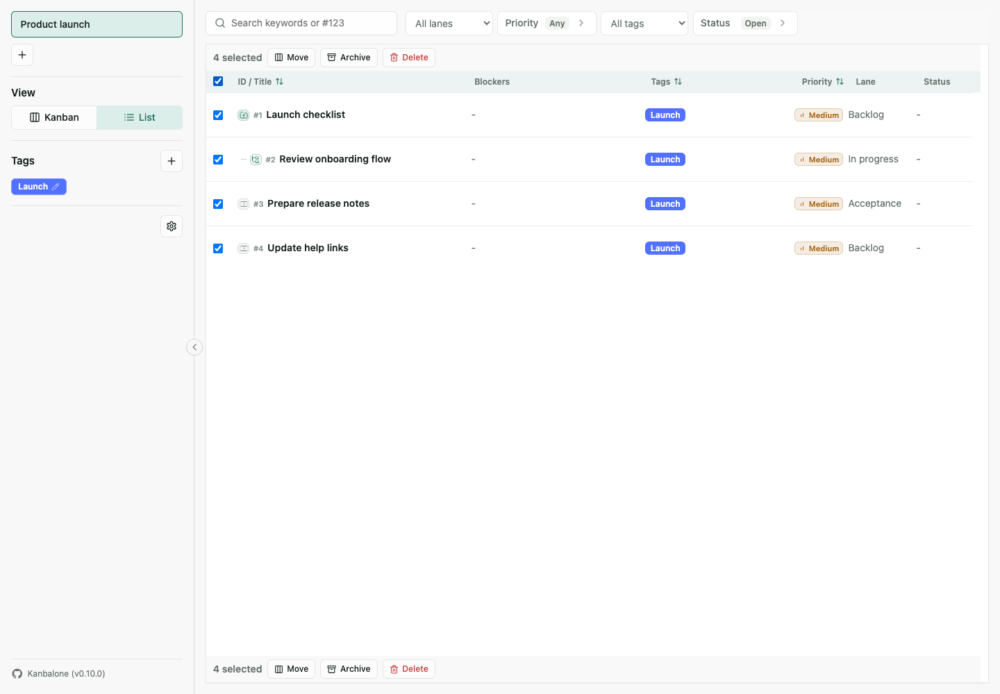

## 13. Groupで作業をまとめる

同じ目的のチケットをGroupにまとめて、一覧で確認できます。

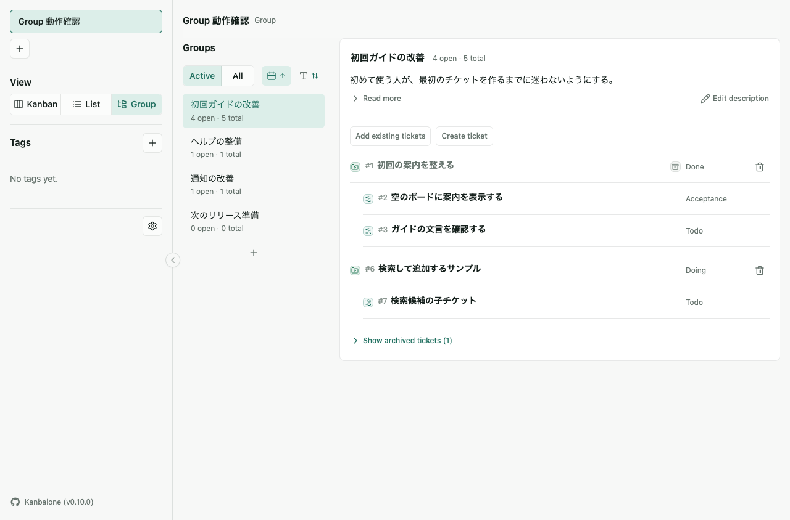

1. サイドバーの **Group** を開き、左の一覧末尾の **＋** でGroupを作ります。
2. **Add existing tickets** で既存チケットを追加するか、**Create ticket** で新しく作ります。
3. 左の一覧からGroupを選ぶと、所属チケットを確認できます。

Group名をクリックすると名前を変更でき、**Add description** からMarkdownで説明を書けます。チケット詳細のGroup名からも、この画面を開けます。

- **並べ替え**：Group一覧のカレンダー／文字アイコンで作成順・名前順を選びます。もう一度押すと昇順／降順が切り替わります。
- **所属解除**：チケット行のゴミ箱アイコンから解除します。チケット自体は削除されません。別のGroupへ移すときは、解除してから追加します。
- **アーカイブ済みの表示**：**Show archived tickets** を押します。未アーカイブの子がいる親は、アーカイブ済みでも関係が分かるように残ります。

**Active** には未完了・未アーカイブのチケットがあるGroupと、空のGroupが表示されます。作業を終えたGroupは **All** で確認できます。

チケットが所属できるGroupは1つです。親子チケットはまとめて追加・解除されます。異なるGroupのチケットを親子にするときは、どちらのGroupに揃えるか選びます。

Groupはボード内で使います。チケットを別のボードへ移すと、そのチケットの所属は解除されます。Groupを削除するには、アーカイブ済みも含めて所属チケットをすべて外してください。

## 14. ボード設定を使う

サイドバーの歯車を開くと、ボード名の変更、完了レーンの設定、データの書き出し・読み込み、ボードの削除ができます。

**ボード名の変更**：名前の横のペンアイコンを押し、入力後に **Enter** で保存します。**Esc** でキャンセルできます。

**完了レーンの設定**：**Completion lanes** の **Set up**（設定済みなら **Change**）を押し、レーンを選んで **Save** を押します。チケットの完了状態が変わる場合は、表示された件数を確認して確定してください。


## 15. ダークモード

OSやブラウザの外観設定をダークモードにすると、Kanbaloneも自動で切り替わります。

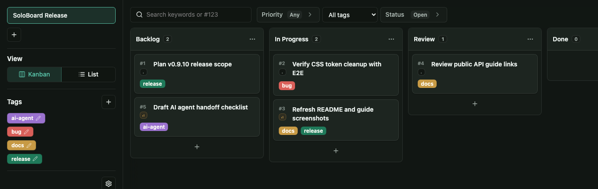

## Docker で試す

```bash
docker run --rm \
  -p 3000:3000 \
  -v kanbalone-data:/app/data \
  ghcr.io/wamukat/kanbalone:v0.10.0
```

ブラウザで開きます。

```text
http://127.0.0.1:3000
```

このコマンドでは、データを `kanbalone-data` に保存します。コンテナを作り直してもデータは残ります。

Kanbalone には認証機能はありません。信頼できないネットワークへ直接公開しないでください。
