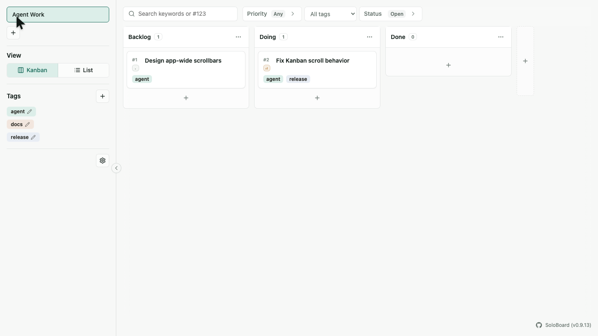
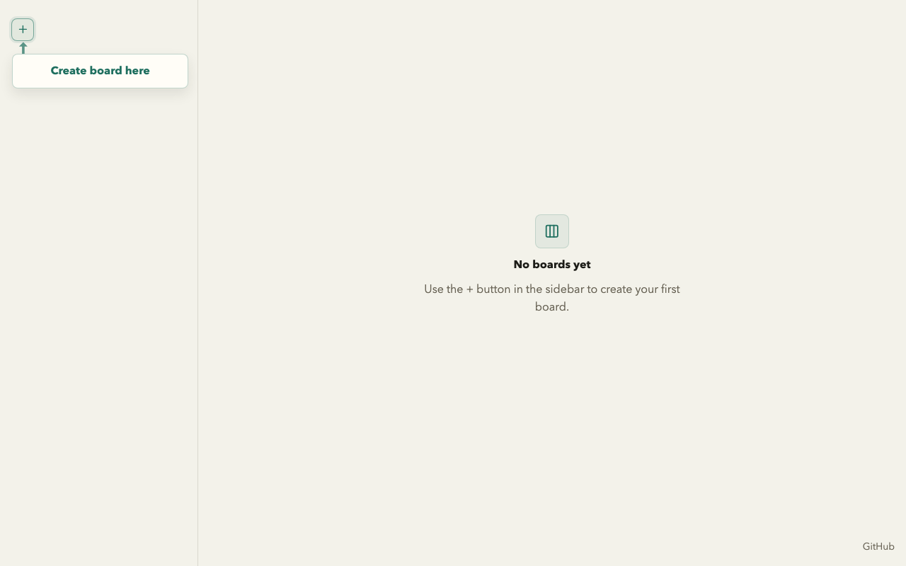
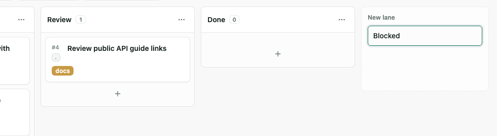
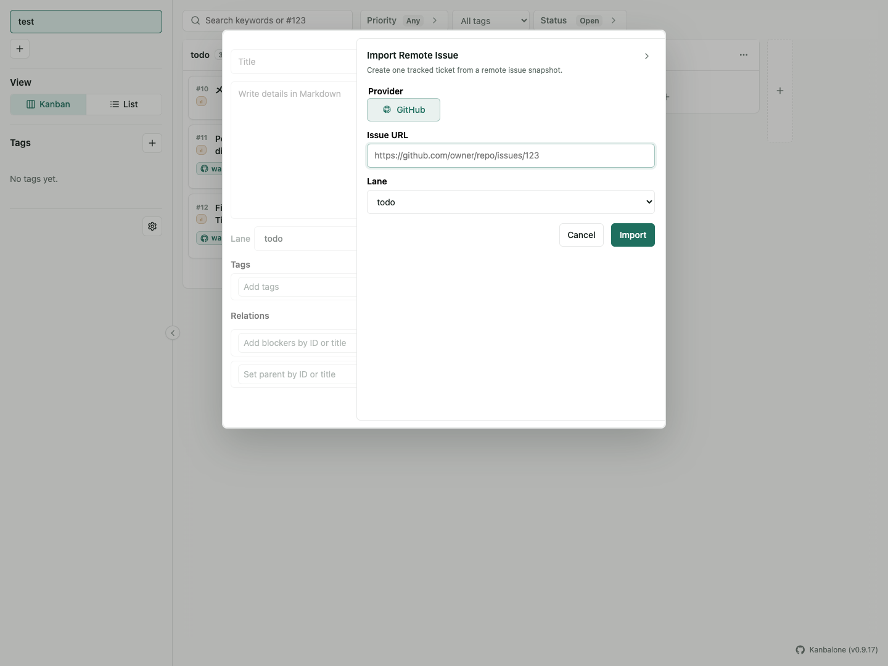
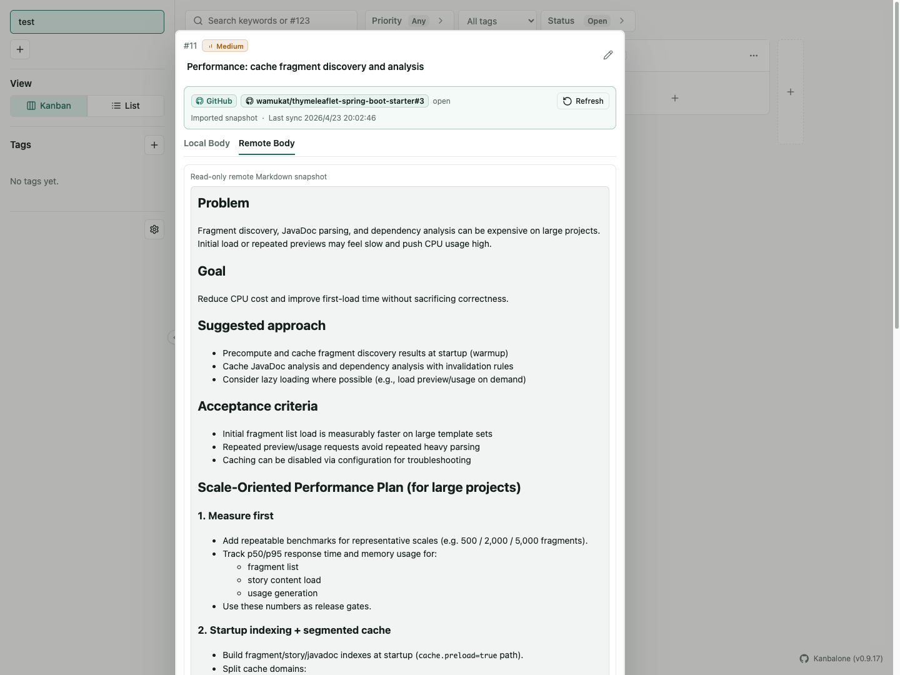

# Kanbalone ユーザーガイド

既存DBを更新する場合は、先に[完了状態の移行ガイド](./migration-guide.md)を確認してください。バックアップ・自動移行・照合・ロールバックとAI向け作業契約をまとめています。

Kanbalone は、ひとりの作業・小さなリリース計画・AI エージェントとの共同作業を、軽いカンバンで整理するためのツールです。

このガイドは、初めて使う時の流れに沿って説明します。

## 全体デモ

チケット作成、Markdown 本文の入力、タグの新規作成と追加、ドラッグアンドドロップ、検索、フィルタ、コメント、List 表示までの流れを短く確認できます。



## 1. 最初のボードを作る

左上の `+` を押すと、ボード名の入力欄が表示されます。

ボード名を入力して Enter を押すと、最初のボードが作成されます。




## 2. 画面の基本を知る

ボードを作成すると、作業画面が表示されます。

左側のサイドバーでボードを選び、中央の Kanban でチケットを動かします。サイドバーの `Kanban` / `List` で表示を切り替えられます。


## 3. レーンを用意する

ボード下部の `+` からレーンを追加できます。名前を入力して Enter を押すと追加されます。

レーン名の変更や削除は、各レーン右上のアクションボタンから行えます。



## 4. チケットを作る

各レーンの `+` からチケットを作成します。

タイトルと本文を入力します。Lane / Priority、Tags、Relations も設定できます。

入力できる主な項目:

- タイトル
- Markdown で書ける本文
- Lane / Priority
- Tags
- Relations

Relations では、ブロッカーや親チケットを設定できます。


## 5. チケットを読む

チケットをクリックすると詳細画面が開きます。

詳細画面では、本文、関係、コメント、アクティビティを確認できます。


## 6. チケットを編集する

詳細画面右上のペンアイコンで編集できます。

編集画面では、Lane / Priority、Tags、Relations、本文などを変更できます。

remote tracked ticket では、title は remote 由来の read-only 値になります。実装のために編集する本文は `Local Body` 側です。

Relations では、ブロッカー、親チケット、子チケットを編集できます。

詳細画面の `Move` で、チケットを別の board / lane へ移動できます。同名 tag は保持されます。別 board へ移動する場合、親子関係と blocker は解除されます。


## 7. コメントと履歴を見る

チケット詳細ではコメントを残せます。

`Activity` タブでは、コメント追加、更新、削除などの履歴を確認できます。

remote tracked ticket では、comment を remote issue に push できます。push に失敗した場合は、comment 上で失敗理由を確認できます。


## 8. Remote Issue で作業する

Kanbalone では、GitHub Issues、GitLab、Redmine などの remote issue を取り込み、ローカルの実装ワークスペースとして扱えます。

現在の実装では、GitHub Issues、GitLab、Redmine を provider として使えます。

- remote は課題の正本
- Kanbalone は実装と作業ログのためのローカル作業面
- local body は AI や自分の実装用本文
- remote へ返すのは必要な comment だけ


### 8.1 Remote Issue を取り込む

新規チケット作成ダイアログ右上の import アイコンから、remote issue を取り込みます。このアイコンは remote provider credential が 1 つ以上設定されている場合だけ表示されます。

入力する項目:

- Provider
- Issue URL
- 登録先 Lane

panel には credential が設定された provider だけが表示されます。

ローカルで GitLab / Redmine を有効化したいときは、`KANBALONE_REMOTE_CREDENTIALS` を設定するか sandbox bootstrap を使います。

取り込み後は、remote issue が通常のチケットとして board に配置されます。



### 8.2 Remote チケットの見方

remote tracked ticket では、detail 上に remote ref が表示されます。

本文は `Local Body` / `Remote Body` の 2 面で扱います。

- `Local Body`
  実装方針、実装メモ、A-AI 向けの作業本文
- `Remote Body`
  remote issue から取り込んだ read-only snapshot

`Refresh` を使うと、remote 側の title / body / state を再取得できます。


### 8.3 Remote チケットで編集できるもの

編集できるもの:

- Local Body
- Lane / Priority
- Tags / Relations
- Comments

編集できないもの:

- Title
- Remote Body

remote issue の要件を書き換えたい場合は remote 側で修正し、必要になったら `Refresh` で取り込み直します。



### 8.4 コメントを Remote に反映する

comment は最初に local comment として保存されます。

必要なものだけ `Push to remote` で remote issue に反映します。

comment の状態:

- `Push to remote`
  まだ local only
- `Pushed`
  remote に反映済み
- `Push failed`
  remote 反映に失敗。クリックすると詳細を確認可能


push 済み comment は、MVP では編集・削除できません。修正が必要な場合は新しい comment を追加して再 push します。

### 8.5 Remote の更新を取り込む

`Refresh` は、remote 側の変更を local snapshot に取り込むための操作です。

更新されるもの:

- remote title
- remote body
- remote state

更新されないもの:

- local body
- local comments
- lane / priority / tags / relations

つまり、要件の正本は remote に残しつつ、Kanbalone 側では実装本文を独立して育てます。

## 9. チケットを完了・整理する

受入済みの作業を完了レーンへ移すとResolvedになります。通常レーンへ戻すと再開します。人間の受入を行う場合、AIの作業終了時は通常レーンのAcceptanceへ渡し、人間が確認してDoneへ移します。レーン名ではなく属性が完了状態を決めます。サイドバーの歯車領域では、ボード名・Completion lanes・データ操作・削除を分けて表示します。Completion lanesは普段は現在値とChange（未設定ならSet up）のみを表示します。Changeからレーン一覧を選び、Saveで保存します。既存チケットに影響するときは同じ領域で完了／未完了になる件数（アーカイブ済みを含む）を確認して確定します。選択しただけでは状態は変わりません。確認後にレーン属性や件数が変わると保存を拒否し、再確認を求めます。

完了レーンがないボードで最初のチケットを画面から作成すると、作成を妨げない案内が一度表示されます。Set upで同じ設定欄へ進み、Laterで閉じられます。案内済みの記録はブラウザごとに保存します。レーン名の編集は従来どおりレーン上で行います。

既存データの更新時は、完了済みチケットがあるボードに `Completed (migration)` という完了レーンを自動作成し、完了済みだけを移します。同名があれば連番を付けます。既存のDoneなどは通常レーンとして残り、未完了チケットの配置は変わりません。アーカイブ状態も維持されます。

もう普段見る必要がないチケットは Archive できます。Archived チケットは通常のボードから隠れます。

アーカイブ済みチケットを表示したい時は、タグフィルタの右にある `Status >` を開き、`Archived` を追加します。`Resolved` も同じメニューから追加できます。条件を解除したい時は、フィルタ内の `x` アイコンを押します。


## 10. チケットを探す

検索フィールドでは、キーワード、チケット番号でチケットを絞り込めます。

- `login` のようなキーワードでタイトルと本文を検索
- `#123` や `123` でチケット番号を検索
- `gh#123`、`github#123`、`ext#123`、完全な display ref で remote / external reference を検索

優先度で絞り込みたい場合は、フィルタ領域の `Priority >` を開きます。Low / Medium / High / Urgent を複数選択できます。

検索欄に入力がある時は、右端の `x` で検索条件を消せます。


## 11. タグで分類する

タグフィルタを使うと、特定テーマのチケットだけを表示できます。

タグはサイドバーの Tags セクションにある `+` から作成できます。色は後からタグバッジをクリックして編集できます。

チケット編集中に新しいタグが必要になった場合は、Tags の入力欄に名前を入れて `+` を押すと、色なしタグとして作成されます。


## 12. リスト表示でまとめて整理する

サイドバーの `List` に切り替えると、チケットを表形式で確認できます。

List 表示では、Resolved / Archive 状態や優先度を一覧で確認できます。


List 表示でチェックを入れると、選択したチケットに対する一括操作が表示されます。

Moveで複数チケットを完了レーン／通常レーンへ移動できます。Archive / Restoreは独立した操作です。


## 13. ボード設定を使う

サイドバーの歯車から、Board name、Completion lanes、Data operations（Export / Import）、Deleteを区分して表示します。

歯車を開くと現在のボード名が表示されます。ボード名の横にあるペンアイコンをクリックすると、ボード名をその場で編集できます。入力後に Enter で保存し、Esc またはフォーカス移動でキャンセルできます。

Completion lanesには現在の設定が表示されます。Change（未設定ならSet up）からレーンを選んでSaveを押し、既存チケットに影響する場合は件数を確認して確定します。レーン名は従来どおりレーン上で直接編集します。


## 14. ダークモード

Kanbalone にはアプリ内の Light / Dark 切り替えボタンはありません。

OS やブラウザの外観設定がダークモードの場合、自動的にダークテーマで表示されます。


## 15. Groupで作業をまとめる

Group表示の上部にはボード名と「Group」を表示します。Kanban／Listと共通の上部領域を保ちますが、Group用の検索・フィルターは追加しません。Kanban／Listの検索条件はGroupの所属チケットには適用されず、元の表示へ戻ると引き続き利用できます。

Kanban / List の横にある **Group** へ切り替えます。サイドバーはそのまま、コンテンツエリアの左側にGroup一覧、右側に選択したGroupのチケットを表示します。チケットが所属できるGroupは同じボード内の1つまでです。重ねて使う分類はタグ、ひとまとまりの作業はGroupで扱います。


左側でGroupを選び、右側の **Add existing tickets**／**Create ticket** からチケットを追加します。画像の #1 はアーカイブ済みの親で、未アーカイブの子との関係を示すため残っています。

- Group一覧末尾の **＋** から名前を入力して作成します。名前だけで作成でき、Markdownの説明は後から追加できます。同じボード内ではinactiveを含めて同名のGroupを作れません。
- 作成順・名前順の昇順／降順を選べます。ボタン内の矢印が現在の方向を示し、選択はボードごとに記憶します。Group内のチケットにはソート操作を設けず、Listの標準の並び順を使い、子は親の直下にまとめます。
- チケット一覧上部左側の **Add existing tickets** で未所属の既存チケットを検索して追加し、**Create ticket** でこのGroupに新規チケットを作成します。新規作成は通常のチケット編集・レーン選択を使います。
- 親子チケットは同じGroupに所属します。子を追加対象に選ぶと、親と兄弟もアーカイブ済みを含めて一緒に追加します。所属解除は親に常時表示するボタンから対象を確認して行います。単独チケットにも解除ボタンがあります。チケット自体は削除しません。別Groupへ移す場合は「解除→追加」で操作します。
- 説明はMarkdownで編集・プレビューでき、長い説明は展開できます。Group名はその場で編集できます。
- チケット詳細のGroup名をクリックすると、そのGroupを開きます。inactiveの場合は一覧を **All** に切り替えます。未所属の場合はリンクを表示しません。

**Active** には、未完了かつ未アーカイブのチケットがあるGroupと、空のGroupを表示します。所属チケットがすべて完了またはアーカイブ済みになるとinactiveになり、**All** から参照できます。Group自体の完了・アーカイブ操作はありません。チケットの再開・復元で再びactiveになります。最後のチケットを外した場合も空のGroupとしてactiveになります。

アーカイブ済みチケットは通常隠し、一覧末尾の切り替えで表示します。親だけアーカイブ済みで子が表示対象の場合、親は関係を示す行として残し、Groupからまとめて外す操作も置きます。ボードの検索・タグフィルターはGroup画面には適用しません。既存チケットを追加するための検索は利用できます。

親子関係を作る際、所属済みと未所属の組み合わせは所属済み側のGroupへ自動で揃えます。異なるGroup同士の場合だけ、揃えるGroupまたはキャンセルを選びます。アーカイブ済みを含む対象の親子チケット全体に適用します。複数の子を同時追加すると、選択肢が3つ以上になる場合もあります。新規作成時に親を指定する場合も同じルールです。

ボード間移動では、移動対象だけGroupの所属を解除し、残るチケットは元のGroupを保持します。Groupは空の場合だけ削除でき、名前と「取り消せない」ことを確認して確定します。アーカイブ済みも所属件数に含みます。所属解除専用のUndoはありません。

## Docker で試す

```bash
docker run --rm \
  -p 3000:3000 \
  -v kanbalone-data:/app/data \
  ghcr.io/wamukat/kanbalone:v0.10.0
```

ブラウザで開きます。

```text
http://127.0.0.1:3000
```

データは `/app/data/kanbalone.sqlite` に保存されます。Docker の named volume を使うと、コンテナを作り直してもデータを残せます。

Kanbalone には認証機能はありません。信頼できないネットワークへ直接公開しないでください。
