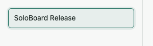
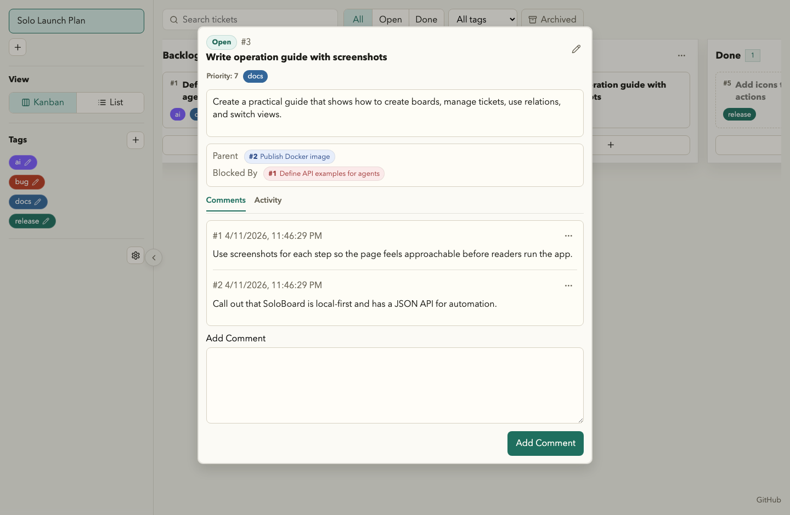
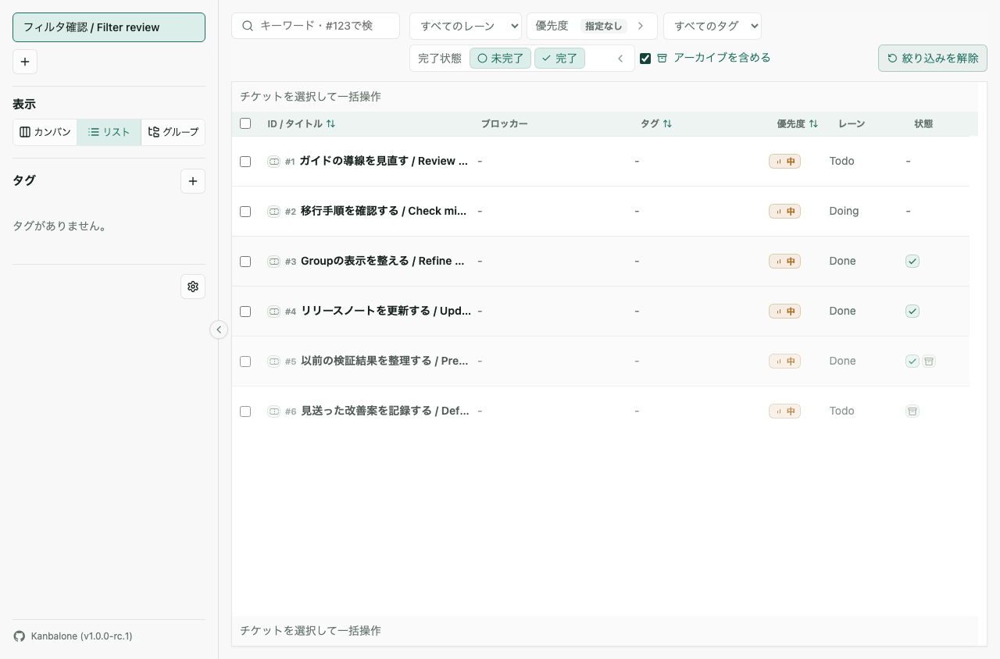
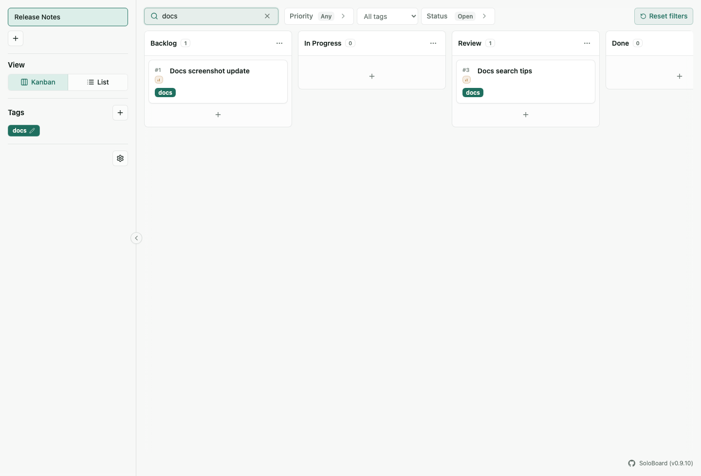
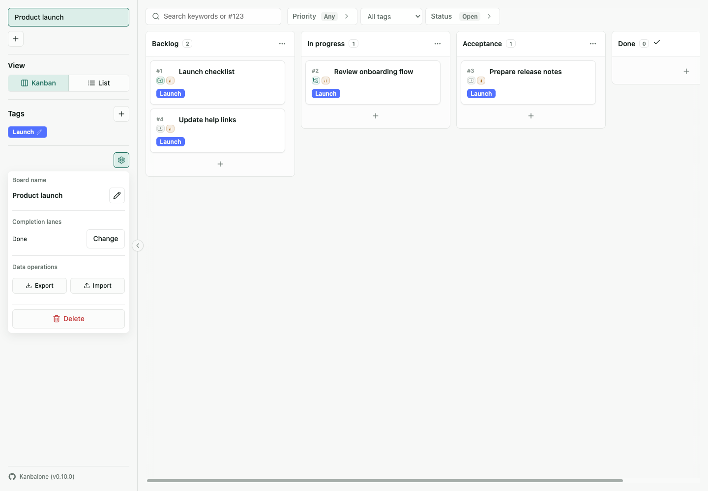

# Kanbalone ユーザーガイド

Kanbalone は、チケットを動かしながら作業の進み具合を整理するツールです。ひとりでの作業にも、AIとの共同作業にも使えます。

画面は日本語・英語で利用できます。このガイドの画像は英語表示の例です。

初めて使う方は、ボードの作成から始めてください。既存のデータを引き継いで更新する方は、先に[移行ガイド](./migration-guide.md)でバックアップ手順を確認してください。

## 全体デモ

チケットの作成から、移動・検索・コメントまでの操作を動画で確認できます。


## 1. 最初のボードを作る

左上の **＋** を押し、ボード名を入力して **Enter** で作成します。




## 2. 画面の基本を知る

左のサイドバーでボードを選び、表示を切り替えます。

- **カンバン**：チケットをドラッグして、作業の進み具合に合わせてレーンを移動します。
- **リスト**：チケットを表で確認し、まとめて操作します。
- **グループ**：同じ目的のチケットをまとめて確認します。


## 3. レーンを用意する

ボード下部の **＋** を押し、レーン名を入力して **Enter** で追加します。「Todo」「Doing」「Done」など、作業の段階に合わせて作ります。

名前の変更や削除は、各レーン右上のボタンから行います。完了扱いにするレーンは、サイドバーの歯車にある **完了レーン** で設定します。


## 4. チケットを作る

各レーンの **＋** を押し、タイトルと本文を入力します。本文にはMarkdownを使えます。 `- [ ]` と `- [x]` でチェック状態も表示できます。

必要に応じて、**レーン**、**優先度**、**タグ**を設定します。**関連** では、親チケットや、先に終える必要があるチケット（ブロッカー）を指定できます。

**保存** を押すとチケットが作成されます。


### キーボードで作る

チケットのタイトルにフォーカスして **N** を押すと、新規作成を開けます。タイトルを入力し、**Ctrl＋Enter**（Macは **⌘＋Enter**）で保存すると、元の位置に戻ります。

- **カンバン**：フォーカス中のチケットと同じレーンに作成します。
- **リスト**：ボードの先頭レーンに作成します。
- **グループ**：表示中のGroupに所属させ、先頭レーンに作成します。選択中のGroup名にフォーカスして **N** を押すこともできます。

保存前に **レーン** を確認・変更できます。完了レーンに作成すると、最初から完了扱いになります。入力をやめるときは **Esc**。未保存の内容がある場合は、破棄するか確認します。

## 5. チケットを読む

チケットをクリックすると詳細が開き、本文・関連チケット・コメントを確認できます。変更履歴は **履歴** タブで確認します。



## 6. チケットを編集する

チケット詳細の右上にあるペンアイコンを押します。本文、レーン、優先度、タグ、親子関係やブロッカーを変更できます。**保存** を押すか、**Ctrl＋Enter**（Macは **⌘＋Enter**）で保存します。

未保存の変更があるときは、閉じる前に確認が表示されます。**キャンセル** で編集を続け、**変更を破棄** で変更を破棄できます。

同じボード内の移動は編集画面の **レーン** で選びます。別のボードへ移すときは **移動** を使います。別のボードへ移すと、親子関係・ブロッカー・グループの所属は解除されます。同名のタグは引き継がれます。


## 7. コメントと履歴を見る

チケット詳細から、進捗やメモをコメントとして残せます。新しいコメントを入力中に **Ctrl＋Enter**（Macは **⌘＋Enter**）を押すと投稿できます。**履歴** タブでは、コメントやチケットの変更履歴を確認できます。


## 8. 外部サービスのIssueを取り込む

GitHub Issues・GitLab・RedmineのIssueを取り込み、Kanbaloneで作業を進められます。取り込んだ内容を確認しながら自分用のメモを書き、必要なコメントを元のIssueへ送れます。

### 8.1 Issueを取り込む

チケット作成画面の右上にある取り込みアイコンを押し、**サービス**、**Issue URL**、登録先レーンを指定して **インポート** を押します。

取り込みには、利用するサービスの接続設定が必要です。アイコンが表示されない場合は、Kanbaloneの起動時の接続設定を確認してください。


### 8.2 本文を確認する

取り込んだチケットでは、2つの本文を切り替えられます。

- **ローカルの本文**：自分の作業方針やメモを書きます。
- **外部の本文**：元のIssueの内容を確認します。


### 8.3 チケットを編集する

ペンアイコンから、**ローカルの本文**、レーン、優先度、タグ、関連チケットを編集できます。

タイトルや **外部の本文** を変更したい場合は、元のサービスで編集し、Kanbaloneで **更新** を押します。


### 8.4 コメントを元のIssueへ送る

コメントはまずKanbaloneに保存されます。送信したいコメントの **リモートに送信** を押してください。

- **送信済み**：送信済みです。
- **送信に失敗しました**：送信できませんでした。クリックすると理由を確認できます。

送信済みコメントは編集・削除できません。訂正するときは、新しいコメントを追加して送信してください。


### 8.5 最新の内容を取り込む

**更新** を押すと、元のIssueのタイトル・本文・状態を更新できます。自分で書いた本文やコメント、レーン・優先度・タグ・関連チケットはそのまま残ります。

## 9. チケットを完了・整理する

作業が終わったら、チケットを完了レーンへ移します。**完了**になり、通常のレーンへ戻すと未完了に戻ります。

完了レーンは、サイドバーの歯車 → **完了レーン** で設定します。「Done」という名前にするだけでは完了レーンになりません。

普段の一覧から隠したいチケットは、詳細画面の **アーカイブ** でアーカイブします。

カンバン／リストは、初期状態で未完了と完了を表示します。**完了状態 >** を押し、**未完了**・**完了** を押して表示を切り替えます。両方選ぶと両方を表示し、**×** で絞り込みを解除できます。

アーカイブしたチケットも見るには、**アーカイブを含める** にチェックします。選択した完了状態に合うものだけが表示されます。

カンバンの完了レーンは、最近完了した5件を表示します。**さらに50件表示** で続きを開き、**最近の5件に戻す** で折り畳めます。移動したチケットは先頭に表示されます。完了レーンは完了した順の表示で、ドラッグによる手動の並べ替えは行いません。Listの表示件数はこの制限の対象外です。



## 10. チケットを探す

カンバン／リスト上部の検索欄に入力して、チケットを絞り込みます。

- **キーワード**：タイトルと本文を検索します。例：`login`
- **チケット番号**：`#123` または `123`
- **外部Issueの番号**：`gh#123`、`github#123`、`ext#123`、またはチケットに表示された参照番号

**優先度 >** では、低／中／高／緊急から優先度を選べます。複数選択もできます。

検索欄の右端の **×** で、入力を消して絞り込みを解除します。



件数の多いカンバンのレーンやグループ画面では、表示範囲の周辺にあるカードや行だけが描画されます。ブラウザーのページ内検索の対象は描画済みの内容です。カンバンの検索欄では、現在の絞り込み条件に合うチケットを全件検索できます。件数の多いグループや「グループなし」では、その画面のチケット検索欄を使うと、画面外のチケットもタイトルや `#ID` で探せます。

### キーボードで探して開く

カンバンやリストで **/** を押すと、検索欄にフォーカスします。グループと「グループなし」では、チケット検索欄が表示されている場合に使えます。入力欄やダイアログを使っていないときに、ボード上で押してください。

カンバンやリストの検索欄で **↓** を押すと、表示中のチケットを選べます。

- **リスト**：↑↓で前後のチケットへ移ります。
- **カンバン**：↑↓で同じレーン内、←→で隣のレーンへ移ります。該当チケットのないレーンは飛ばします。
- **Enter**：選んだチケットの詳細を開きます。
- **Esc**：詳細を閉じ、元のチケットとスクロール位置に戻ります。チケット上でもう一度押すと検索欄に戻ります。

検索条件は保持されるので、そのまま次のチケットを確認できます。元のチケットが絞り込みなどで表示されなくなった場合は、検索欄に戻ります。カンバンの完了レーンで続きを見るには、**もっと見る** を押してください。


## 11. タグで分類する

種類や用途で分類したいときは、チケットにタグを付けます。タグフィルターで、そのタグのチケットだけを表示できます。

- **作成**：サイドバーの **タグ** にある **＋** を押します。
- **色の変更**：タグをクリックします。
- **チケットに追加**：編集画面の **タグ** で選びます。新しい名前を入力して **＋** を押すと、タグを作成できます。


## 12. リスト表示でまとめて整理する

サイドバーの **リスト** を開くと、チケットの優先度や完了・アーカイブ状態を表で確認できます。

レーンを指定して絞り込めます。完了レーンと「未完了」など、条件が合わない場合は理由が表示されます。**完了も表示** または **レーン指定を解除** で条件を変更できます。検索やタグの条件はそのまま残ります。


チケットにチェックを入れると、一括操作のボタンが表示されます。

- **移動**：選択したチケットを移動します。完了レーンへ移すと、まとめて完了にできます。
- **アーカイブ**：一覧から隠します。
- **復元**：アーカイブを解除します。


## 13. グループで作業をまとめる

同じ目的のチケットをグループにまとめて、一覧で確認できます。


1. サイドバーの **グループ** を開き、左の一覧末尾の **＋** でグループを作ります。
2. **既存チケットを追加** で既存チケットを追加するか、**チケットを作成** で新しく作ります。
3. 左の一覧からグループを選ぶと、所属チケットを確認できます。

グループ名をクリックすると名前を変更でき、**説明を追加** からMarkdownで説明を書けます。チケット詳細のグループ名からも、この画面を開けます。

- **並べ替え**：グループ一覧のカレンダー／文字アイコンで作成順・名前順を選びます。もう一度押すと昇順／降順が切り替わります。
- **所属解除**：チケット行のゴミ箱アイコンから解除します。チケット自体は削除されません。別のグループへ移すときは、解除してから追加します。
- **アーカイブ済みの表示**：**アーカイブ済みを表示** を押します。未アーカイブの子がいる親は、アーカイブ済みでも関係が分かるように残ります。

初期状態では完了したチケットも一覧に残ります。チェックマークと控えめな文字色で見分けられます。親が完了していても、未完了の子は通常の濃さで表示されます。

**アクティブ** には未完了・未アーカイブのチケットがあるグループと、空のグループが表示されます。作業を終えたグループは **すべて** で確認できます。

v1.4.0 から、課題一覧の上にある **未完了のみ** で、選択したグループまたは **グループ指定なし** の完了チケットを非表示にできます。初期状態はOFFで、このブラウザーでの選択をボードごとに保存します。**アーカイブ済みを表示** は別の条件です。未完了の子がある完了親は、関係が分かるように理由付きの操作できない参照行として残します。その親の詳細を開くときは「未完了のみ」をOFFにし、親がアーカイブ済みなら「アーカイブ済みを表示」もONにしてください。

このフィルターは課題一覧の表示を変えます。グループ全体の進捗と所属件数は、引き続きグループ全体の値です。グループの未完了数には、従来どおりアーカイブ済みを含めません。課題の完了状態や所属は変更せず、他の表示形式の完了フィルターにも影響しません。

チケットが所属できるグループは1つです。親子チケットはまとめて追加・解除されます。異なるグループのチケットを親子にするときは、どちらのグループに揃えるか選びます。

グループはボード内で使います。チケットを別のボードへ移すと、そのチケットの所属は解除されます。グループを削除するには、アーカイブ済みも含めて所属チケットをすべて外してください。

## 14. 設定を変更する

サイドバーの歯車を開くと、ボード名の変更、完了レーンの設定、データの書き出し・読み込み、ボードの削除ができます。

**ボード名の変更**：名前の横のペンアイコンを押し、入力後に **Enter** で保存します。**Esc** でキャンセルできます。

**完了レーンの設定**：**完了レーン** の **設定する**（設定済みなら **変更**）を押し、レーンを選んで **保存** を押します。チケットの完了状態が変わる場合は、表示された件数を確認して確定してください。

**表示言語**：歯車の設定にある **言語** で **日本語**／**English** を選びます。最初はブラウザの言語に合わせて表示し、変更後はこのブラウザに選択を保存します。ボード名やチケットの内容はそのままです。



## 15. ダークモード

OSやブラウザの外観設定をダークモードにすると、Kanbaloneも自動で切り替わります。


## Docker で試す

```bash
docker run --rm \
  -p 3000:3000 \
  -v kanbalone-data:/app/data \
  ghcr.io/wamukat/kanbalone:v1.4.0
```

ブラウザで開きます。

```text
http://127.0.0.1:3000
```

このコマンドでは、データを `kanbalone-data` に保存します。コンテナを作り直してもデータは残ります。

Kanbalone には認証機能はありません。信頼できないネットワークへ直接公開しないでください。

## 複数ボードを横断するカスタムビュー

カスタムビューは v1.4.0 から利用できます。

サイドバーの **カスタムビュー** から、複数ボードの課題を集めるリストに名前を付けて保存できます。対象を全ボードまたは選択したボードにし、ボードごとにタグを設定します。同じボードで複数のタグを選ぶと、いずれかに一致する課題を表示します。複数タグに一致しても重複しません。

- **未設定** またはタグがすべてOFF：そのボードの表示対象は0件です。
- **タグで絞らない**：タグの有無を問わず対象にします。明示的に選択してください。
- **全ボード**：後から作ったボードも設定対象に加わります。タグ条件を設定するまでは0件です。

完了状態は未完了・完了・すべてから選びます。アーカイブ済みは対象外です。リストはボード別にまとまり、初期状態では既存のボード順・レーン順・課題順を保ちます。総件数とボード別件数は、次のページも含む条件に一致する全課題の件数です。

**レーン条件と並べ替え（未リリース）**：ボードごとに「すべてのレーン」または選択したレーンを対象にできます。複数レーンは、いずれかに一致すれば対象です。タグ条件・レーン条件・完了条件は、すべてを満たす必要があります。選択レーンが0件なら表示も0件です。「すべてのレーン」は後から追加したレーンも含みますが、現在のレーンをすべて選択した場合は、そのIDだけが対象です。既存ビューは従来どおり全レーンを含みます。

**ボード内の並び順** では、レーンと課題の表示順、本文・コメントの更新が新しい順、優先度が高い順を選べます。ボード自体の並びは変わりません。同じ値の課題は従来のレーン・課題順で並びます。次ページも含めた全対象を並べ替えてからページ分割し、切替時は先頭ページへ戻ります。

更新順は、本文が実際に変わった時刻とコメントの投稿・内容編集の時刻をまとめて扱います。タイトル・レーン・タグ・優先度の変更では先頭へ移りません。コメントの削除も新たな更新時刻としては数えません。過去の本文編集時刻は記録されていないため、既存課題は判明している作成・コメント投稿・確実に記録されたコメント編集の時刻を初期値にします。DB全体のバックアップには履歴が含まれます。ボードJSONのインポートでは課題とコメントを新規作成するため、取り込み時刻から開始します。

本文と最終コメントは個別に表示ON/OFFできます。表示と並び順の変更は保存するまでは一時的で、**元に戻す** と保存済み設定に戻ります。再読込みも保存済み設定から開きます。抜粋を展開すると原文を確認できます。最終コメントには投稿日時を表示し、投稿者名は扱いません。コメントがなければその旨を表示します。

タイトルから通常の詳細を開き、コメントやレーン変更を行えます。コメント投稿ではレーンやタグを変更しません。条件に一致する間は一覧に残ります。条件外になった場合、詳細を閉じると近くの課題またはビュー見出しへフォーカスを戻します。

ボード・タグ・レーンを改名しても選択は維持されます。削除された参照は修正できるよう表示し、無条件には変換しません。同名で作り直しても自動で結び直しません。カスタムビューを削除しても、課題そのものは削除されません。

保存ビューはDB全体のバックアップに含まれます。単一ボードのJSONエクスポート／インポートでは、横断ビューの設定を移しません。
